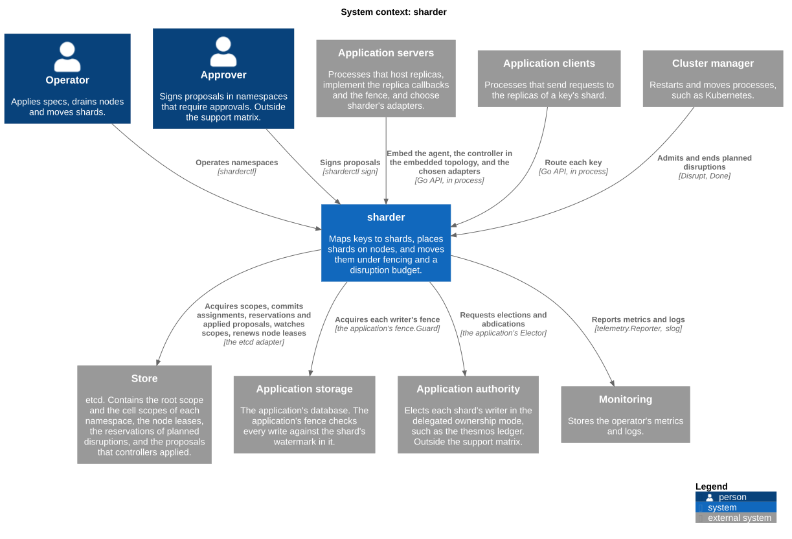
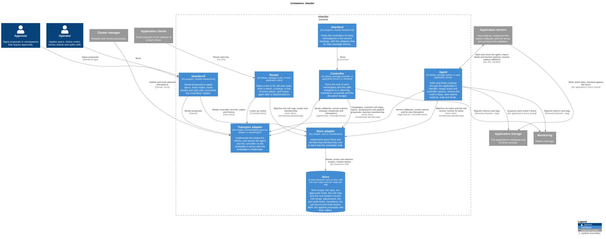
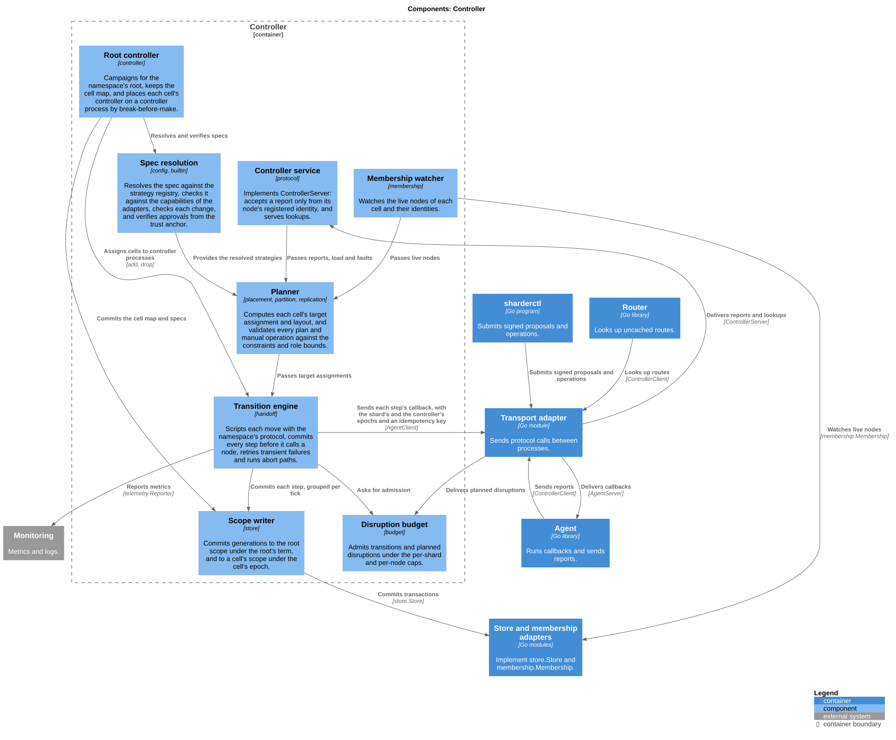
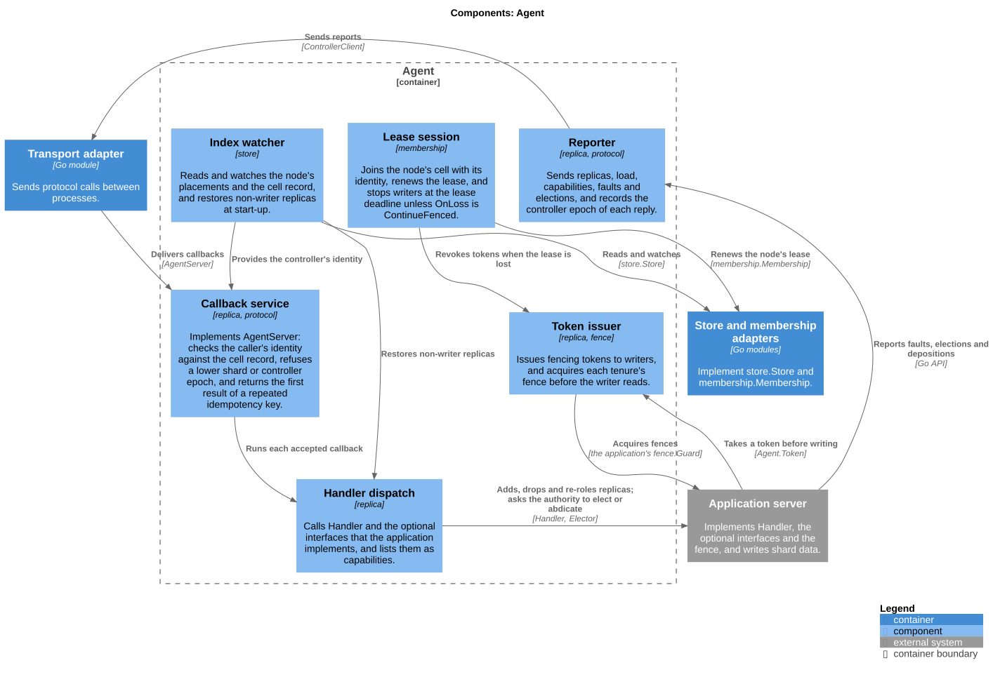
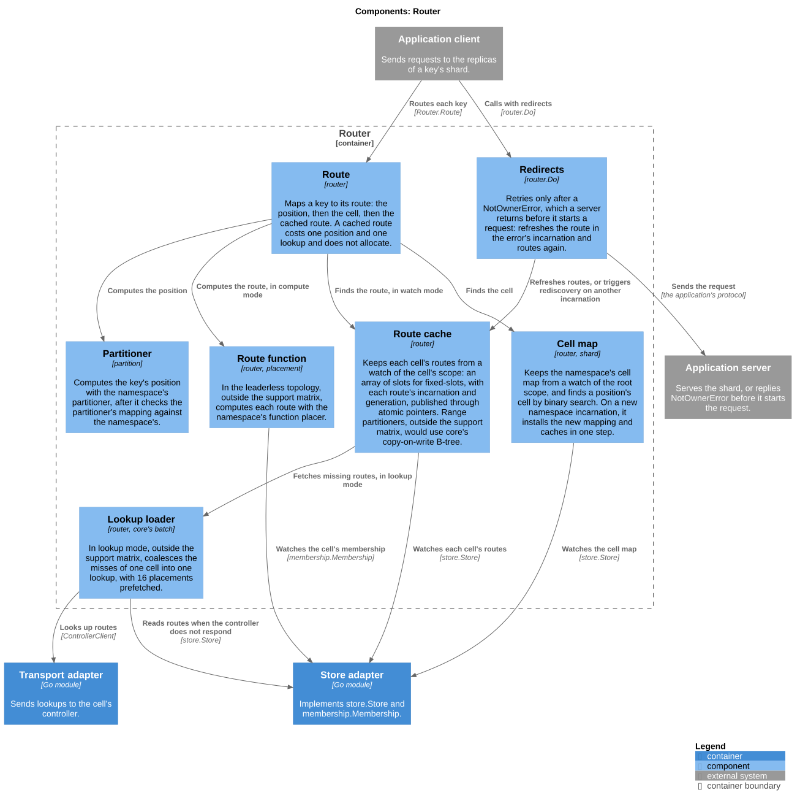
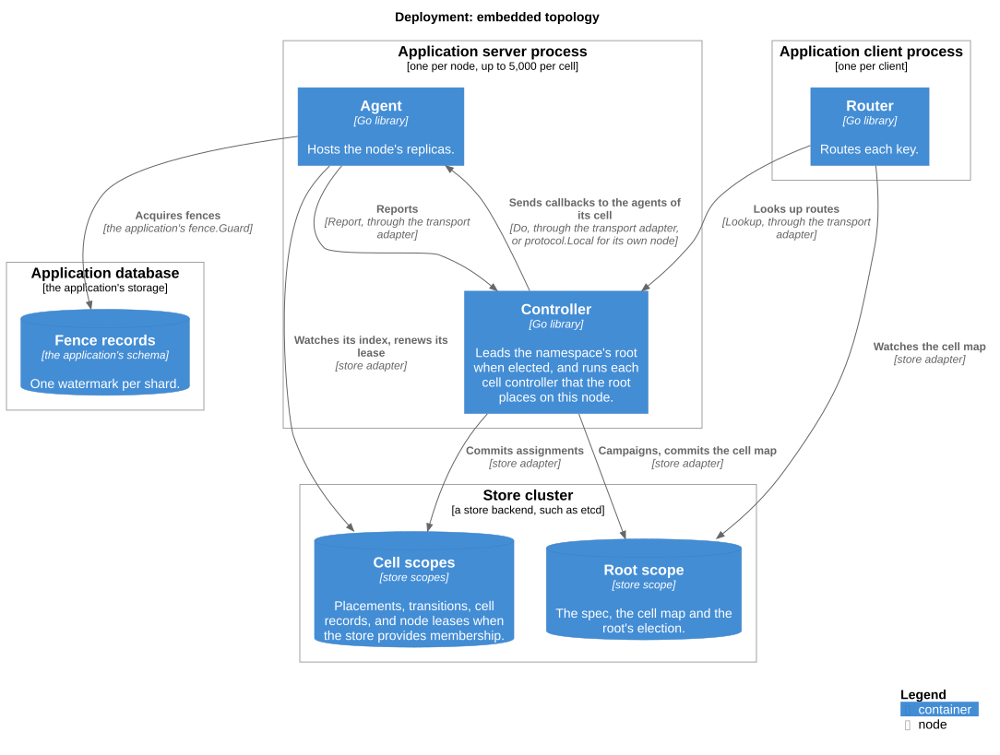
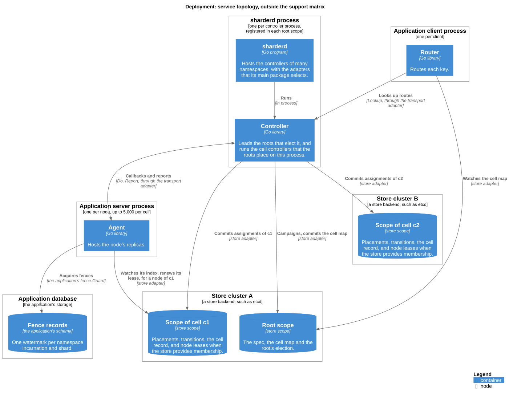
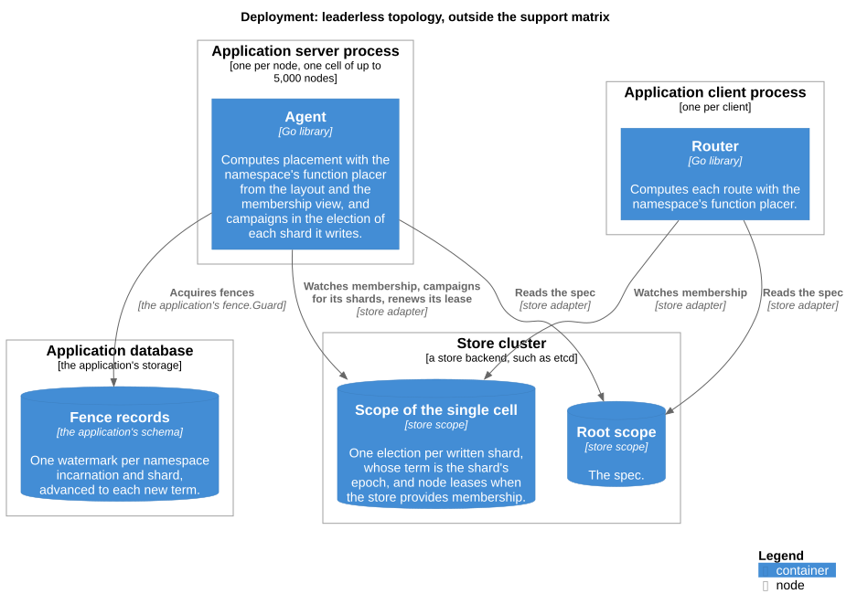

# C4 model

The C4 model describes sharder at three levels of zoom, and deploys it once per topology.

| Kind | Diagram | Shows | Specified in |
|---|---|---|---|
| System context | [sharder](#system-context) | sharder, the people who operate it, and the systems it depends on | [RFC-0001](../rfc/0001-architecture-and-core-model.md) |
| Containers | [sharder](#containers) | the libraries, the adapters, the programs and the store | [RFC-0001](../rfc/0001-architecture-and-core-model.md), [RFC-0007](../rfc/0007-membership-store-and-distribution.md), [RFC-0008](../rfc/0008-agent-router-and-budgets.md) |
| Components | [Controller](#controller) | planning, transitions, proposals, the budget and the root | [RFC-0004](../rfc/0004-placement-and-rebalancing.md), [RFC-0006](../rfc/0006-ownership-handoff-and-fencing.md), [RFC-0009](../rfc/0009-horizontal-scaling-with-cells.md) |
| Components | [Agent](#agent) | callbacks, leases, tokens and reports | [RFC-0008](../rfc/0008-agent-router-and-budgets.md) |
| Components | [Router](#router) | positions, the cell map, the route cache and computed routes | [RFC-0003](../rfc/0003-partitioning-strategies.md), [RFC-0008](../rfc/0008-agent-router-and-budgets.md) |
| Deployment | [Embedded](#embedded-topology), [Service](#service-topology), [Leaderless](#leaderless-topology) | where the containers run in each topology | [RFC-0001](../rfc/0001-architecture-and-core-model.md), [RFC-0009](../rfc/0009-horizontal-scaling-with-cells.md) |

## The support matrix

The diagrams show the whole design. The first release supports a subset of it, the support matrix of [RFC-0001](../rfc/0001-architecture-and-core-model.md), and each diagram marks the elements outside it:

| In the diagrams | In the support matrix | Outside it |
|---|---|---|
| Topology | `embedded`, with one cell per namespace | `service` with `sharderd`, `leaderless`, more than one cell |
| Store | etcd, through `go.thesmos.sh/sharder/etcd`. `store/memory` in tests and simulations | Every other backend |
| Transport | `httptransport` | `grpc` |
| Routing | `watch` | `lookup`, `compute` |
| Ownership | `exclusive`, fenced by the application's fence | `delegated`, with the application authority, and approvals, with the approver |

## Layout

- Each kind of diagram has its own directory: `context/`, `containers/`, `components/` and `deployment/`.
- A file is named after the element it zooms into, or the topology it deploys.
- Every diagram includes `c4.iuml`, which contains the C4-PlantUML library and the font settings. Deployment diagrams also include `C4_Deployment`.
- Each `.puml` source has its rendered `.svg` beside it.

## System context

- Application servers embed the agent, and the controller in the `embedded` topology. Application clients embed the router.
- The application authority takes part only in the `delegated` ownership mode, and the approver only in a namespace with approvals. Both are outside the support matrix.
- The application implements the fence over its own storage. sharder calls it to acquire each writer's tenure, and every write of the application's shard data checks it.

## Containers

- The controller, the agent and the router are packages of the root module, which imports only core, kanon's runtime, `github.com/cespare/xxhash/v2` and the standard library.
- Every call between processes goes through a transport adapter, `httptransport`, which sends kanon-encoded bodies over HTTP/2 and the call's version and features in headers. Calls within one process go through `protocol.Local`, which checks the same metadata.
- The store adapter implements `store.Store` and `membership.Membership` over an etcd client that the embedder built. The store has one root scope per namespace and one scope per cell.
- `sharderctl` sends every operation to the controller that applies it through `Submit`, and a cluster manager calls `Disrupt` and `Done`. The transport adapter authenticates each caller, and the controller authorises it by the kind of the operation. Operators need store read credentials for `sharderctl status` and `history`, and no write credentials.

## Components

### Controller

- The controller process that `Campaign` elects leads the namespace's root. Any controller process runs the cell controllers that a root places on it. Its cell host receives the root's `add` and `drop` on the process's callback endpoint, which `protocol.Dispatch` shares with the process's agents.
- The scope writer acquires a scope with one conditional commit before the controller reads the scope, and gives every commit an ID and a receipt.
- The transition engine commits each transition's full record before its first callback, and each step before it calls a node, so a replacement controller continues each transition from its record.
- The proposal handler authorises each proposal by its kind, against the operators in the process's own configuration, and commits it with its caller's identity. The budget commits each deferred or admitted disruption as a reservation before it replies.

### Agent

- The callback service refuses a callback from any identity other than the controller that the cell record names. It also refuses a callback for another namespace incarnation or node incarnation, at a lower shard or controller epoch, or of a superseded or ended operation, before it calls the handler.
- A callback whose controller epoch is above the cell record that the index watcher has delivered gets a transient error, and the controller retries it once the newer record has arrived.
- The callback service starts a tenure only once the index watcher lists it. The index watcher cleans up a tenure that its watched state stops listing, after an event or a replacement snapshot, only while that exact tenure is still active. Neither a delayed removal nor an older snapshot can therefore stop a newer tenure.
- In the `delegated` mode, outside the support matrix, handler dispatch also calls the application's `Elector`. The application reports its authority's replicas to the reporter through `Hosted` and `Released`, and its elections and depositions through `Elected` and `Deposed`.

### Router

- In `watch` mode, the only mode of the support matrix, the route cache contains every route of each cell the router uses, and replaces a route only with one from a newer generation of the same incarnation. A new incarnation replaces the mapping and every cache at once. The `lookup` and `compute` modes are outside the support matrix.
- A `fixed-slots` namespace caches routes in an array indexed by slot. The range partitioners, outside the support matrix, would cache them in core's copy-on-write B-tree.

## Deployment

### Embedded topology

- The root is elected among the application server processes, and each cell's controller runs on a node of its cell. In the support matrix, a namespace has one cell.

### Service topology

The service topology is outside the support matrix.

- `sharderd` processes host the roots and the cell controllers of many namespaces.
- The root scope and the scope of cell `c1` share store cluster A, and cell `c2` has its own cluster B, as the store adapter maps them.

### Leaderless topology

The leaderless topology is outside the support matrix.

- A leaderless namespace has one cell and no controller. Each agent computes placement with the namespace's function placer. Exclusive ownership in it would need routers that read each shard's election, which the store does not offer, so the topology suits affinity only.

## Rendering

The SVG files are rendered with PlantUML 1.2026.8 and Liberation Sans. PlantUML writes the width of each label into the SVG, measured with its own font, and Liberation Sans has the advance widths of the Arial and Helvetica fonts that the SVG files request.
