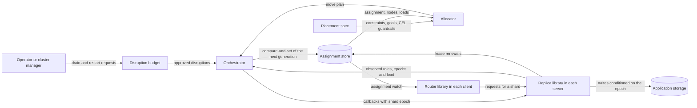

# Research-0001: Is seaweedfs/shardmanager a sound base for a generic shard-management library, and what must a replacement add?

## The question

Can we port `github.com/seaweedfs/shardmanager` at commit `b7eea97` as the base of a generic Go shard-management library, and which mechanisms does that library need that the repository lacks?

## The answer

No. The repository is a draft written in about 15 hours on 2025-06-12 and 2025-06-13, and its last push was on 2025-06-13. It implements a registry of nodes and shards with a least-count placement at registration. It implements none of the control mechanisms of the Shard Manager paper it cites: failure detection, failover, replica roles, the migration protocol, rebalancing and admission control for maintenance.

Port the contract, not the code. The contract is the paper's five application callbacks, which the repository copies into `AppShardService`. A replacement adds a per-shard epoch that the application's storage checks, and a pure allocator over typed constraints. It also adds an orchestrator that reconciles desired and observed state, and one disruption budget for failures, maintenance and rebalancing. No Go library or service we found combines these mechanisms. The maintained Go services atoms-co/splitter and cadence-workflow/shard-manager cover part of them, but neither gives the application a fencing token or models replica roles.

## Findings

### The repository at commit b7eea97

| Property | Value | Source |
|---|---|---|
| Status | The README opens with "DRAFT IMPLEMENTATION" and "not yet ready for production use" | README.md:3-5 [1] |
| History | 25 commits, authored from 2025-06-12T10:07-07:00 to 2025-06-13T01:16-07:00 | `git log` [1] |
| Contributors | `chrislusf` with 24 commits and `ChrisluRoblox` with 1 | GitHub API [4] |
| Activity | Last push 2025-06-13T08:16:44Z. 4 stars, 0 forks, 0 issues | GitHub API, 2026-09-27 [4] |
| Releases | No tags. The Go module proxy serves only `v0.0.0-20250613081642-b7eea973f3fe` | proxy.golang.org [5] |
| Consumers | GitHub code search finds no reference to the module outside the repository | GitHub code search [6] |
| Size | 4,099 lines of hand-written Go, 2,767 lines of tests and 3,511 lines generated from `shardmanager.proto` | `wc -l` [1] |
| Licence | Apache-2.0 | LICENSE [1] |
| Dependencies | `lib/pq`, `mattn/go-sqlite3` (cgo), `google/uuid`, gRPC 1.73 and testify | go.mod:7-14 [1] |

The README cites the paper as SIGMOD '21 (README.md:7). The DOI it gives, 10.1145/3477132.3483546, resolves to SOSP '21, pages 553 to 569 [7].

### Server API and behaviour

The server exposes 14 RPCs in five gRPC services: NodeService (3), ShardService (6), PolicyService (2), MonitoringService (2) and FailureService (1). A sixth service, `AppShardService`, is the interface that application servers implement. Its five RPCs match the paper's Figure 11 (shardmanager.proto:7-43).

| Behaviour | Where |
|---|---|
| `RegisterShard` without a node picks the active node with the fewest shards | server/shard_service.go:32-69 |
| After `RegisterShard` and `AssignShard`, a goroutine dials the node's `location` and calls `AddShard` with role `primary` | server/shard_service.go:84, 159, 235-257 |
| `MigrateShard` rewrites the shard row: status `migrating`, new node, status `active` | server/shard_service.go:167-216 |
| Nodes, shards, versions, policies and failure reports are tables in PostgreSQL (`schema.sql`) or SQLite (`db/db.go:70-140`) | db/ |
| A policy engine evaluates JSON rules with `all` and `any` conditions over named metrics, periodically or on demand | policy/, policy/engine, policy/manager |

No package outside `policy/` and `examples/` imports the policy packages, so the server never evaluates a policy. The examples run the policy engine against fixed metrics and do not use the server.

### Defects

We checked each row by reading the cited lines. A row marked probe, compiler or race was also reproduced with Go 1.27.1 on a scratch clone. Source [3] describes the probe.

#### Control loop

| Defect | Evidence | Check |
|---|---|---|
| A node cannot learn its own ID. `RegisterNode` replaces the client's ID with a new UUID, and the response has no ID field | server/node_service.go:16-21, shardmanager.proto:64 | Probe: client ID `fa1f957b…`, stored ID `76c9df70…` |
| A heartbeat for an unknown node succeeds, because the update ignores the affected row count | db/node.go:116-124 | Probe: `success:true` for the unregistered ID |
| The example application server heartbeats as `appserver-1`, which fails UUID parsing | cmd/example_appserver/main.go:89, server/node_service.go:34-37 | Probe: `InvalidArgument` |
| No failure detection. `last_heartbeat` is written and never compared with a deadline. Placement trusts the node's self-reported status | db/node.go:119, server/shard_service.go:46 | Search for readers of the field |
| `GetHealth` returns the constant "System is healthy" | server/monitoring_service.go:38-44 | Read |
| `MigrateShard` calls neither the source nor the destination | server/shard_service.go:195-210 | Probe: the source received only the `AddShard` from registration, the destination received nothing, and the version went from 0 to 3 |
| `MigrateShard` does not check that the destination exists | server/shard_service.go:167-216 | Probe on SQLite: the owner became an unregistered UUID. The PostgreSQL foreign key at schema.sql:25 would reject it. We did not run PostgreSQL |
| Assignment notification is fire-and-forget. The row commits first, then a goroutine calls `AddShard` with `context.Background()` and logs a failure without retrying | server/shard_service.go:78-85, 154-159, 236-256 | Read |
| Concurrent `RegisterShard` calls skew placement, because the read of nodes and shards and the insert share no transaction or lock | server/shard_service.go:33-78 | Probe: 30 concurrent registrations over 3 nodes in 5 rounds. The busiest node received 11, 11, 11, 12 and 12 shards against an even 10 |
| Placement reads every shard once for each active node | server/shard_service.go:45-63 | Read |
| Neither direction has transport security or authentication | server/runner.go:46, server/shard_service.go:241 | Read |

#### Persistence and versioning

| Defect | Evidence | Check |
|---|---|---|
| The version counter is not a history. `AssignShard` and `UpdateShardStatus` increment `version` without writing `shard_versions` | db/shard.go:98-116 | Probe: version 6 with zero history rows. `RollbackShardVersion(2)` returns `sql: no rows in result set` |
| `UpdateShardVersion` reads the current version and never compares it, so it does not detect concurrent writers | db/shard_version.go:98-103 | Read |
| The server never sends the version to the application. `AddShardRequest` has only `shard_id` and `role`, so the version cannot act as a fencing token | shardmanager.proto:102-105 | Read |
| Shards registered through the server get version 0 instead of the schema default of 1 | server/shard_service.go:25-30, db/shard.go:15-20 | Probe: version 0 |
| Status is free text. Tests write `inactive` and `pending`, which the PostgreSQL enum excludes | server/shard_service.go:218-232, server/shard_test.go:112, integration/integration_test.go:119, schema.sql:6 | Read. Not run on PostgreSQL |
| Two data-access layers use different placeholder syntax. The `db` tests exercise mostly the free functions, and the server calls the methods | db/node.go:10-102 against 104-176, db/shard.go:118-239 against 12-116 | Read |
| The free functions in `db/policy.go` query columns that exist only in the test schema | db/policy.go:46-115, db/test_utils.go:62-71, schema.sql:60-66 | Read |
| `shard_migrations` is created and never written. `failure_reports` is written and never read | db/db.go:105, db/failure.go:11-18 | Search |
| `db/test_utils.go` is not a `_test.go` file, so package `db` imports `testing` and testify in production builds | db/test_utils.go:3-9 | Read |

#### Policy engine

| Defect | Evidence | Check |
|---|---|---|
| Three writers disagree on the `policies` table: raw parameters keyed by type, a whole marshalled policy, and columns that do not exist | db/policy.go:13-22, policy/storage/postgres_store.go:25-46, db/policy.go:46-54 | Read |
| `PersistentPolicyStore` does not implement `PolicyStore` | policy/storage/persistent_store.go:138, 217 | Compiler: "wrong type for method Delete: have Delete(context.Context, uuid.UUID) error, want Delete(context.Context, string) error" |
| Conditions read one global metric map and ignore per-node and per-shard metrics. A rule such as "place on nodes below 80% CPU" cannot be written | policy/evaluator.go:79-84 | Probe: a per-node `cpu=95` returns "metric cpu not found in system state" |
| `Validate` accepts integer thresholds and `Evaluate` rejects them. `eq` compares a float64 with an interface value | policy/parser.go:108-116, policy/evaluator.go:89-92, 103 | Probe: `gt 80` returns "invalid value type for greater than operator", and `eq 90` does not match 90.0 |
| Two evaluators disagree on a missing metric. One returns an error and the other returns 0 | policy/evaluator.go:81-84, policy/engine/engine.go:152-158 | Read |
| Two `ActionExecutor` interfaces declare different methods | policy/types.go:119-123, policy/engine/engine.go:15-18 | Read |
| Actions are untyped maps. `migrate_shard` reads `shard_id` and `target_node` in one place and `source`, `target` and `shard` in another | policy/advanced_evaluator.go:172-181, examples/shard_host/main.go:137-150 | Read |
| `PolicyManager` cannot restart. `Stop` closes `stopChan`, and `Start` does not recreate it | policy/manager/manager.go:42-68 | Probe: the second `Stop` panics with "close of closed channel" |
| The metric provider and the action executor have no synchronisation | policy/engine/engine.go:148-177 | Race: the detector reports lines 153, 161, 171 and 176 |

#### Tests and tooling

- `go test ./...` passes in all 11 test packages.
- `go test -race ./...` fails in 2 of the 11: `examples/periodic_evaluation` and `policy/storage`. The second race is inside the test itself (policy/storage/persistent_store_test.go:186).
- `go vet ./...` reports one finding: integration/integration_test.go:84 calls `t.Fatalf` from a goroutine that the test started.
- `TestShardBalancing` logs how many shards each server received and asserts nothing about the counts (integration/integration_test.go:130-146).
- `TestNodeService` asserts that a heartbeat for an unregistered node succeeds (server/node_test.go:39-52).
- `db/failure_test.go` defines a `ReportFailure` stub that returns nil and then tests the stub (db/failure_test.go:10-14).
- The orchestration example requests `/metrics` from a server that serves `/node1/metrics`, so its `main` never reads a metric (examples/orchestration/main.go:28, 97).
- Tests bind the fixed ports 6000 and 5101 to 5103 and write fixed file names into the package directory (integration/integration_test.go:72-75, db/test_utils.go:12).

### Paper mechanisms absent from the repository

Lee et al. describe Facebook's Shard Manager (SM) in the SOSP '21 paper [8]. The 2020 Meta engineering post by Guo and Kooburat describes the same system for operators [9]. SM ran hundreds of applications on over one million servers. Its largest deployments used about 19,000 servers and 2.6 million shards, and one control-plane instance on an 18-core, 64 GB machine managed up to about 50,000 servers and 1.3 million shards (§8.1).

| Mechanism | The paper or the post | The repository |
|---|---|---|
| Application callbacks | Five calls: `add_shard(shardID, role)`, `drop_shard(shardID)`, `change_role(shardID, current_role, new_role)`, `prepare_add_shard(shardID, current_owner, role)` and `prepare_drop_shard(shardID, new_owner, role)` (§3.3, Fig. 11). The post adds `update_membership(shard_id, [m1, m2, ...])` for Paxos applications | `AppShardService` copies the five calls. The server calls only `AddShard` |
| Replication strategies | Primary-only, secondary-only and primary-secondary (§2.2.3) | One node per shard in `shards.node_id`. The role is always `primary` |
| Failure detection | The orchestrator watches ZooKeeper ephemeral nodes that the SM library creates (§3.2) | The heartbeat time is stored and never evaluated |
| Failover | "Upon the failure of an application server, SM reassigns its shards to other servers" (§3.4). The post makes detection latency, failover delay and failover rate configurable | Absent |
| Move protocol | The post: "First, Shard Manager makes a `drop_shard` call to server A and waits for it to succeed. Second, it makes an `add_shard` call to server B. This protocol provides an at-most-one-primary guarantee." | `MigrateShard` rewrites the row and calls no server |
| Graceful primary migration | Five ordered steps in which the old primary forwards requests to the new one until clients switch (§4.3) | Absent |
| Planned maintenance | The TaskController approves a subset of pending container operations under a global cap on concurrent operations and a per-shard cap on unavailable replicas. Both caps count replicas that are already down (§4.1). Non-negotiable events arrive with advance notice and an impact class (§4.2) | Absent |
| Placement | Hard constraints: move caps and capacity per metric. Seven soft goals in priority order: region preference, replica spread, planned maintenance, utilisation threshold, global balance, regional balance and parallel failover (§5.1). An emergency mode and a periodic mode | Fewest shards at registration. No rebalancing |
| Solver | Local search in ReBalancer. MIP "can solve an optimization problem with millions of assignment variables in tens of minutes, whereas SM needs to solve a problem with billions of variables in tens of seconds" (§5.2). Replacing heuristics with the solver cut the allocator to about 20% of its lines (§5.3) | None |
| Routing | Clients link a routing library that finds the server for a key or a shard (§3.3, post) | Shards have no key range. `GetDistribution` lists shard IDs per node |
| Start-up without the control plane | "During start-up, an application server reads its shard assignment from ZooKeeper, without dependency on the SM control plane" (§3.2) | Absent |
| Control-plane availability | Every component has replicas in several regions. "Even if all SM control-plane components are down, application clients can continue to send requests to application servers" (§6.2) | One process without replicas |
| Scale-out | Large applications are split into partitions of thousands of servers, each managed by one control-plane instance. All replicas of a shard are in one partition (§6.1) | Absent |
| Load collection | The orchestrator collects per-replica load and per-server capacity (§3.2, post) | One `int64` load per heartbeat, never read |

### Guarantees the paper states without a mechanism

We read the paper for the mechanism behind two of its guarantees and did not find either. This is our reading.

- The five-step migration in §4.3 lists only the successful sequence. The paper does not say what SM does when the new primary fails after `prepare_drop_shard` while the old primary forwards requests to it. The API in Figure 11 cannot cancel a prepare.
- §2.2.3 states that "SM guarantees that no two servers serve the same shard at the same time". The post's drop-then-add protocol provides this only when the old server responds. The paper does not describe what prevents an unreachable old server from serving after SM reassigns its shards.

### Exclusive ownership needs a fence that the resource checks

- Kleppmann defines a fencing token as "a number that increases (e.g. incremented by the lock service) every time a client acquires the lock". The client sends it with every write, and the storage must "take an active role in checking tokens, and rejecting any writes on which the token has gone backwards" [13].
- Chubby's sequencer includes the lock name, the lock mode and "the lock generation number", and "The recipient server is expected to test whether the sequencer is still valid". For servers that cannot check a sequencer, Chubby withholds a released lock for a lock-delay of up to one minute [15].
- The etcd documentation states that "the lock APIs cannot be used as mutual exclusion mechanism by themselves" and that "The lock feature of etcd itself cannot be used for protecting external resources". Its authors "interpret that fencing token is revision number in the case of etcd" [16].
- client-go's leader election "does not guarantee that only one client is acting as a leader (a.k.a. fencing)" (tools/leaderelection/leaderelection.go:19-20 at v0.37.1) [17].
- Temporal fences each history shard with a range ID. Acquiring a shard runs `updatedShardInfo.RangeId++` (service/history/shard/context_impl.go:1170 at v1.32.0), every Cassandra write of the shard ends in `IF range_id = ?` (common/persistence/cassandra/shard_store.go:28-37), and a mismatch raises `ShardOwnershipLostError`, which shuts the shard down (context_impl.go:1426-1427) [18].
- KIP-848 fences Kafka consumers with a member epoch. The coordinator rejects a stale request "with the FENCED_MEMBER_EPOCH error", and "new partitions are incrementally assigned to the member when they are revoked by the other members" [19].
- WriteGuards (OSDI '26), which Databricks built on its auto-sharder: "Ownership at the caching layer is not enough. A pod must also become the owner in the storage layer before assuming that no other writes can succeed." [12]

We conclude that a shard manager can issue the token and order the transitions, but it cannot stop a delayed write from a paused former owner. That check has to run in the resource the owner writes to, so a replacement has to include the epoch in every callback and give our storage adapters a conditional-write helper.

### Replica lifecycles as state machines: Helix and Service Fabric

- Apache Helix declares each resource's replica lifecycle as a state model with states, prioritised transitions and per-state bounds such as `upperBound("LEADER", 1)`. Every model must define DROPPED, and "There must be a path to DROPPED for every state in the model" [20].
- The Helix controller "will not blindly issue LEADER-->STANDBY to N1 and STANDBY-->LEADER to N2 in parallel" [21]. It has four modes, from FULL_AUTO, where it decides placement and state, to CUSTOMIZED, where the application decides both [21].
- Helix does not fence its participants. Issue #691 reports that a participant cut off from ZooKeeper "continues to think it is MASTER" while "The controller makes another node MASTER". The issue was opened on 2020-01-20 and closed on 2024-02-23 with no linked fix [22].
- A Service Fabric stateful replica implements `IStatefulServiceReplica` with `OpenAsync`, `ChangeRoleAsync`, `CloseAsync` and `Abort` [23].
- Service Fabric fences inside its own replicator: "Epoch changes act as a barrier by segmenting operations into the exact configuration periods in which they were sent by a specific primary replica" [24].
- Service Fabric places replicas by simulated annealing. Its authors "initially attempted to use LP/IP-based and genetic algorithms" and found that these converged too slowly or produced poor solutions [25].

The Helix state model is the most complete published contract for replica roles and transition constraints that we found. The Helix double-master reports show that such a model still needs the storage fence from the previous section.

### Auto-sharders: Slicer and Dicer

- Google's Slicer "hashes each application key into a 63-bit slice key", and the framework splits and merges ranges of that space [10].
- Slicer's consistent mode gives each key at most one owner, using three Chubby locks per job. The 2016 paper states: "The consistency feature is implemented, but it is not yet deployed by customers in production." [10]
- Slicer rebalances with weighted moves "until a key churn budget (9% of the keyspace) is exhausted", and "95% of assignments reach subscribers within 2 s" [10].
- The SM paper argues that hashing "destroys key locality", which rules out prefix scans, and that "Slicer cannot orchestrate live migration" [8].
- Databricks released Dicer as open source on 2026-01-13. It is written in Scala under Apache-2.0, and its latest release is v1.1.0 of 2026-08-28 [11].
- Dicer's open-source Assigner keeps assignments in memory, where "an assignment may be lost forever" if the Assigner crashes first. Committing a Strong-mode assignment throws `NotImplementedError("TODO(<internal bug>): Only Affinity is currently supported")` [11].

### Existing Go shard managers and components

| Candidate | What it provides | What it lacks | Source |
|---|---|---|---|
| atoms-co/splitter v1.5.0 (2026-09-25), Apache-2.0 | A control-plane service on Raft. Shards are half-open UUID ranges that it splits and merges. Exclusive ownership through leases, with Active, Revoked and Allocated grants and Loaded and Unloaded handoff signals. Region-aware placement and a routing map for consumers | App-defined shards, replica roles and a fencing token. A grant ID is `<coordinator>:<seqno>` (pkg/allocation/allocation.go:963-966). Consumers stop on a local timer at the end of a 40-second lease (pkg/service/coordinator/coordinator.go:38-39) | [26] |
| cadence-workflow/shard-manager, no release, last commit 2026-09-23, Apache-2.0 | A service on etcd with fixed or on-demand shard keys. An executor client whose `ShardProcessor` starts and stops a shard, a spectator client with `GetShardOwner`, naive and greedy balancers, and drain commands | A release, epochs and replica roles. `ShardProcessor` receives only a shard ID (service/sharddistributor/client/executorclient/client.go:43-52). Depends on Cadence's YARPC and fx wiring | [27] |
| grafana/dskit `ring` and `kv` | Membership lifecycle, token ownership and zone-aware replica sets over Consul, etcd or memberlist, with compare-and-set and watch | Central placement. The module has no releases, only pseudo-versions | [28] |
| TiKV PD placement rules | A rule schema with the label operators `in`, `notIn`, `exists` and `notExists`, location labels and isolation levels | Reusable code. Its operators are built on TiKV regions | [29] |
| M3 `src/cluster/placement`, couchbase/blance | Placement algorithms with shard states such as Initializing, Available and Leaving | Ownership and fencing. The blance licence needs legal review | [30] |
| cel.dev/cel-go v0.32.0 (2026-08-19) | Type-checked expressions, host-defined functions, static cost estimates and runtime cost limits | Nothing for this use. The module path moved from github.com/google/cel-go | [31] |
| Optimisation solvers | OR-Tools has a Go wrapper for CP-SAT that its maintainers describe as community-built and "not officially supported by Google" | We found no maintained pure-Go local-search or constraint solver | [32] |

### Where sources disagree

- The SOSP paper lists five callbacks [8]. The 2020 post lists `add_shard`, `drop_shard`, `change_role` and `update_membership` [9]. The paper's client lookup takes a key, `get_client(app_name, key)`, and the post's takes a shard ID, `create_rpc_client(app_name, shard_id)`.
- The repository's README cites SIGMOD '21. The DOI resolves to SOSP '21 [7].
- Kleppmann requires a monotonic token that the storage checks [13]. antirez calls that token "unrealistic" and proposes a random token with check-and-set [14]. The current Redis documentation recommends fencing tokens [34].
- Hochstein's 2025 model check found that "fencing tokens don’t protect against the scenario where two processes both believe they hold the lock" when the resource receives the lower token first, and reports that Kleppmann agreed [33]. Temporal also conditions each write on a record version, which covers that case [18].
- The Helix documentation promises that demotion precedes promotion [21]. Helix issues #691 and #1027 report two masters after a network partition and after a controller switch [22, 35].

## What we conclude for the port

The rest of this document is our conclusion, drawn from the findings.

### Port the contract, not the code

- No part of the Go code can be kept as it is. Node identity, liveness, versioning, placement concurrency and the policy model are wrong at the level of the model, and correcting each one means rewriting it.
- The callback service in shardmanager.proto:36-43 is the paper's Figure 11. Take the contract from the paper, not from the repository.
- Include the shard epoch in every callback, so that the replica and its storage can reject stale instructions.
- Add a request identifier to every callback, so that the orchestrator can retry a call safely.
- Report callback failures with gRPC status codes instead of `bool success` and `string message`.
- Define how to cancel `prepare_add_shard` and `prepare_drop_shard`, which the paper leaves open.
- The repository is Apache-2.0. A copied file keeps its licence notice. Code written from the paper has no such obligation.

### Reuse before building

| Option | Provides | Lacks | Choose it when |
|---|---|---|---|
| Adopt Splitter | Leased exclusive ownership, UUID-range shards with split and merge, region-aware placement, routing and a Go client | App-defined shards, replica roles, a fencing token and maintenance admission. It runs as a separate Raft service | The first consumer needs one owner per shard over a UUID key space and can fence its own writes with the grant ID |
| Adopt Cadence shard-manager | Assignment on etcd, drain, executor and spectator clients, and fixed shard sets | A release, epochs and roles. It depends on YARPC and fx | The consumer already runs YARPC and etcd |
| Build a library on etcd and cel-go | Every component in the next section | Nothing, but the orchestrator, the allocator and the simulator are ours to write and maintain | The consumer needs replica roles, fencing epochs, graceful migration or maintenance admission |

We recommend building, unless the first consumer fits Splitter's model in its current form. Decision 2 records this.

### Components of a replacement

| Component | Responsibility | Contract |
|---|---|---|
| Model | Shard, replica, role, node, epoch, generation, move and budget | Value types with one type per concept. Roles and replica states are enumerations with declared transitions, as in a Helix state model |
| Store | The assignment, the node registry and moves in flight | Every write is a compare-and-set from generation g to g+1. A watcher receives every generation in order. Adapters: in-memory for tests and etcd for production |
| Membership | Node registration, liveness and departure | A node registers a stable ID and an incarnation number that increases on each restart. Each incarnation has one lease. A node is dead when its lease expires |
| Allocator | Computing moves | A pure function of the assignment, the nodes, the loads and the spec. Deterministic for a given seed. It never violates a hard constraint and reports every shard it cannot place |
| Orchestrator | Executing moves | Reconciles desired state against observed state on every pass. Persists each step before it calls a replica. Every call is idempotent and includes the shard epoch. Every step has a defined abort |
| Disruption budget | Admitting planned operations | Approves the largest set of node operations and moves that keeps each shard within its cap on unavailable replicas, counting replicas already down |
| Replica library | The server side | Dispatches callbacks, rejects stale epochs, reads its assignment from the store at start-up, stops serving when its lease lapses and reports load |
| Router library | The client side | Maps a key to a shard and a shard to its replicas from the watched assignment. Retries when a server reports that it is no longer the owner |
| Fence helper | Storage adapters we control | Conditional writes on the shard epoch and a record version |
| Simulator | Tests | Runs every component against a simulated clock, network and store with injected faults, and checks the invariants after every step |

### Invariants

1. At most one replica of a shard acts as primary for a given epoch. The storage fence rejects writes from an older epoch.
2. The orchestrator promotes a new primary only after the old primary acknowledges its demotion or drop, or after the old lease has expired and a bound on clock drift has passed.
3. The assignment changes only by compare-and-set from one generation to the next. The history is the sequence of generations, and a rollback writes an old assignment as a new generation.
4. The number of unavailable replicas of a shard never exceeds its cap. Failures, maintenance and moves count against the same cap.
5. The allocator never violates a hard constraint. When no placement satisfies them, it reports the shard as unplaced.
6. Observed state converges to desired state. The orchestrator retries a step until the replica reports the desired role and epoch, or it aborts the move.
7. The data plane does not depend on the control plane. Servers and routers keep serving the last assignment they read while the manager is down.

### Build order

| Stage | Delivers | Needed when |
|---|---|---|
| 1. Exclusive ownership | Model, store with in-memory and etcd adapters, membership, orchestrator with drop-then-add moves, replica and router libraries, fence helper, an allocator that balances shard counts and spreads across one label, and the simulator | The first consumer needs primary-only shards |
| 2. Planned events | Disruption budget, drain, and graceful primary migration with abort paths | A consumer cannot accept a gap in ownership during a restart |
| 3. Replicated shards | Secondary-only and primary-secondary strategies, `change_role`, replica counts and `update_membership` | A consumer replicates a shard |
| 4. Placement depth | Multi-metric local search in the paper's goal order, a churn budget, region preference, emergency and periodic modes, CEL guardrails and label constraints | A consumer runs on unequal hardware or in several regions |
| 5. Scale-out | Partitions and several manager instances | One manager instance cannot keep up with its shards |

### Decisions for Roy

1. Which consumer comes first, and which replication strategy does it use? The answer sets the scope of stage 1 and determines whether Splitter can serve that consumer.
2. Build or adopt Splitter? We recommend building, unless the first consumer needs one owner per shard over UUID keys and can fence its writes with Splitter's grant ID.
3. Library or service? We recommend library packages, with the manager as a binary that composes them.
4. Which store? We recommend etcd. It provides leases, compare-and-set on revisions and watches, and its documentation identifies the revision as the fencing token. Choose PostgreSQL if the first consumer does not run etcd.
5. Who decides shard boundaries? We recommend the application, as in SM and Service Fabric. Application-defined shards keep key locality and match indices built outside the manager. Framework split and merge, as in Slicer, Dicer and Splitter, can follow when a consumer needs it.
6. Exclusive ownership or affinity? We recommend exclusive ownership with epochs as the default contract. A consumer that needs only affinity can ignore the epoch.
7. How are placement rules written? We recommend typed constraints and goals with CEL for guardrails, in place of the repository's JSON condition language.

## What we could not establish

- We do not know the requirements of our consumers. This request covered the external project, so we did not read any thesmos repository, and the fit of each option to a consumer is open.
- We ran the repository on SQLite only. The enum and foreign-key conclusions for PostgreSQL come from reading `schema.sql`.
- ReBalancer is not public. The paper describes its optimisations but not its code.
- The paper does not describe what SM does when a migration step fails or when an old owner is unreachable.
- We did not find a published measurement of a pure-Go local-search allocator at our scale, and we did not measure one ourselves.
- We read Splitter's guide and its ownership code, but not its placement code. We did not read the algorithm of the Cadence greedy balancer.
- The licence of the current couchbase/blance code is a legal question, because its BSL text applies per version.

## What would change this answer

- Commits to seaweedfs/shardmanager that implement failure detection, failover and the migration protocol would reopen the port.
- If the first consumer's needs fit Splitter in its current form, we should adopt Splitter, because it would cost less than building a library.
- If Splitter or Cadence shard-manager starts delivering a monotonic per-shard token to the application, adopting it becomes a stronger option.
- If Dicer releases its Strong mode together with a Go client, it becomes a candidate for adoption.
- If a consumer needs the manager to split and merge shards, application-defined shards are the wrong default.

## Sources

| # | Source | What it is | Retrieved | What it supports |
|---|---|---|---|---|
| 1 | [seaweedfs/shardmanager at b7eea973f3fe](https://github.com/seaweedfs/shardmanager/tree/b7eea973f3fe618ac1fb20666f6590dd196b7e2f) | Source code, cloned and read in full | 2026-09-27 | Every file and line reference to the repository |
| 2 | Our test runs on source 1 | `go test ./...`, `go test -race ./...` and `go vet ./...` with Go 1.27.1, `GOMAXPROCS=4` and `-p 2` | 2026-09-27 | Pass, race and vet results |
| 3 | Our probe on source 1 | `probe/compile/compile.go` asserts that three stores implement `policy.PolicyStore`. `probe/behaviour_test.go` calls the server's handlers over SQLite, with in-process application servers on ephemeral ports that record every call | 2026-09-27 | Every row marked probe or compiler |
| 4 | GitHub REST API for seaweedfs/shardmanager: repository, contributors, issues, forks and tags | Repository metadata | 2026-09-27 | Dates, counts and contributors |
| 5 | [Go module proxy, @latest](https://proxy.golang.org/github.com/seaweedfs/shardmanager/@latest) and @v/list | Module metadata | 2026-09-27 | No tagged version |
| 6 | GitHub code search for `shardmanager` in seaweedfs/seaweedfs and for `seaweedfs/shardmanager` everywhere | Search | 2026-09-27 | No consumer found |
| 7 | [Crossref record for DOI 10.1145/3477132.3483546](https://api.crossref.org/works/10.1145/3477132.3483546) | Bibliographic metadata | 2026-09-27 | SOSP '21, pages 553–569 |
| 8 | [Lee et al., "Shard Manager: A Generic Shard Management Framework for Geo-distributed Applications", SOSP '21](https://dl.acm.org/doi/10.1145/3477132.3483546) | Paper by the system's authors, read in full | 2026-09-27 | SM mechanisms, numbers and critique of Slicer |
| 9 | [Guo and Kooburat, "Scaling services with Shard Manager", Engineering at Meta, 2020-08-24](https://engineering.fb.com/2020/08/24/production-engineering/scaling-services-with-shard-manager/) | Post by the system's maintainers | 2026-09-27 | Move protocol, `update_membership`, routing call |
| 10 | [Adya et al., "Slicer: Auto-Sharding for Datacenter Applications", OSDI '16](https://www.usenix.org/system/files/conference/osdi16/osdi16-adya.pdf) | Paper by the system's authors | 2026-09-27 | Slicer hashing, consistent mode, balancing |
| 11 | [databricks/dicer at 747e89acb3b7](https://github.com/databricks/dicer/tree/747e89acb3b7b28fb52a8dc02933e162b86f29b8) and [the release announcement, 2026-01-13](https://www.databricks.com/blog/open-sourcing-dicer-databricks-auto-sharder) | Source code and maintainers' post | 2026-09-27 | Dicer language, licence, releases, in-memory store, affinity-only commit |
| 12 | [Mao et al., "WriteGuards", OSDI '26](https://www.usenix.org/system/files/osdi26-mao-ziming-writeguards.pdf) | Paper | 2026-09-27 | Ownership must also be taken in the storage layer |
| 13 | [Kleppmann, "How to do distributed locking", 2016-02-08](https://martin.kleppmann.com/2016/02/08/how-to-do-distributed-locking.html) | Essay | 2026-09-27 | Fencing token definition and storage-side check |
| 14 | [antirez, "Is Redlock safe?", 2016](https://antirez.com/news/101) | Essay by the Redis author | 2026-09-27 | Counter-argument to fencing tokens |
| 15 | [Burrows, "The Chubby lock service for loosely-coupled distributed systems", OSDI '06](https://static.googleusercontent.com/media/research.google.com/en//archive/chubby-osdi06.pdf) | Paper, §2.4 | 2026-09-27 | Sequencer and lock-delay |
| 16 | [etcd v3.7, "Why etcd", notes on lock and lease](https://etcd.io/docs/v3.7/learning/why/) | Maintainers' documentation | 2026-09-27 | Locks alone do not exclude, revision as fencing token |
| 17 | [client-go v0.37.1, tools/leaderelection/leaderelection.go](https://github.com/kubernetes/client-go/blob/v0.37.1/tools/leaderelection/leaderelection.go) | Source code, lines 19-20 | 2026-09-27 | Leader election without fencing |
| 18 | [temporalio/temporal v1.32.0 at d94e34a1ebba](https://github.com/temporalio/temporal/tree/d94e34a1ebba5410a2e7d07119a76896909591aa) | Source code: service/history/shard/context_impl.go and common/persistence/cassandra/shard_store.go | 2026-09-27 | Range ID fencing of shard writes |
| 19 | [KIP-848, "The Next Generation of the Consumer Rebalance Protocol"](https://cwiki.apache.org/confluence/spaces/KAFKA/pages/217387038/KIP-848+The+Next+Generation+of+the+Consumer+Rebalance+Protocol) | Specification | 2026-09-27 | Member epochs, revoke before assign |
| 20 | [Apache Helix 2.0.1, state model tutorial](https://helix.apache.org/2.0.1-docs/tutorial_state.html) | Maintainers' documentation | 2026-09-27 | State models, bounds, DROPPED rule |
| 21 | [Apache Helix 2.0.1, rebalancing tutorial](https://helix.apache.org/2.0.1-docs/tutorial_rebalance.html) | Maintainers' documentation | 2026-09-27 | Rebalance modes, demotion before promotion |
| 22 | [apache/helix issue #691](https://github.com/apache/helix/issues/691) | Issue report | 2026-09-27 | A participant cut off from ZooKeeper remains MASTER |
| 23 | [Microsoft Learn, IStatefulServiceReplica](https://learn.microsoft.com/en-us/dotnet/api/system.fabric.istatefulservicereplica?view=azure-dotnet) | API documentation | 2026-09-27 | Replica lifecycle calls |
| 24 | [Microsoft Learn, IStateProvider.UpdateEpochAsync](https://learn.microsoft.com/en-us/dotnet/api/system.fabric.istateprovider.updateepochasync?view=azure-dotnet) | API documentation | 2026-09-27 | Epochs as barriers between primaries |
| 25 | [Kakivaya et al., "Service Fabric", EuroSys '18](https://dprg.cs.uiuc.edu/data/files/2018/ServiceFabricEuroSys2018.pdf) | Paper by the system's authors, §5.3 | 2026-09-27 | Simulated annealing for placement |
| 26 | [atoms-co/splitter v1.5.0 at 1cb229a9b342](https://github.com/atoms-co/splitter/tree/1cb229a9b3429db424618d652e129b0459ed7ef0) | Source code and docs: README.md, docs/guide.md, docs/sharding.md, pkg/allocation, pkg/service | 2026-09-27 | Splitter's model, grants, leases and grant IDs |
| 27 | [cadence-workflow/shard-manager at 3d52aa043305](https://github.com/cadence-workflow/shard-manager/tree/3d52aa043305af15663bc072d9befb2970c0c80e) | Source code and README | 2026-09-27 | The Cadence service, its clients and its etcd store |
| 28 | [grafana/dskit at 231137e79a40](https://github.com/grafana/dskit/tree/231137e79a4095e39ae228692f92c91031ab391c) | Source code: ring/doc.go, ring/lifecycler.go, kv/client.go | 2026-09-27 | Ring membership and KV operations |
| 29 | [PingCAP, "Placement Rules"](https://docs.pingcap.com/tidb/stable/configure-placement-rules/) | Maintainers' documentation | 2026-09-27 | Label constraints and isolation levels |
| 30 | [m3db/m3 src/cluster/placement](https://github.com/m3db/m3/tree/4fc419fefc28b3534ad2eee5ca19ee54abd8f4cf/src/cluster/placement) and [couchbase/blance](https://github.com/couchbase/blance) | Source code | 2026-09-27 | Placement algorithms and shard states |
| 31 | [cel-go v0.32.0 release notes](https://github.com/cel-expr/cel-go/releases/tag/v0.32.0) and README | Maintainers' release notes | 2026-09-27 | Module path, type checks, cost limits |
| 32 | [google/or-tools issue #5042](https://github.com/google/or-tools/issues/5042) | Maintainer comment | 2026-09-27 | Go support is community-built and unofficial |
| 33 | [Hochstein, "Locks, leases, fencing tokens, FizzBee!", 2025-03-03](https://surfingcomplexity.blog/2025/03/03/locks-leases-fencing-tokens-fizzbee/) | Model-checking essay | 2026-09-27 | Limit of fencing tokens without compare-and-set |
| 34 | [Redis, "Distributed locks with Redis"](https://redis.io/docs/latest/develop/clients/patterns/distributed-locks/) | Maintainers' documentation | 2026-09-27 | Redis recommends fencing tokens |
| 35 | [apache/helix issue #1027](https://github.com/apache/helix/issues/1027) | Issue report | 2026-09-27 | Two masters after a controller switch |

Sources 1 to 3 are our own reading and measurement. Sources 8 to 11, 15, 18, 23 to 27 and 31 are statements by the builders of each system. We re-opened every quotation in this document at its source on 2026-09-27.

## What we searched

| Search | Tool | Date | Useful |
|---|---|---|---|
| Repository metadata, contributors, issues, forks and tags of seaweedfs/shardmanager | GitHub REST API | 2026-09-27 | Yes |
| `shardmanager` in seaweedfs/seaweedfs, and `seaweedfs/shardmanager` everywhere | GitHub code search | 2026-09-27 | Ruled out known consumers |
| `shard` in the seaweedfs/seaweedfs go.mod | GitHub contents API | 2026-09-27 | Ruled out a SeaweedFS dependency |
| @v/list and @latest for the module | Go module proxy | 2026-09-27 | Yes, no tagged version |
| Imported-by page for the server package | pkg.go.dev | 2026-09-27 | No, the page did not parse |
| DOI 10.1145/3477132.3483546 | Crossref API | 2026-09-27 | Yes, corrected the venue |
| The paper PDF | ACM Digital Library through curl | 2026-09-27 | No, a challenge page |
| "Shard Manager: A Generic Shard Management Framework for Geo-distributed Applications SOSP 2021 PDF" | Exa search | 2026-09-27 | Yes, found the full text and the Meta post |
| Slicer and Dicer: "Databricks Dicer auto-sharder", "Slicer auto-sharding Google OSDI 2016 limitations criticism", "open source auto-sharder dynamic sharding service shard assignment", "shard assignment service Slicer Dicer Shard Manager", "Dicer limitations eventual consistency split-brain ownership lease fencing", "OSDI 2026 strongly consistent cache auto-sharder write guards", "site:databricks.com blog Dicer", "Dicer autosharder analysis review drawbacks", "Google Slicer open source release or successor" | Web search | 2026-09-27 | Yes |
| Slicer and Dicer: Databricks post introducing Dicer, papers comparing Slicer, SM and Centrifuge, critiques of Dicer, the WriteGuards paper, a Dicer design deep dive | Exa search | 2026-09-27 | Yes, except the deep dive, which has not been published |
| Helix and Service Fabric: the SoCC 2012 and EuroSys 2018 papers, the WAGED rebalancer, `StateTransitionThrottleConfig`, Helix operational problems, Service Fabric simulated annealing, retirement, open-sourcing, state-model frameworks, reconfiguration epochs | Web search and Exa search | 2026-09-27 | Yes |
| Helix issues for "split brain", "two masters", "double master", "dual master", "duplicate master", "multiple masters", "two leaders". Service Fabric issues for "reconfiguration stuck", "quorum loss", "split brain", "two primaries". Helix code for `tgtSessionId` and `ExcessiveTopStateResolver`. Service Fabric code for epoch handling | GitHub search API | 2026-09-27 | Yes, found Helix #691 and #1027 |
| Service Fabric opinions: "service fabric" with "reliable collections", "nightmare", "painful", "regret", "abandoned", "dead" | Hacker News Algolia API | 2026-09-27 | Anecdotes only |
| Fencing: "etcd Notes on the usage of lock and lease fencing token revision", "Jepsen 3.4.3 results lock lease fencing", "KIP-1251 assignment epoch", "fencing token lease expiry process pause", "epoch fencing shard ownership lease expiry split brain", "shard ownership lost range_id Temporal Cadence", "fencing tokens criticism", "Kleppmann response to antirez" | Web search | 2026-09-27 | Yes |
| Fencing in code: `ShardOwnershipLostError`, `RangeId++`, `range_id = ?`, `AssertShardOwnership` in temporalio/temporal. `fencing` and `ETCD_LOCK_REV` in etcd-io/etcd. `FencedMemberEpochException` in apache/kafka. `ProposerLeaseSequence` in cockroachdb/cockroach | GitHub code search | 2026-09-27 | Yes |
| Go components: "shard manager", "shardmanager", "shard-manager", "slicer sharding", "auto-sharder", "autosharder", "shard assignment", "shard distributor", "sharding library", "partition assignment", "shard placement", "shard rebalancing", "dicer", "shardz", "constraint solver", "sat solver", "simulated annealing", "local search optimization", "metaheuristic", "integer programming", "linear programming", each restricted to Go where the query allowed | GitHub repository search | 2026-09-27 | Yes, found Splitter, Cadence shard-manager and the solver candidates |
| "golang shard assignment library", "go consistent hashing ring with replication library", "go partition rebalancing library", "open source shard manager golang Slicer Facebook Shard Manager implementation", "pure Go constraint programming solver library maintained", "OR-Tools CP-SAT Go bindings cpmodel golang" | Web search | 2026-09-27 | Yes |
| Issues on or-tools Go bindings, dskit ring, memberlist, PD placement rules, cel-go cost, franz-go KIP-848 and ringpop-go | GitHub issue search | 2026-09-27 | Yes |
| Splitter and Cadence shard-manager source: grant, lease, fence, epoch and generation identifiers, lease durations, `ShardProcessor`, `ModRevision`, drain and heartbeat handling | Local clones and grep | 2026-09-27 | Yes |
