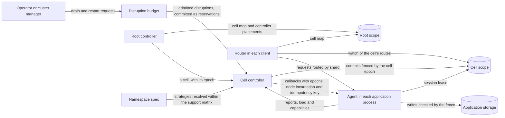

# RFC-0001: Pluggable sharding strategies over a fixed correctness core

## Summary

We propose `sharder`, a Go library that a sharded application embeds to map keys to shards, place shards on nodes and move them safely. The library separates what differs between applications from what must not differ. Each of seven axes has pluggable strategies: partitioning, placement, replication, ownership, handoff, topology and routing. An application names a preset in a declarative namespace spec, and selects its own strategy on any axis where it differs from the preset. A fixed core applies every strategy's decisions. It assigns epochs, sequences transitions, enforces the disruption budget and checks each strategy's output against properties with a stated scope. A strategy computes where shards go. It cannot weaken fencing, exceed the budget or skip a step of a transition.

The first release supports a subset of this design, which a support matrix lists as data: one cell per namespace, a key-to-slot mapping that never changes, exclusive ownership with a transactional fence, break-before-make handoff, the primary-only model, the embedded topology, and routes that routers watch in the store. `Resolve` rejects every spec outside the matrix before it takes effect. The rest of the design is recorded here with the changes that each part needs before the matrix can include it. One such part is the `delegated` ownership mode, in which an application's own election, such as a consensus protocol, grants each writer's epoch and the core follows it.

A namespace scales horizontally in cells. A cell is a disjoint set of nodes, the shards placed on them and one controller, with its own keyspace in the store. The library builds on `go.thesmos.sh/core` for time, randomness, identifiers, epochs and fencing, conditional writes, errors, state machines, structured concurrency, retries and telemetry, and defines only what core does not. Its root module imports only core, kanon's small runtime, one module for XXH64 and the standard library. The store, the membership and the transport are interfaces. Adapter modules implement the store and the membership over etcd, and the transport over HTTP/2 or gRPC. The protocol's messages have binary codecs that kanon generates.

## Motivation

Published sharding systems disagree on nearly every design choice, and each one fixes a single option:

- **Key control.** Slicer hashes each application key into a 63-bit space and splits and merges ranges itself. Shard Manager (SM) and Service Fabric let the application define its shards, because hashing "destroys key locality" and rules out prefix scans. SM reports that 9% of the queries of one of its applications are prefix scans.
- **Ownership.** Dicer's open-source release commits only affinity assignments. Temporal fences each shard's writes with a range ID, and Kafka fences consumers with a member epoch. Splitter grants exclusive leases and lets two owners overlap during a move.
- **Coordination.** SM, Slicer, Helix, Splitter and Dicer compute assignments in a central controller. Dynamo-style systems compute placement from membership alone, with no controller.
- **Replication.** SM needs three strategies: primary-only, secondary-only and primary-secondary. Across its applications, 67% were primary-only in August 2020, and they ran on 17% of its servers.
- **Placement.** Within SM alone, 55% of applications balance on shard count, 20% on one metric, and the applications that balance on more than one metric use 65% of the servers.

An application whose needs differ from one system's fixed option builds its own sharding. SM's authors found that teams "were already building their own custom solutions to varying degrees of completeness", and 45% of Facebook's sharded applications still used static sharding or consistent hashing when SM was published. Each custom build re-implements the parts that are hard to get right: fencing a paused owner, sequencing a primary handoff, and keeping enough replicas up during maintenance.

The correctness mechanisms belong in one shared layer, because none of them works from inside a single application process:

- A fence needs one authority that orders writers across nodes.
- A disruption budget needs a view of every replica of a shard.
- A primary handoff needs one party that sequences calls on two nodes.

The cluster manager runs processes but does not know which process serves which key. The application knows its keys but sees only its own replicas.

The target scale is larger than one controller can serve. SM's largest deployments used about 19,000 servers and 2.6 million shards, and SM manages nearly 100 million shards on over one million servers in total. SM reaches that scale by dividing each large application into partitions of "thousands of servers and hundreds of thousands of shard replicas", each managed by one control-plane instance.

## Detailed design

### Vocabulary

| Term | Meaning | Go type |
|---|---|---|
| Namespace | One independently configured sharded application or key space | `shard.Namespace` |
| Namespace incarnation | One creation of a namespace. The root generates it when it creates the namespace, and every scope, fence token, operation and message of the namespace contains it | `shard.NamespaceIncarnation` |
| Position | The ordered form of a key that the namespace's partitioner defines | `[]byte` |
| Mapping | The function from keys to positions: the partitioner, its configuration and the version of its hash function. It never changes during a namespace incarnation | `shard.Mapping` |
| Shard | The unit of assignment. It covers one range of positions | `shard.ID`, `shard.Range` |
| Cell | A disjoint set of nodes, the shards placed on them and one controller. It covers one range of positions | `shard.CellID`, `shard.Cell` |
| Scope | One keyspace of a namespace in the store: the root, or one cell | `shard.Scope` |
| Root | The controller of a namespace's cell map. It places the controllers of the cells | `shard.Scope` with an empty cell |
| Node | A process that hosts replicas. It belongs to one cell and keeps its ID across restarts | `shard.Node`, `shard.NodeID` |
| Node incarnation | A counter that increases each time a node process starts. Every callback names the node incarnation it is for | `epoch.Epoch` |
| Replica | One copy of a shard on one node, in one role | `shard.Replica` |
| Role | A state in a replica state model, such as `primary` | `shard.Role` |
| Epoch | The fence epoch of a shard's writer, or of a cell's controller. It increases each time the writer or the controller changes | `epoch.Epoch` |
| Tenure | One writer's authority over a shard at one epoch. It starts when the writer acquires the shard's fence, and it ends when a newer tenure acquires the fence | `fence.Token` |
| Generation | A per-scope counter that increases by one on every committed assignment change | `epoch.Epoch` |
| Assignment | The desired placement of every shard of a cell at one generation | `shard.Assignment` |
| Transition | One move of one replica, executed as a sequence of callbacks | `store.Transition` |
| Operation ID | The identity of one transition: the namespace incarnation, the shard and the shard's transition sequence | `shard.OperationID` |
| Commit ID | The identity of one atomic commit to a scope. It differs from the operation ID of the transition that the commit advances | `store.CommitID` |
| Spec | The declarative configuration of a namespace | `config.Spec` |
| Preset | A named partial spec for a common use case | `config.Preset` |
| Support matrix | The strategies, presets and adapters that the first release supports | `config.Support` |
| Proposal | A change that an operator requests | `config.Proposal` |
| Authority | The application's own election of writers, which the `delegated` ownership mode follows | `replica.Elector` |
| Identity | The identity of a process as the embedder's transport authenticates it, such as a SPIFFE ID or the digest of a certificate's key | `shard.Identity` |

The shared value types are in package `shard`. Every other sharder package imports them, and they import only core. `shard` generates kanon codecs for `Scope`, `OperationID`, `Mapping`, `Range`, `Replica`, `Placement`, `Observed`, `Node` and `Cell`, so the protocol's messages and the store adapters encode them through one codec per type, and their field numbers are recorded once, in `shard`. `NamespaceIncarnation` encodes through the binary encoding methods of core's `id.ID`.

```go
// Package shard defines the value types that every sharder package shares.
package shard

import (
 "errors"
 "time"

 "go.thesmos.sh/core/epoch"
 "go.thesmos.sh/core/errs"
 "go.thesmos.sh/core/id"
 "go.thesmos.sh/core/tag"
)

//go:generate go tool kanon -type=Scope,OperationID,Mapping,Range,Replica,Placement,Observed,Node,Cell

// Namespace names one independently configured sharded application or key space.
type Namespace string

// NamespaceIncarnation identifies one creation of a namespace. The root generates it
// with core's id/ulid when it creates the namespace, and it never changes afterwards. A
// namespace that is deleted and created again under the same name has a new
// incarnation, so no scope, fence token, operation or message of the old incarnation
// matches the new one.
type NamespaceIncarnation struct{ id.ID }

// ErrIncarnation reports a commit, a callback or a report for an incarnation of the
// namespace other than the receiver's. It classifies as errs.Conflict: the sender acts
// on a namespace that no longer exists, and reads the root scope again.
var ErrIncarnation = errs.WithClass(errors.New("shard: namespace incarnation mismatch"), errs.Conflict)

// ID identifies a shard within a namespace. The partitioning strategy defines its format.
type ID string

// NodeID identifies a node. The node chooses it and reuses it across restarts.
type NodeID string

// CellID identifies a cell of a namespace. The empty CellID names no cell.
type CellID string

// Scope names one keyspace of a namespace in the store: the root when Cell is empty,
// or one of the namespace's cells. Every store call and every protocol call names the
// scope it acts on.
type Scope struct {
 Namespace Namespace
 Cell      CellID
}

// OperationID identifies one transition of one shard. Sequence counts the shard's
// transitions from one, in a counter that the shard's placement keeps after each
// transition ends, so no two transitions of a shard in one namespace incarnation share
// an OperationID.
type OperationID struct {
 Incarnation NamespaceIncarnation
 Shard       ID
 Sequence    uint64
}

// Role is a state in a replica state model, such as "primary" or "secondary".
type Role string

// Identity is the identity of a process as the embedder's transport authenticates it,
// such as a SPIFFE ID or the digest of a certificate's key. The library compares
// identities and does not interpret them.
type Identity string

// Mapping identifies the function from a namespace's keys to positions. The root
// records it when it creates the namespace, and it never changes during the namespace
// incarnation. Every controller and every router compares the Mapping of its own
// partitioner with the recorded one when it starts, and refuses the namespace when the
// two differ.
type Mapping struct {
 // Partitioner is the registered name of the partitioner.
 Partitioner string
 // Config is the partitioner's configuration after parsing, with every default
 // applied, encoded with encoding/json. It includes every field that decides a key's
 // position.
 Config []byte
 // Hash is the registered name of the partitioner's hash function, and HashVersion
 // is the version of that function. Both are zero for a partitioner without a hash.
 Hash        string
 HashVersion uint32
}

// Range is the half-open interval [Start, End) of positions. A nil End extends to the
// end of the position space.
type Range struct {
 Start []byte
 End   []byte
}

// Node describes one live member of a cell. A published Node is never modified.
type Node struct {
 ID NodeID
 // Incarnation increases each time the node process starts. Every callback names the
 // incarnation it is for, and a node refuses a callback for another incarnation of
 // itself. A report or lease from an older incarnation of the same ID is stale.
 Incarnation epoch.Epoch
 Cell        CellID
 Address     string
 // Labels contains topology and attributes, such as "region", "zone" and "host".
 Labels tag.Tags
 // Capacity maps a load metric, such as "cpu" or "bytes", to the node's capacity.
 Capacity map[string]float64
 // Identity is the node's identity. It is empty when the embedder does not
 // authenticate peers.
 Identity Identity
}

// Load maps a metric name to its value, averaged over the namespace's load window.
// A published Load is never modified.
type Load map[string]float64

// Replica is one copy of a shard on one node, in one role.
type Replica struct {
 Node NodeID
 Role Role
}

// Placement is the desired replica set of one shard.
type Placement struct {
 Shard ID
 Range Range
 // Epoch is the fence epoch of the shard's writer. It is epoch.Zero for a shard
 // without a writer, and fenced storage admits a zero epoch without fencing it.
 Epoch epoch.Epoch
 // Reserved is the highest epoch that any transition of the shard has reserved,
 // including an abort path's epoch that no callback used. The core reserves every
 // later epoch above it, so no epoch is granted twice.
 Reserved epoch.Epoch
 // Sequence is the Sequence of the shard's latest transition. It remains after the
 // transition ends.
 Sequence uint64
 Replicas []Replica
}

// Assignment is the desired placement of every shard of one cell at one generation.
type Assignment struct {
 Scope Scope
 // Generation increases by one with every committed change of the assignment.
 Generation epoch.Epoch
 Placements map[ID]Placement
}

// Cell is one entry of a namespace's cell map, and the record that a cell's controller
// commits to the cell's scope when it acquires the scope.
type Cell struct {
 ID    CellID
 Range Range
 // Controller is the address of the cell's controller, or empty while it has none.
 Controller string
 // ControllerIdentity is the identity of the cell's controller.
 ControllerIdentity Identity
 // Epoch is the controller's fence epoch for the cell's keyspace in the store.
 Epoch epoch.Epoch
 // SpecVersion is the version of the namespace's spec that the cell's controller
 // applies. It is at most the version that the root has accepted.
 SpecVersion epoch.Epoch
}

// CellMap lists the cells of a namespace in position order. Their ranges cover the
// position space without gaps or overlaps.
type CellMap struct {
 Namespace   Namespace
 Incarnation NamespaceIncarnation
 Version     epoch.Epoch
 Cells       []Cell
}

// Locate returns the cell whose range contains pos, by binary search.
func (m CellMap) Locate(pos []byte) (Cell, bool)

// Status is the condition of a replica as its node reports it.
type Status string

const (
 StatusStarting Status = "starting" // a callback that adds the replica is running
 StatusServing  Status = "serving"
 StatusStopping Status = "stopping" // a callback that removes the replica is running
 // StatusFailed reports that the last callback returned an error, or that the
 // application reported a fault in the replica.
 StatusFailed Status = "failed"
)

// Fault classifies a fault that an application reports in one of its replicas.
type Fault uint8

const (
 // FaultNone means that the application has not reported a fault in the replica.
 FaultNone Fault = iota
 // FaultTransient reports a condition that stops the replica from serving until the
 // application reports it recovered.
 FaultTransient
 // FaultPermanent reports that the replica cannot serve again. The core replaces it
 // on another node. In a delegated namespace, the application's authority replaces
 // it, and the core counts it unavailable until the application releases it.
 FaultPermanent
)

// Observed is what a node reports about one of its replicas.
type Observed struct {
 Shard  ID
 Role   Role
 Epoch  epoch.Epoch
 Status Status
 Load   Load
 // Fault is the fault that the application reported, and Cause describes it in at
 // most 1,024 bytes.
 Fault Fault
 Cause string
 // Range and Parents describe a shard that a split or a merge by a delegated
 // namespace's authority created. They are empty for any other shard.
 Range    Range
 Parents  []ID
 Reported time.Time
}
```

### The strategy axes

Each axis is an interface with built-in strategies. A strategy has a registered name and a typed configuration. Presets and defaults fill every axis a spec leaves empty, so an application writes only the fields where it differs.

| Axis | Decides | Interface | Built-in strategies |
|---|---|---|---|
| Partitioning | The position of a key, and the shards of a cell | `partition.Partitioner` | `fixed-slots`, `hash-range`, `key-range`, `explicit`, `singleton` |
| Placement | Which nodes of a cell host each shard's replicas | `placement.Placer`, `placement.Function` | `planner`, `rendezvous`, `consistent-hash`, `bounded-load`, `jump`, `maglev`, `static` |
| Replication | The roles of a replica, the replica count, and when a shard counts as available | `replication.Model` | `primary-only`, `secondary-only`, `primary-secondary`, custom models |
| Ownership | What a replica may assume about exclusivity, and who elects the writers | `ownership.Mode` | `affinity`, `exclusive`, `overlapping`, `delegated` |
| Handoff | The order of callbacks that moves a replica | `handoff.Protocol` | `break-before-make`, `make-before-break`, `graceful`, `staged`, `elect` |
| Topology | Where the controllers run | `controller.Topology` | `embedded`, `service`, `leaderless` |
| Routing | How clients find a shard's replicas | `router.Source` | `watch`, `lookup`, `compute` |

The disruption budget, the load model and the cell bounds are typed sections of the spec, not strategies. Every namespace has all three, and none has a credible alternative implementation.

The store, the membership and the transport are process wiring, not axes. The embedder builds them and passes them to the controller and the agent, because the spec is stored in the store and cannot select it. Each store and membership adapter declares the capabilities it provides, such as leases, and the spec's strategies are checked against them.

### The support matrix

The first release supports the strategies, presets and adapters in the following table, and no others. The matrix is a value in code, which `builtin.Support` returns as a `config.Support`. Every consumer of the matrix reads that value:

- `builtin.Registry` installs it, and `Resolve` checks every spec against it before anything else. A selection outside it fails with an error of class `errs.Unsupported` that names the axis and the value.
- `builtin` registers only the presets inside it.
- The examples cover each supported preset once, and no example uses a strategy outside it.
- The README's support table lists it, and a test fails when the table and `builtin.Support` differ.

| Area | Supported | Outside the matrix |
|---|---|---|
| Cells | One cell per namespace. The root elects and places the cell's controller | More than one cell, cell splits |
| Partitioning | `fixed-slots` and `singleton`. The whole mapping is fixed for the namespace incarnation: the slot count, the hash function and its version, and hash tags | `hash-range`, `key-range`, `explicit`, resharding |
| Placement | `planner` | The function placers, `static` |
| Replication | `primary-only` | `secondary-only`, `primary-secondary`, custom models, replica scaling |
| Ownership | `exclusive` with `fenced: true`, and a fence guard in every agent | `affinity`, `overlapping`, `delegated`, `exclusive` without a fence |
| Handoff | `break-before-make`, with an explicit writer gap | `make-before-break`, `graceful`, `staged`, `elect` |
| Topology | `embedded` | `service` with `sharderd`, `leaderless` |
| Routing | `watch` | `lookup`, `compute`, `hold` |
| Store | The etcd adapter. `store/memory` in tests and simulations only | Restoring a store from a backup |
| Transport | `httptransport` | `grpc` |
| Presets | `exclusive-worker`, `consumer-group`, `actor-entities`, `leader-election` | `replicated-store`, `cache-affinity`, `leaderless-hash` |
| Strategies that applications register | Constraints, goals and hash functions | Every other kind |
| Approvals | None | Approvals sections and trust anchors |

Each section of these RFCs that designs a strategy outside the matrix marks it as outside, and lists the changes the strategy needs before the matrix can include it.

The first release does not need core's copy-on-write B-tree, because a `fixed-slots` route cache is an array indexed by slot, and a namespace of one cell needs no search over a cell map.

### What core provides

The library takes every mechanism below from core and defines none of them itself.

| sharder needs | core provides | Where sharder uses it |
|---|---|---|
| Time that a simulation can control | `clock.Clock`, `clock/hlc`, `clock/fake` | Lease timers, planner deadlines, retries, cooldowns, the simulator |
| Randomness that a seed reproduces | `rand.Rand`, `rand/pcg` | Planner sampling, jitter, the simulator |
| Ordered counters | `epoch.Epoch` | Shard epochs, generations, terms, node incarnations, spec versions |
| Unique identifiers | `id.ID`, `id/ulid` | Namespace incarnations |
| Fencing | `epoch.Admissible`, `epoch.ErrFenced`, and the fence laws | Every fenced write: application storage and the store |
| A conformance suite for fenced writers | `coretest/epochtest` | Every application's fence and every store adapter |
| Conditional writes | `version.ErrMismatch` | A commit whose generation moved |
| An error for a write whose outcome is unknown | `version.ErrOutcomeUnknown`, which core does not contain at commit `8edf26a` | A commit whose reply was lost |
| Pagination | `page.Page`, `page.Cursor` | Reading a cell's placements from the store |
| Error classes | `errs.Classify`, `errs.WithClass` | Every sentinel error of the library |
| Validated state machines | `fsm.Spec` | Replica state models and the transition lifecycle |
| Structured concurrency | `task.Run`, `task.Each`, `task.Every` | The runtimes of controllers and agents, callback fan-out, renewals |
| Retries and concurrency limits | `resilience.Retrier`, `resilience.Bulkhead` | Callback retries, callbacks per node |
| Coalesced lookups | `batch.Loader` | Route lookups of routers in `lookup` mode, outside the support matrix |
| Labels | `tag.Tags` | Node labels and shard labels |
| Digests | `crypto.Digest`, `crypto/sha256` | Commit receipts, callback fingerprints, disruption reservations, and the anchor of approvals |
| Signature thresholds | `sign.Policy`, `sign.Resolver`, `crypto.NewFramer` | Approvals of specs and operations, outside the support matrix |
| Ordered maps with copy-on-write clones | A B-tree, none at commit `8edf26a` | Route caches of range partitioners, outside the support matrix |
| Metrics and traces | `telemetry.Reporter` | Every metric of the library |

The fence laws come from core: a write whose epoch is at or above the scope's watermark is admitted, a greater epoch advances the watermark, a zero epoch is unfenced, and validation runs in the same atomic step as the write, against durable state. Logs go through `log/slog`, as in core.

The root module takes one mechanism from outside core, kanon and the standard library: XXH64, the hash of `fixed-slots`, from `github.com/cespare/xxhash/v2` v2.3.0, a module without dependencies of its own. The adapters take what their backends need: the etcd client, and gRPC with protobuf. The HTTP transport needs nothing beyond the root module and the standard library. The root module's `go.mod` lists kanon as a tool, which generates the codecs of the protocol's messages, of the store's records and of the types they contain, in `shard`, `config`, `budget`, `store` and `protocol`. The generated code imports kanon's runtime: `go.thesmos.sh/kanon` for the message interface, the decode options, the typed errors and the version constants, and `go.thesmos.sh/kanon/wire` for the varint, time and skip functions. The `tool` directive keeps the generator and the runtime at one version.

### The fixed core

A namespace spec sets the core's parameters but cannot replace the core. The core applies these rules to every combination of strategies:

- The core assigns every generation, and every epoch except the writer epochs of the `delegated` mode, which it takes from the application's authority. A placer returns target replica sets without epochs.
- The core turns a target assignment into transitions and runs each transition through the namespace's handoff protocol.
- Before a transition's first callback, the core commits the transition's full record: its operation ID, both endpoints with their node incarnations, every epoch it reserves, and the version of its protocol. The core commits each step before it calls a node, so a new controller resumes a transition from the record alone, without planning it again.
- The core checks every placer output against the hard constraints and the state model's bounds before it commits anything.
- The core admits every transition through the disruption budget, together with maintenance requests from outside, and commits each admitted request to the store before it replies.
- The core gives each callback an idempotency key and a digest of its payload, and each commit a commit ID. A retried callback or commit then has the effect of the first attempt, and a controller that lost a reply can learn the outcome.

### Properties

The core guarantees the properties below. Each has a scope and states what it assumes. The simulator checks every safety property after every event, under every fault it injects. Convergence depends on its stated assumptions.

A fault can take down more replicas than the budget allows. The admission property restricts what the core admits, so such a fault does not violate it.

| Property | Applies to | Statement |
|---|---|---|
| Epoch uniqueness | Every ownership mode with writers | The core grants each epoch of a shard to one tenure. It reserves each epoch in the shard's placement before any callback names the epoch, and never reserves an epoch twice |
| Writer safety | `exclusive` with `fenced: true` | Once a tenure has acquired a shard's fence, no transaction of an older tenure commits a fenced write. Two processes can still both act as the writer for a while, for example on the two sides of a partition. The fence decides which process's writes commit |
| Control safety | Every scope | A scope's state changes only by a commit in the scope's namespace incarnation that names the generation it replaces, from a writer whose epoch is at or above the scope's watermark |
| Role safety | Every state model | The replicas in each role, counted together with the started transitions into the role, never exceed the role's bound. The core admits a transition that lowers a role that is already above its bound |
| Admission | Every namespace | The core admits a planned transition or disruption only when the unavailable replicas it observes, plus the reservations in the store, remain within the budget. It admits repair that raises no shard's count of unavailable replicas, even when failures have already exceeded the budget |
| Constraints | The planner | Every replica that a commit adds or moves satisfies every hard constraint. A replica that a changed constraint or a changed node makes invalid is reported as a violation, and repair moves it without making any violation worse |
| Convergence | Every namespace | While the store is available, the nodes of each transition are live and their handlers return within the step timeouts, every transition ends in `Done` or `Aborted`. When a feasible placement also exists, the committed assignment arrives at the planner's target |

The data plane does not depend on the control plane. Agents keep their replicas and routers keep their routes while a controller or the store is unavailable, within these limits:

| Unavailable | Writers under `continue-fenced` | Writers under `stop` | Routers that have the cell's routes | Routers that start during the outage | Transitions and failover |
|---|---|---|---|---|---|
| The cell's controller | Serve | Serve | Route | Read the routes from the store, then route | Stop until the root places the cell's controller again. A crashed writer is not replaced meanwhile |
| The root's leader | Serve | Serve | Route | Route | Continue. The cell cannot change controller |
| The store | Serve. No newer tenure can acquire during the outage | Stop at the lease deadline, one TTL after the last renewal | Route on the last routes they read | Return an error of class `errs.Transient`, because they have no route | Stop. A crashed writer is not replaced until the store returns |

### Components



### Cells and the root

A cell is a disjoint set of nodes, the shards placed on them and one controller. Each cell covers one contiguous range of positions, and every replica of a shard is on a node of the shard's cell. A node's cell is the value of its `cell` label. A namespace starts with one cell that covers every position, and a node without the label joins it. In the support matrix, a namespace keeps that one cell, and a node whose label names another cell is refused. Outside the matrix, in a namespace of more than one cell, a node without the label is refused.

The root is a small controller per namespace. It keeps the cell map and places each cell's controller on a controller process, with the same planner and handoff protocols that place shards: a cell is a shard of the root, and the cell's controller is that shard's writer. The controller's epoch fences its commits to the cell's keyspace in the store, so a controller that the root has replaced cannot commit. The root's own leader is elected through the store. The root also creates the namespace: its first commit generates the namespace incarnation and records the mapping, and neither changes until the namespace is deleted.

Each cell has its own keyspace in the store, its own membership, its own planner and its own lease sessions, so adding cells adds capacity to every part of the control plane. The spec bounds a cell at 5,000 nodes and 1,000,000 shards by default. Both bounds are targets, and we have not measured a cell at either of them. The root reports a cell that exceeds either bound. Splitting a cell is outside the support matrix. Routers read the small cell map, and then the routes of each cell they call.

### Topologies

The topology axis selects where the controllers run. The support matrix contains `embedded`. The controller code is the same in all three, except that the leaderless topology has no controller.

| Topology | Controllers run in | Leaders | Suited to | Restricts | In the support matrix |
|---|---|---|---|---|---|
| `embedded` | The application processes of the namespace | The root is elected through the store. Each cell's controller runs on a node of its cell | Namespaces without a separate service | Controller work shares the application's CPU | Yes |
| `service` | Dedicated `sharderd` processes that serve many namespaces | The root is elected through the store and places cell controllers on `sharderd` processes | Many namespaces, and every namespace above one cell | One more service to deploy and operate | No |
| `leaderless` | Nowhere. Each agent computes placement with a function placer | None | Affinity routing without a coordinator | One cell per namespace. Placement must be a `Function`, and there is no planner and no budget across nodes. Exclusive ownership would need routers to observe each shard's election, which the store does not offer | No |

### Presets

A preset fills every axis for one use case. The application still overrides any single field.

| Preset | Use case | Partitioning | Placement | Replication | Ownership | Handoff | Topology | In the support matrix |
|---|---|---|---|---|---|---|---|---|
| `exclusive-worker` | Stream processors, schedulers, per-tenant workers | `fixed-slots`, 1024 | `planner`: count balance, zone spread | `primary-only` | `exclusive`, fenced | `break-before-make` | `embedded` | Yes |
| `consumer-group` | Fixed partitions of a queue | `fixed-slots`, one per partition | `planner`: count balance, stickiness | `primary-only` | `exclusive`, fenced | `break-before-make` | `embedded` | Yes |
| `actor-entities` | Entity and actor sharding | `fixed-slots`, 10 per expected node | `planner`: count balance | `primary-only` | `exclusive`, fenced | `break-before-make` | `embedded` | Yes |
| `leader-election` | One active instance of a component | `singleton` | `planner` | `primary-only` | `exclusive`, fenced | `break-before-make` | `embedded` | Yes |
| `replicated-store` | Databases and logs with a leader per shard | `key-range` | `planner`: balance on every load metric, zone spread, region preference | `primary-secondary`, 3 replicas | `exclusive` | `graceful` | `service` | No |
| `cache-affinity` | Caches and in-memory indexes | `hash-range` | `planner`: load balance, stickiness | `secondary-only`, 1 replica, scaled on load | `affinity` | `make-before-break` | `service` | No |
| `leaderless-hash` | Client-side routing without a coordinator | `fixed-slots`, 1024 | `rendezvous` | `secondary-only`, 1 replica | `affinity` | `make-before-break` | `leaderless` | No |

The four supported presets also select `watch` routing and a budget that allows the planned interruption of break-before-make. A spec names its preset, and `Resolve` rejects a spec without one. Every strategy of a namespace is then one that its spec or its preset selected. `builtin` does not register the three presets outside the matrix, and a spec that selects the same strategies without them fails `Resolve` with an error of class `errs.Unsupported`.

### Packages and modules

The root module, `go.thesmos.sh/sharder`, contains these packages. They import packages of core, of kanon's runtime, of `github.com/cespare/xxhash/v2`, of the standard library and of the module itself.

| Package | Contains | Imports from the library |
|---|---|---|
| `shard` | The value types in this RFC | nothing |
| `config` | The spec, the strategy registry, the support matrix type, presets and validation | `shard` |
| `builtin` | The factories of the built-in strategies, the built-in presets, and the support matrix | `config` and every strategy package |
| `partition` | The partitioner interface, layouts and built-in partitioners | `shard` |
| `placement` | Placer interfaces, the planner, function placers | `shard`, `partition`, `replication` |
| `replication` | State models and replica counts | `shard` |
| `ownership` | Ownership modes and lease parameters | `shard` |
| `handoff` | Handoff protocols, their abort paths and the transition lifecycle | `shard`, `ownership`, `protocol` |
| `fence` | Fencing tokens and the guard interface | `shard` |
| `budget` | The disruption budget and its reservations | `shard`, `replication` |
| `store` | The store interface and its records | `shard`, `budget` |
| `store/memory` | The in-memory store and membership with fault hooks, the conformance suite's first subject | `store`, `membership` |
| `store/storetest` | The conformance suite for store adapters | `store` |
| `protocol` | The protocol's messages with their kanon codecs, its metadata, its server and client interfaces, and `Network` and `Local`, which connect servers by direct calls | `shard`, `config`, `budget` |
| `membership` | The membership interface | `shard` |
| `membership/static` | A fixed node list | `membership` |
| `controller` | The root and cell controllers: planning loop, transition engine, budget enforcement, topologies | every package above except `store/memory`, `store/storetest` and `membership/static` |
| `replica` | The agent that an application process runs | `shard`, `config`, `protocol`, `fence`, `store`, `membership` |
| `router` | The client-side router and its route cache | `shard`, `protocol`, `store`, `partition` |
| `sim` | The deterministic simulator | every package above |

Each adapter is a module of its own, so an application's build contains only the backends it imports. The embedder constructs the adapters and passes them to `controller.New` and `replica.Start`.

| Module | Implements | Depends on | In the support matrix |
|---|---|---|---|
| `go.thesmos.sh/sharder/etcd` | `store.Store` and `membership.Membership` | The etcd v3 client | Yes |
| `go.thesmos.sh/sharder/httptransport` | The protocol's clients, and an HTTP/2 handler that calls its servers, with kanon-encoded bodies. The default transport | The standard library | Yes |
| `go.thesmos.sh/sharder/grpc` | The protocol's clients, and a gRPC service that calls its servers | gRPC and protobuf | No |
| `go.thesmos.sh/sharder/cmd` | `sharderctl`, and `sharderd` for the `service` topology | The adapters that each program selects | `sharderctl` only |

### Verification

Three kinds of evidence support the properties:

- Deterministic failure traces from the simulator.
- A conformance suite per axis and per adapter.
- One feasibility check of the etcd adapter against a real etcd cluster.

The simulator in package `sim` runs every process of a namespace on one goroutine: the root, the cell's controller, the agents and the routers, together with `store/memory`, which also provides the membership. It reuses the production logic of each component and replaces only its runtime:

- Each controller and each agent is a state machine that takes one event at a time, such as a message, a store result, a timer or a handler's result. It returns the calls it makes and does not start a goroutine. In production, a runtime calls the state machine from goroutines under core's `task` package. In the simulator, the scheduler calls it.
- The scheduler keeps one queue of events, ordered by virtual time and then by the sequence number that the scheduler gave each event when it queued it. When more than one event is due at one virtual time, the scheduler picks the next one with the run's `rand/pcg` source, so a seed selects one interleaving and reproduces it.
- Every process has its own `clock/fake` clock. The scheduler advances each clock by the virtual time that passed, scaled by the process's clock drift, and a paused process's clock stops.
- Faults enter at three boundaries: the `protocol.Network` that connects the processes, the fault hooks of `store/memory`, and a simulated `Handler` that each agent calls. The fault hooks lose a commit before it applies or lose its reply after it applies, and both fail the call with an error that wraps `version.ErrOutcomeUnknown`, as the ledger's memory store does for its appends.
- The planner evaluates candidate moves in parallel in production, and reduces the results in candidate order, so its plan does not depend on the number of goroutines.

The determinism contract is that the same binary, spec, faults and seed produce the same event trace, whatever `GOMAXPROCS` is. CI runs every scenario at `GOMAXPROCS` 1 and 4 and compares the two traces. A failing run prints its seed and its trace, and CI keeps each failing trace as a named regression scenario.

CI runs the simulator over each supported preset, with every fault kind and a fixed set of seeds, and `CrashPoints` over each preset's first handoff. A release is not published while any seed violates a property.

Each axis has a conformance suite that every strategy, built-in or external, must pass. A partitioner must map every key to one position in every process, and every position of a cell to at most one shard of the cell's layout. A partitioner whose layouts leave gaps, as `explicit` does, declares the gaps, and every other partitioner covers every position. A placer must return the same plan for the same input. Every store adapter passes `store/storetest`. Every fenced writer, the application's fence and the store's writers alike, passes core's `coretest/epochtest`.

The etcd adapter's feasibility check runs these cases against a real etcd cluster:

- a commit whose reply is lost after it applies
- two controllers that race to acquire one scope
- a watch whose history is compacted during a paged snapshot
- every supported transaction shape at the cluster's configured limits

A formal model is optional, and the supported scope has none. Its authority protocol is break-before-make with a fenced acquisition, and `CrashPoints` covers a crash at every event of it. A model is worth building for an authority or migration protocol whose interleavings the traces leave uncovered, such as a cell split.

```go
package sim

import (
 "testing"
 "time"

 "go.thesmos.sh/core/rand"
 "go.thesmos.sh/sharder/config"
)

// Faults selects the faults the simulator injects and how often.
type Faults struct {
 CrashRate float64       // node crashes per node per simulated minute
 PauseRate float64       // process pauses per node per simulated minute
 MaxPause  time.Duration // longest injected pause
 DropRate  float64       // fraction of messages lost
 // DelayRate is the fraction of messages that arrive up to MaxDelay late, after
 // messages sent later.
 DelayRate     float64
 MaxDelay      time.Duration
 MaxClockDrift float64 // largest clock-rate error, as a fraction
 StoreOutages  float64 // store outages per simulated hour
 // UnknownCommits is the fraction of commits that fail with an error that wraps
 // version.ErrOutcomeUnknown. Half of them apply before the reply is lost.
 UnknownCommits float64
 // SlowHandlers is the fraction of callbacks whose handler returns after the step's
 // timeout.
 SlowHandlers float64
 // ForgeRate is the fraction of callbacks that a process repeats under another
 // process's identity, at the epoch of a controller that the root has replaced, or to
 // an earlier incarnation of the target node.
 ForgeRate float64
}

// Run simulates spec on nodes for the simulated duration d from seed. It checks every
// safety property after every event. It injects no faults in the last quarter of d, and
// checks convergence at the end. On the first violation, it fails t with the seed and
// the event trace.
func Run(t *testing.T, reg *config.Registry, spec config.Spec, nodes int, d time.Duration, f Faults, seed rand.Seed)

// CrashPoints runs spec once from seed without faults, and then twice for every event
// of that run: once with the process that handles the event crashed just before it, and
// once just after it. It checks every property in each run, so a crash between any
// commit and any callback is covered.
func CrashPoints(t *testing.T, reg *config.Registry, spec config.Spec, nodes int, d time.Duration, seed rand.Seed)
```

## Alternatives considered

### One opinionated framework

SM shows that one fixed model can serve a large share of a company. It served 54% of Facebook's sharded applications with application-defined shards, a central controller and three replication strategies. A fixed model has one code path to test and one set of failure modes to learn. It also rules out configuration errors.

**Why not:** the use cases we target disagree on the fixed parts:

- A cache needs hashed keys and affinity, without the cost of fencing.
- A consumer group needs a fixed partition count and sticky assignment.
- Leader election needs one shard.

SM itself excluded the 1% of applications with their own orchestrators, which used 27% of its servers, and exposed its components separately for them. A fixed model would push those applications back to building their own.

### A toolkit without a core

Publish independent packages: a rendezvous hash, a lease helper, a placement solver, a router. Each application composes what it needs. This is the smallest library, and every package is useful alone.

**Why not:** the hard parts are the interactions between the packages:

- The hash maps keys to nodes without epochs.
- The lease helper grants leases without checking the disruption budget.
- The router routes requests without regard to a handoff in progress.

Each application would re-implement the sequencing that keeps them consistent, which is the work this library exists to remove. Every package in this proposal is still usable alone. The partitioners and function placers are pure functions with no dependency on the controller.

### A standalone service only

Run sharding as a service that applications connect to, as Splitter and Dicer do. The service upgrades independently of the applications, and one team operates it for all applications.

**Why not as the only option:** a service is one more production dependency for small deployments. The request is for a library that applications embed. The `service` topology keeps this option: `sharderd` hosts the same controllers for many namespaces.

### Adopting an existing system

Splitter, Cadence's shard-manager and Apache Helix each cover part of this design.

**Why not:** each of them leaves fencing to the application:

- Splitter shards only UUID ranges and runs as a separate Raft service. Its grants contain no fencing token.
- Cadence's shard-manager has no release and depends on Cadence's RPC framework. It passes no epoch to the application.
- Helix is written in Java and requires ZooKeeper. It does not fence a participant that loses its ZooKeeper session.

### Supporting every strategy in the first release

Support every strategy of these RFCs from the first release. Applications could then choose any combination from the start, and no later release would need to widen the matrix.

**Why not:** strategies outside the matrix still have open protocol design, and a release that offered them would include each gap:

- A split reuses the parent's ID for a child, and a change of the slot count moves keys between cells.
- A cell split copies a cell's state between two scopes without a durable record of the copy.
- The `majority` rule counts learners as replicas, so the budget can admit the loss of a quorum.
- A leaderless router computes a writer without knowing that writer's election epoch.

A matrix that `Resolve` enforces keeps each of these out until its design is complete. Adding a strategy to the matrix is then a change to `builtin.Support`, together with the strategy's implementation and its tests.

### Adapters as packages of the root module

Put the etcd store and the gRPC transport in the root module, as packages. One module has one version, so a root interface and its adapters change in the same release.

**Why not:** the requirements in the root module's `go.mod` enter the module graph of an application that imports the module. Minimal version selection applies them even when the application does not import an adapter package. An application that uses gRPC or the etcd client at an older version would move to the version that sharder requires.

### sharder's own clock, epochs and retries

Define the time seam, the epoch type, the fence rules and the retry loop inside the library, tuned to sharding.

**Why not:** core already defines each of them, with conformance suites, a virtual clock and a validated state machine. Copies in sharder would drift from core's laws, and every thesmos library that fences writes to the same storage would apply different rules to it.

## Drawbacks

- The root module has 20 packages and 33 exported interfaces, counted from the code in these RFCs. The built-in strategies number 30 across the seven axes. The counts exclude the four adapter modules.
- The axes multiply. Counting built-ins only, partitioning (5) × placement (7) × replication (3) × ownership (4) × handoff (5) × topology (3) × routing (3) gives 18,900 combinations. The support matrix admits 8 of the 30 built-ins and 2 of the combinations: `fixed-slots` or `singleton`, with every other axis fixed. Outside the matrix, the capability checks reject many combinations, and the remainder is too large to test one by one.
- Every axis adds configuration that a user can get wrong. The spec has 14 top-level fields, and 7 of them select a strategy with its own configuration schema. Presets fill most of them, and validation reports every problem at once, but a misconfigured namespace is a failure mode that a fixed framework does not have.
- The support matrix makes every application of the first release fence its writes. Each implements a `fence.Guard` over its storage, including an application that would accept affinity.
- Generality costs speed on the hot path. A router maps a key to a position before it finds the route. A `fixed-slots` route cache is an array indexed by slot. The range partitioners outside the matrix search a cache instead, which we measured at 241 to 292 ns per lookup at 1,000,000 cached ranges, against a few nanoseconds for a hash.
- The controller and the agent are state machines that a runtime drives, so that the simulator can drive them on one goroutine. That structure takes more code than goroutines that call each other directly.
- Cells add a root controller and a second level of lookup, even in a namespace of one cell, which every namespace in the support matrix is. A cell's nodes cannot help another cell's load until an operator moves them.
- The library depends on core's `fsm`, `task`, `coretest/epochtest`, fence laws, and the `Policy`, `Signature` and `Resolver` of `crypto/sign`, which core contains at commit `8edf26a` and which no core release contains. The latest release, v0.6.1, predates all five.
- The root module needs an error beside `version.ErrMismatch` for a write whose outcome is unknown, and binary encoding methods on `id.ID`. Core does not contain either at commit `8edf26a`, and the ledger defines the same error as `storage.ErrOutcomeUnknown`. The route caches of range partitioners, outside the matrix, also need a copy-on-write B-tree.
- The root module depends on kanon's runtime and on `github.com/cespare/xxhash/v2` as well as on core, and every application's binary links both. A kanon release that stops supporting a generator version is a breaking change of sharder's codecs. An application that requires an older version of `cespare/xxhash` moves to v2.3.0.
- An adapter module has its own version and its own release. A change to a root interface requires a new release of the adapter modules that implement it.

## Open questions

None.

## Unresolved and future work

- Strategies, presets and adapters outside the support matrix are designed in these RFCs and are not supported. Each section that designs one lists what it needs before the matrix can include it.
- Delegated ownership is outside the support matrix. The thesmos ledger's integration depends on it.
- Restoring a store from a backup is not supported. A namespace recovers with a new incarnation, over a fresh application-data namespace or behind an administrative barrier that stops every writer of the old incarnation.
- Formal models of the handoff and acquisition protocols are not proposed here. The simulator's traces are the evidence for the supported scope.
- Agents, routers and controllers in languages other than Go are not proposed here.
- Automatic shard scaling across namespaces, where one namespace lends capacity to another, is not proposed here.
- A graphical console for operators is not proposed here. Operators use the `sharderctl` command and the metrics.
- Cost-based placement across cloud providers is not proposed here.
- Kubernetes adapters, for membership, specs or evictions, are not proposed here.

## References

| What | Where |
|---|---|
| Lee et al., "Shard Manager: A Generic Shard Management Framework for Geo-distributed Applications", SOSP '21, §6.1 and §8.1 | https://dl.acm.org/doi/10.1145/3477132.3483546 |
| Guo and Kooburat, "Scaling services with Shard Manager", Engineering at Meta, 2020 | https://engineering.fb.com/2020/08/24/production-engineering/scaling-services-with-shard-manager/ |
| Adya et al., "Slicer: Auto-Sharding for Datacenter Applications", OSDI '16 | https://www.usenix.org/system/files/conference/osdi16/osdi16-adya.pdf |
| Databricks Dicer, source at 747e89acb3b7 | https://github.com/databricks/dicer |
| atoms-co/splitter v1.5.0 | https://github.com/atoms-co/splitter |
| Apache Helix issue 691, a partitioned participant remains MASTER | https://github.com/apache/helix/issues/691 |
| DeCandia et al., "Dynamo: Amazon's Highly Available Key-value Store", SOSP '07 | https://www.allthingsdistributed.com/files/amazon-dynamo-sosp2007.pdf |
| go.thesmos.sh/core at 8edf26a: ordering and fencing (RFC-0026), finite state machines (RFC-0031), structured concurrency (RFC-0030), resilience (RFC-0023), `id/ulid`, `crypto/digest.go` | https://github.com/thesmos-ai/core |
| go.thesmos.sh/ledger, `pkg/storage/errors.go` and `pkg/storage/memory/fault.go`: `ErrOutcomeUnknown` and the memory store's crash points | The ledger repository |
| Go Modules Reference, module graph pruning | https://go.dev/ref/mod#graph-pruning |
