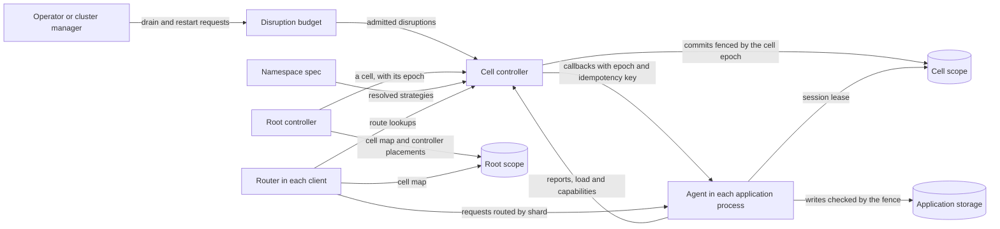

# RFC-0001: Pluggable sharding strategies over a fixed correctness core

## Summary

We propose `sharder`, a Go library that a sharded application embeds to map keys to shards, place shards on nodes and move them safely. The library separates what differs between applications from what must not differ. Each of seven axes has pluggable strategies: partitioning, placement, replication, ownership, handoff, topology and routing. An application names a preset in a declarative namespace spec, and selects its own strategy on any axis where it differs from the preset. A fixed core applies every strategy's decisions. It assigns epochs, sequences transitions, enforces the disruption budget and checks each strategy's output against eight invariants. A strategy computes where shards go. It cannot weaken fencing, exceed the budget or skip a step of a transition. An application with its own election, such as a consensus protocol, selects the `delegated` ownership mode, in which its election grants each writer's epoch and the core follows it.

A namespace scales horizontally in cells. A cell is a disjoint set of nodes, the shards placed on them and one controller, with its own keyspace in the store. The library builds on `go.thesmos.sh/core` for time, randomness, epochs and fencing, conditional writes, errors, state machines, structured concurrency, retries and telemetry, and defines only what core does not. Its root module imports only core and the standard library. The store, the membership and the transport are interfaces. Adapter modules implement the store and the membership over etcd, and the transport over HTTP/2 or gRPC. The protocol's messages have binary codecs that kanon generates.

## Motivation

Published sharding systems disagree on nearly every design choice, and each one fixes a single option:

- **Key control.** Slicer hashes each application key into a 63-bit space and splits and merges ranges itself. Shard Manager (SM) and Service Fabric let the application define its shards, because hashing "destroys key locality" and rules out prefix scans. SM reports that 9% of the queries of one of its applications are prefix scans.
- **Ownership.** Dicer's open-source release commits only affinity assignments. Temporal fences each shard's writes with a range ID, and Kafka fences consumers with a member epoch. Splitter grants exclusive leases and lets two owners overlap during a move.
- **Coordination.** SM, Slicer, Helix, Splitter and Dicer compute assignments in a central controller. Dynamo-style systems compute placement from membership alone, with no controller.
- **Replication.** SM needs three strategies: primary-only, secondary-only and primary-secondary. Across its applications, 67% were primary-only in August 2020, and they ran on 17% of its servers.
- **Placement.** Within SM alone, 55% of applications balance on shard count, 20% on one metric, and the applications that balance on more than one metric use 65% of the servers.

An application whose needs differ from one system's fixed option builds its own sharding. SM's authors found that teams "were already building their own custom solutions to varying degrees of completeness", and 45% of Facebook's sharded applications still used static sharding or consistent hashing when SM was published. Each custom build re-implements the parts that are hard to get right: fencing a paused owner, sequencing a primary handoff, and keeping enough replicas up during maintenance.

The correctness mechanisms belong in one shared layer, because none of them works from inside a single application process:

- A fence needs one authority that orders writers across nodes.
- A disruption budget needs a view of every replica of a shard.
- A primary handoff needs one party that sequences calls on two nodes.

The cluster manager runs processes but does not know which process serves which key. The application knows its keys but sees only its own replicas.

The target scale is larger than one controller can serve. SM's largest deployments used about 19,000 servers and 2.6 million shards, and SM manages nearly 100 million shards on over one million servers in total. SM reaches that scale by dividing each large application into partitions of "thousands of servers and hundreds of thousands of shard replicas", each managed by one control-plane instance.

## Detailed design

### Vocabulary

| Term | Meaning | Go type |
|---|---|---|
| Namespace | One independently configured sharded application or key space | `shard.Namespace` |
| Position | The ordered form of a key that the namespace's partitioner defines | `[]byte` |
| Shard | The unit of assignment. It covers one range of positions | `shard.ID`, `shard.Range` |
| Cell | A disjoint set of nodes, the shards placed on them and one controller. It covers one range of positions | `shard.CellID`, `shard.Cell` |
| Root | The controller of a namespace's cell map. It places the controllers of the cells | `store.Scope` with an empty cell |
| Node | A process that hosts replicas. It belongs to one cell and keeps its ID across restarts | `shard.Node`, `shard.NodeID` |
| Incarnation | A counter that increases each time a node process starts | `epoch.Epoch` |
| Replica | One copy of a shard on one node, in one role | `shard.Replica` |
| Role | A state in a replica state model, such as `primary` | `shard.Role` |
| Epoch | The fence epoch of a shard's writer, or of a cell's controller. It increases each time the writer or the controller changes | `epoch.Epoch` |
| Generation | A per-scope counter that increases by one on every committed assignment change | `epoch.Epoch` |
| Assignment | The desired placement of every shard of a cell at one generation | `shard.Assignment` |
| Transition | One move of one replica, executed as a sequence of callbacks | `store.Transition` |
| Spec | The declarative configuration of a namespace | `config.Spec` |
| Preset | A named partial spec for a common use case | `config.Preset` |
| Proposal | A change that an operator requests, signed by approvers when the namespace requires approvals | `config.Proposal` |
| Authority | The application's own election of writers, which the `delegated` ownership mode follows | `replica.Elector` |
| Identity | The identity of a process as the embedder's transport authenticates it, such as a SPIFFE ID or the digest of a certificate's key | `shard.Identity` |

The shared value types are in package `shard`. Every other sharder package imports them, and they import only core.

```go
// Package shard defines the value types that every sharder package shares.
package shard

import (
 "time"

 "go.thesmos.sh/core/epoch"
 "go.thesmos.sh/core/tag"
)

// Namespace names one independently configured sharded application or key space.
type Namespace string

// ID identifies a shard within a namespace. The partitioning strategy defines its format.
type ID string

// NodeID identifies a node. The node chooses it and reuses it across restarts.
type NodeID string

// CellID identifies a cell of a namespace. The empty CellID names no cell.
type CellID string

// Role is a state in a replica state model, such as "primary" or "secondary".
type Role string

// Identity is the identity of a process as the embedder's transport authenticates it,
// such as a SPIFFE ID or the digest of a certificate's key. The library compares
// identities and does not interpret them.
type Identity string

// Range is the half-open interval [Start, End) of positions. A nil End extends to the
// end of the position space.
type Range struct {
 Start []byte
 End   []byte
}

// Node describes one live member of a cell. A published Node is never modified.
type Node struct {
 ID NodeID
 // Incarnation increases each time the node process starts. A report or lease from
 // an older incarnation of the same ID is stale.
 Incarnation epoch.Epoch
 Cell        CellID
 Address     string
 // Labels contains topology and attributes, such as "region", "zone" and "host".
 Labels tag.Tags
 // Capacity maps a load metric, such as "cpu" or "bytes", to the node's capacity.
 Capacity map[string]float64
 // Identity is the node's identity. It is empty when the embedder does not
 // authenticate peers.
 Identity Identity
}

// Load maps a metric name to its value, averaged over the namespace's load window.
// A published Load is never modified.
type Load map[string]float64

// Replica is one copy of a shard on one node, in one role.
type Replica struct {
 Node NodeID
 Role Role
}

// Placement is the desired replica set of one shard.
type Placement struct {
 Shard ID
 Range Range
 // Epoch is the fence epoch of the shard's writer. It is epoch.Zero for a shard
 // without a writer, and fenced storage admits a zero epoch without fencing it.
 Epoch    epoch.Epoch
 Replicas []Replica
}

// Assignment is the desired placement of every shard of one cell at one generation.
type Assignment struct {
 Namespace Namespace
 Cell      CellID
 // Generation increases by one with every committed change of the assignment.
 Generation epoch.Epoch
 Placements map[ID]Placement
}

// Cell is one entry of a namespace's cell map.
type Cell struct {
 ID    CellID
 Range Range
 // Controller is the address of the cell's controller, or empty while it has none.
 Controller string
 // ControllerIdentity is the identity of the cell's controller.
 ControllerIdentity Identity
 // Epoch is the controller's fence epoch for the cell's keyspace in the store.
 Epoch epoch.Epoch
}

// CellMap lists the cells of a namespace in position order. Their ranges cover the
// position space without gaps or overlaps.
type CellMap struct {
 Namespace Namespace
 Version   epoch.Epoch
 Cells     []Cell
}

// Locate returns the cell whose range contains pos, by binary search.
func (m CellMap) Locate(pos []byte) (Cell, bool)

// Status is the condition of a replica as its node reports it.
type Status string

const (
 StatusStarting Status = "starting" // a callback that adds the replica is running
 StatusServing  Status = "serving"
 StatusStopping Status = "stopping" // a callback that removes the replica is running
 // StatusFailed reports that the last callback returned an error, or that the
 // application reported a fault in the replica.
 StatusFailed Status = "failed"
)

// Fault classifies a fault that an application reports in one of its replicas.
type Fault uint8

const (
 // FaultNone means that the application has not reported a fault in the replica.
 FaultNone Fault = iota
 // FaultTransient reports a condition that stops the replica from serving until the
 // application reports it recovered.
 FaultTransient
 // FaultPermanent reports that the replica cannot serve again. The core replaces it
 // on another node.
 FaultPermanent
)

// Observed is what a node reports about one of its replicas.
type Observed struct {
 Shard  ID
 Role   Role
 Epoch  epoch.Epoch
 Status Status
 Load   Load
 // Fault is the fault that the application reported, and Cause describes it in at
 // most 1,024 bytes.
 Fault Fault
 Cause string
 // Range and Parents describe a shard that a split or a merge by a delegated
 // namespace's authority created. They are empty for any other shard.
 Range    Range
 Parents  []ID
 Reported time.Time
}
```

### The strategy axes

Each axis is an interface with built-in strategies. A strategy has a registered name and a typed configuration. Presets and defaults fill every axis a spec leaves empty, so an application writes only the fields where it differs.

| Axis | Decides | Interface | Built-in strategies |
|---|---|---|---|
| Partitioning | The position of a key, and the shards of a cell | `partition.Partitioner` | `fixed-slots`, `hash-range`, `key-range`, `explicit`, `singleton` |
| Placement | Which nodes of a cell host each shard's replicas | `placement.Placer`, `placement.Function` | `planner`, `rendezvous`, `consistent-hash`, `bounded-load`, `jump`, `maglev`, `static` |
| Replication | The roles of a replica, the replica count, and when a shard counts as available | `replication.Model` | `primary-only`, `secondary-only`, `primary-secondary`, custom models |
| Ownership | What a replica may assume about exclusivity, and who elects the writers | `ownership.Mode` | `affinity`, `exclusive`, `overlapping`, `delegated` |
| Handoff | The order of callbacks that moves a replica | `handoff.Protocol` | `break-before-make`, `make-before-break`, `graceful`, `staged`, `elect` |
| Topology | Where the controllers run | `controller.Topology` | `embedded`, `service`, `leaderless` |
| Routing | How clients find a shard's replicas | `router.Source` | `watch`, `lookup`, `compute` |

The disruption budget, the load model and the cell bounds are typed sections of the spec, not strategies. Every namespace has all three, and none has a credible alternative implementation.

The store, the membership and the transport are process wiring, not axes. The embedder builds them and passes them to the controller and the agent, because the spec is stored in the store and cannot select it. Each store and membership adapter declares the capabilities it provides, such as leases, and the spec's strategies are checked against them.

### What core provides

The library takes every mechanism below from core and defines none of them itself.

| sharder needs | core provides | Where sharder uses it |
|---|---|---|
| Time that a simulation can control | `clock.Clock`, `clock/hlc`, `clock/fake` | Lease timers, planner deadlines, retries, cooldowns, the simulator |
| Randomness that a seed reproduces | `rand.Rand`, `rand/pcg` | Planner sampling, jitter, the simulator |
| Ordered counters | `epoch.Epoch` | Shard epochs, generations, terms, incarnations, spec versions |
| Fencing | `epoch.Admissible`, `epoch.ErrFenced`, and the fence laws | Every fenced write: application storage and the store |
| A conformance suite for fenced writers | `coretest/epochtest` | Every application's fence and every store adapter |
| Conditional writes | `version.ErrMismatch` | A commit whose generation moved |
| Pagination | `page.Page`, `page.Cursor` | Reading a cell's placements from the store |
| Error classes | `errs.Classify`, `errs.WithClass` | Every sentinel error of the library |
| Validated state machines | `fsm.Spec` | Replica state models and the transition lifecycle |
| Structured concurrency | `task.Run`, `task.Each`, `task.Every` | Controller loops, callback fan-out, renewals |
| Retries and concurrency limits | `resilience.Retrier`, `resilience.Bulkhead` | Callback retries, callbacks per node |
| Coalesced lookups | `batch.Loader` | Route lookups in routers |
| Labels | `tag.Tags` | Node labels and shard labels |
| Signature thresholds | `sign.Policy`, `sign.Resolver`, `crypto.NewFramer` | Approvals of specs and operations |
| Digests | `crypto.Digest` | The anchor of a namespace's approvals |
| Non-cryptographic hashing | XXH64 | Key positions in `fixed-slots` and `hash-range` |
| Ordered maps with copy-on-write clones | A B-tree | Route caches |
| Metrics and traces | `telemetry.Reporter` | Every metric of the library |

The fence laws come from core: a write whose epoch is at or above the scope's watermark is admitted, a greater epoch advances the watermark, a zero epoch is unfenced, and validation runs in the same atomic step as the write, against durable state. Logs go through `log/slog`, as in core.

The root module takes nothing from outside core and the standard library. The adapters take what their backends need: the etcd client, and gRPC with protobuf. The HTTP transport needs only the standard library. The root module's `go.mod` also lists kanon as a tool, which generates the protocol's codecs, and no package of the module imports it.

### The fixed core

A namespace spec sets the core's parameters but cannot replace the core. The core applies these rules to every combination of strategies:

- The core assigns every generation, and every epoch except the writer epochs of the `delegated` mode, which it takes from the application's authority. A placer returns target replica sets without epochs.
- The core turns a target assignment into transitions and runs each transition through the namespace's handoff protocol.
- The core persists every transition step before it calls a node, so a new controller resumes a transition where the old one stopped.
- The core checks every placer output against the hard constraints and the state model's bounds before it commits anything.
- The core admits every transition through the disruption budget, together with maintenance requests from outside.
- The core gives each callback an idempotency key, so a retried call has the same effect as the first.

### Invariants

The core maintains these invariants for every combination of strategies. Invariants 1 and 2 apply to the `exclusive` and `overlapping` ownership modes. The contract of the `affinity` mode waives them. In the `delegated` mode, the application's authority provides them, because it grants each epoch to one writer, and invariant 4 covers only the moves that the core requests.

1. At most one replica of a shard is in a writer role at a given epoch, and the core grants each epoch to one writer. Fenced storage admits a write whose epoch is at or above the shard's watermark and rejects a lower one with `epoch.ErrFenced`.
2. A new writer receives a higher epoch only after the old writer acknowledges its demotion or drop, or after its lease has expired and the clock-drift bound has passed.
3. A cell's assignment changes only by a commit that names the generation it replaces, from a controller whose epoch is at or above the cell's watermark. The store rejects a commit whose generation moved with `version.ErrMismatch`, and one from a superseded controller with `epoch.ErrFenced`. A rollback writes an old assignment as a new generation.
4. The number of unavailable replicas of a shard never exceeds the budget's per-shard cap. Failures, maintenance and transitions count against the same cap.
5. No committed assignment violates a hard constraint. When no node satisfies the constraints for a replica, the core reports the shard as unplaced and leaves its current replicas in place.
6. The number of replicas in each role never exceeds the role's bound in any order in which pending transitions can complete.
7. Observed state converges to desired state. The core retries each step until the node reports the target role and epoch, or it runs the protocol's abort path.
8. The data plane does not depend on the control plane. Agents and routers keep serving the last assignment they read while a controller or the store is unavailable.

### Components



### Cells and the root

A cell is a disjoint set of nodes, the shards placed on them and one controller. Each cell covers one contiguous range of positions, and every replica of a shard is on a node of the shard's cell. A node's cell is the value of its `cell` label. A namespace starts with one cell that covers every position, and a node without the label joins it. In a namespace of more than one cell, a node without the label is refused.

The root is a small controller per namespace. It keeps the cell map and places each cell's controller on a controller process, with the same planner and handoff protocols that place shards: a cell is a shard of the root, and the cell's controller is that shard's writer. The controller's epoch fences its commits to the cell's keyspace in the store, so a controller that the root has replaced cannot commit. The root's own leader is elected through the store.

Each cell has its own keyspace in the store, its own membership, its own planner and its own lease sessions, so adding cells adds capacity to every part of the control plane. The spec bounds a cell at 5,000 nodes and 1,000,000 shards by default. An operator splits a cell that exceeds either bound with `sharderctl`. Routers read the small cell map, and then the routes of each cell they call.

### Topologies

The topology axis selects where the controllers run. The controller code is the same in all three, except that the leaderless topology has no controller.

| Topology | Controllers run in | Leaders | Suited to | Restricts |
|---|---|---|---|---|
| `embedded` | The application processes of the namespace | The root is elected through the store. Each cell's controller runs on a node of its cell | Namespaces without a separate service | Controller work shares the application's CPU |
| `service` | Dedicated `sharderd` processes that serve many namespaces | The root is elected through the store and places cell controllers on `sharderd` processes | Many namespaces, and every namespace above one cell | One more service to deploy and operate |
| `leaderless` | Nowhere. Each agent computes placement with a function placer | None | Affinity routing, and exclusive ownership through one store election per shard | One cell per namespace. Placement must be a `Function`, and there is no planner and no budget across nodes |

### Presets

A preset fills every axis for one use case. The application still overrides any single field.

| Preset | Use case | Partitioning | Placement | Replication | Ownership | Handoff | Topology |
|---|---|---|---|---|---|---|---|
| `exclusive-worker` | Stream processors, schedulers, per-tenant workers | `fixed-slots`, 1024 | `planner`: count balance, zone spread | `primary-only` | `exclusive` | `break-before-make` | `embedded` |
| `replicated-store` | Databases and logs with a leader per shard | `key-range` | `planner`: balance on every load metric, zone spread, region preference | `primary-secondary`, 3 replicas | `exclusive` | `graceful` | `service` |
| `cache-affinity` | Caches and in-memory indexes | `hash-range` | `planner`: load balance, stickiness | `secondary-only`, 1 replica, scaled on load | `affinity` | `make-before-break` | `service` |
| `consumer-group` | Fixed partitions of a queue | `fixed-slots`, one per partition | `planner`: count balance, stickiness | `primary-only` | `exclusive` | `break-before-make` | `embedded` |
| `actor-entities` | Entity and actor sharding | `fixed-slots`, 10 per expected node | `planner`: count balance | `primary-only` | `exclusive` | `break-before-make` | `embedded` |
| `leader-election` | One active instance of a component | `singleton` | `planner` | `primary-only` | `exclusive` | `break-before-make` | `embedded` |
| `leaderless-hash` | Client-side routing without a coordinator | `fixed-slots`, 1024 | `rendezvous` | `secondary-only`, 1 replica | `affinity` | `make-before-break` | `leaderless` |

A spec names its preset, and `Resolve` rejects a spec without one. Every strategy of a namespace is then one that its spec or its preset selected.

### Packages and modules

The root module, `go.thesmos.sh/sharder`, contains these packages. They import packages of core, of the standard library and of the module itself.

| Package | Contains | Imports from the library |
|---|---|---|
| `shard` | The value types in this RFC | nothing |
| `config` | The spec, the strategy registry, presets and validation | `shard` |
| `builtin` | The factories of the built-in strategies, and the built-in presets | `config` and every strategy package |
| `partition` | The partitioner interface, layouts and built-in partitioners | `shard` |
| `placement` | Placer interfaces, the planner, function placers | `shard`, `partition`, `replication` |
| `replication` | State models and replica counts | `shard` |
| `ownership` | Ownership modes and lease parameters | `shard` |
| `handoff` | Handoff protocols, their abort paths and the transition lifecycle | `shard`, `ownership`, `protocol` |
| `fence` | Fencing tokens and the guard interface | `shard` |
| `protocol` | The protocol's messages with their kanon codecs, its server and client interfaces, and `Network` and `Local`, which connect servers by direct calls | `shard`, `config`, `budget` |
| `store` | The store interface | `shard` |
| `store/memory` | The in-memory store, the conformance suite's first subject | `store` |
| `store/storetest` | The conformance suite for store adapters | `store` |
| `membership` | The membership interface | `shard` |
| `membership/static` | A fixed node list | `membership` |
| `controller` | The root and cell controllers: planning loop, transition engine, budget enforcement, topologies | every package above except `store/memory`, `store/storetest` and `membership/static` |
| `replica` | The agent that an application process runs | `shard`, `config`, `protocol`, `fence`, `store`, `membership` |
| `router` | The client-side router and its route cache | `shard`, `protocol`, `store`, `partition` |
| `budget` | The disruption budget | `shard`, `replication` |
| `sim` | The deterministic simulator | every package above |

Each adapter is a module of its own, so an application's build contains only the backends it imports. The embedder constructs the adapters and passes them to `controller.New` and `replica.Start`.

| Module | Implements | Depends on |
|---|---|---|
| `go.thesmos.sh/sharder/etcd` | `store.Store` and `membership.Membership` | The etcd v3 client |
| `go.thesmos.sh/sharder/httptransport` | The protocol's clients, and an HTTP/2 handler that calls its servers, with kanon-encoded bodies. The default transport | The standard library |
| `go.thesmos.sh/sharder/grpc` | The protocol's clients, and a gRPC service that calls its servers | gRPC and protobuf |
| `go.thesmos.sh/sharder/cmd` | `sharderd` and `sharderctl` | The adapters that each program selects |

### Verification

The simulator and the conformance suites check that a combination of strategies keeps the invariants.

The simulator in package `sim` runs the root, the controllers, the agents, the store and the membership in one goroutine against core's virtual clock, `clock/fake`, and takes every random choice from `rand/pcg` with the run's seed. Every simulated process has its own identity and calls the others through its own `protocol.Local` of one `protocol.Network`, so every server receives each call with its caller's identity, as over an authenticating transport. The simulator injects node crashes, process pauses, message loss, clock drift, store unavailability, and callbacks that a process sends under another process's identity or at a replaced controller's epoch. It checks all eight invariants after every event, and each must remain true under every fault. A failing seed reproduces the run exactly. CI runs the simulator over every preset and every built-in strategy with a fixed set of seeds, and a release is not published while any seed violates an invariant.

Each axis has a conformance suite that every strategy, built-in or external, must pass. A partitioner must map every key to exactly one position and every position to exactly one shard, and a placer must return the same plan for the same input. Every store adapter passes `store/storetest`. Every fenced writer, the application's fence and the store's writers alike, passes core's `coretest/epochtest`.

```go
package sim

import (
 "testing"
 "time"

 "go.thesmos.sh/core/rand"
 "go.thesmos.sh/sharder/config"
)

// Faults selects the faults the simulator injects and how often.
type Faults struct {
 CrashRate     float64       // node crashes per node per simulated minute
 PauseRate     float64       // process pauses per node per simulated minute
 MaxPause      time.Duration // longest injected pause
 DropRate      float64       // fraction of messages lost
 MaxClockDrift float64       // largest clock-rate error, as a fraction
 StoreOutages  float64       // store outages per simulated hour
 // ForgeRate is the fraction of callbacks that a process repeats under another
 // process's identity, or at the epoch of a controller that the root has replaced.
 ForgeRate float64
}

// Run simulates spec on nodes for the simulated duration d from seed. It checks every
// invariant after every event. On the first violation, it fails t with the seed and the
// event trace.
func Run(t *testing.T, reg *config.Registry, spec config.Spec, nodes int, d time.Duration, f Faults, seed rand.Seed)
```

## Alternatives considered

### One opinionated framework

SM shows that one fixed model can serve a large share of a company. It served 54% of Facebook's sharded applications with application-defined shards, a central controller and three replication strategies. A fixed model has one code path to test and one set of failure modes to learn. It also rules out configuration errors.

**Why not:** the use cases we target disagree on the fixed parts:

- A cache needs hashed keys and affinity, without the cost of fencing.
- A consumer group needs a fixed partition count and sticky assignment.
- Leader election needs one shard.

SM itself excluded the 1% of applications with their own orchestrators, which used 27% of its servers, and exposed its components separately for them. A fixed model would push those applications back to building their own.

### A toolkit without a core

Publish independent packages: a rendezvous hash, a lease helper, a placement solver, a router. Each application composes what it needs. This is the smallest library, and every package is useful alone.

**Why not:** the hard parts are the interactions between the packages:

- The hash maps keys to nodes without epochs.
- The lease helper grants leases without checking the disruption budget.
- The router routes requests without regard to a handoff in progress.

Each application would re-implement the sequencing that keeps them consistent, which is the work this library exists to remove. Every package in this proposal is still usable alone. The partitioners and function placers are pure functions with no dependency on the controller.

### A standalone service only

Run sharding as a service that applications connect to, as Splitter and Dicer do. The service upgrades independently of the applications, and one team operates it for all applications.

**Why not as the only option:** a service is one more production dependency for small deployments. The request is for a library that applications embed. The `service` topology keeps this option: `sharderd` hosts the same controllers for many namespaces.

### Adopting an existing system

Splitter, Cadence's shard-manager and Apache Helix each cover part of this design.

**Why not:** each of them leaves fencing to the application:

- Splitter shards only UUID ranges and runs as a separate Raft service. Its grants contain no fencing token.
- Cadence's shard-manager has no release and depends on Cadence's RPC framework. It passes no epoch to the application.
- Helix is written in Java and requires ZooKeeper. It does not fence a participant that loses its ZooKeeper session.

### Adapters as packages of the root module

Put the etcd store and the gRPC transport in the root module, as packages. One module has one version, so a root interface and its adapters change in the same release.

**Why not:** the requirements in the root module's `go.mod` enter the module graph of an application that imports the module. Minimal version selection applies them even when the application does not import an adapter package. An application that uses gRPC or the etcd client at an older version would move to the version that sharder requires.

### sharder's own clock, epochs and retries

Define the time seam, the epoch type, the fence rules and the retry loop inside the library, tuned to sharding.

**Why not:** core already defines each of them, with conformance suites, a virtual clock and a validated state machine. Copies in sharder would drift from core's laws, and every thesmos library that fences writes to the same storage would apply different rules to it.

## Drawbacks

- The root module has 20 packages and 32 exported interfaces, counted from the code in these RFCs. The built-in strategies number 30 across the seven axes. The counts exclude the four adapter modules.
- The axes multiply. Counting built-ins only, partitioning (5) × placement (7) × replication (3) × ownership (4) × handoff (5) × topology (3) × routing (3) gives 18,900 combinations. The capability checks reject many of them, but the remainder is still too large to test one by one. Coverage comes from per-axis conformance suites, the simulator over random combinations, and end-to-end tests of the seven presets.
- Every axis adds configuration that a user can get wrong. The spec has 14 top-level fields, and 7 of them select a strategy with its own configuration schema. Presets fill most of them, and validation reports every problem at once, but a misconfigured namespace is a failure mode that a fixed framework does not have.
- Generality costs speed on the hot path. A router lookup maps a key to a position and searches a cache instead of computing an inlined hash. We measured the cache at 241 to 292 ns per lookup at 1,000,000 cached ranges, against a few nanoseconds for a hash.
- Cells add a root controller and a second level of lookup, and a cell's nodes cannot help another cell's load until an operator moves them.
- The library depends on core's `fsm`, `task`, `coretest/epochtest`, fence laws, and the `Policy`, `Signature` and `Resolver` of `crypto/sign`, which core contains at commit `8edf26a` and which no core release contains. The latest release, v0.6.1, predates all five.
- The root module needs an XXH64 hash and a copy-on-write B-tree from core, and core does not contain either at commit `8edf26a`.
- An adapter module has its own version and its own release. A change to a root interface requires a new release of the adapter modules that implement it.

## Open questions

None.

## Unresolved and future work

- Agents, routers and controllers in languages other than Go are not proposed here.
- Automatic shard scaling across namespaces, where one namespace lends capacity to another, is not proposed here.
- A graphical console for operators is not proposed here. Operators use the `sharderctl` command and the metrics.
- Cost-based placement across cloud providers is not proposed here.
- Kubernetes adapters, for membership, specs or evictions, are not proposed here.

## References

| What | Where |
|---|---|
| Lee et al., "Shard Manager: A Generic Shard Management Framework for Geo-distributed Applications", SOSP '21, §6.1 and §8.1 | https://dl.acm.org/doi/10.1145/3477132.3483546 |
| Guo and Kooburat, "Scaling services with Shard Manager", Engineering at Meta, 2020 | https://engineering.fb.com/2020/08/24/production-engineering/scaling-services-with-shard-manager/ |
| Adya et al., "Slicer: Auto-Sharding for Datacenter Applications", OSDI '16 | https://www.usenix.org/system/files/conference/osdi16/osdi16-adya.pdf |
| Databricks Dicer, source at 747e89acb3b7 | https://github.com/databricks/dicer |
| atoms-co/splitter v1.5.0 | https://github.com/atoms-co/splitter |
| Apache Helix issue 691, a partitioned participant remains MASTER | https://github.com/apache/helix/issues/691 |
| DeCandia et al., "Dynamo: Amazon's Highly Available Key-value Store", SOSP '07 | https://www.allthingsdistributed.com/files/amazon-dynamo-sosp2007.pdf |
| go.thesmos.sh/core at 8edf26a: ordering and fencing (RFC-0026), finite state machines (RFC-0031), structured concurrency (RFC-0030), resilience (RFC-0023) | https://github.com/thesmos-ai/core |
| Go Modules Reference, module graph pruning | https://go.dev/ref/mod#graph-pruning |
