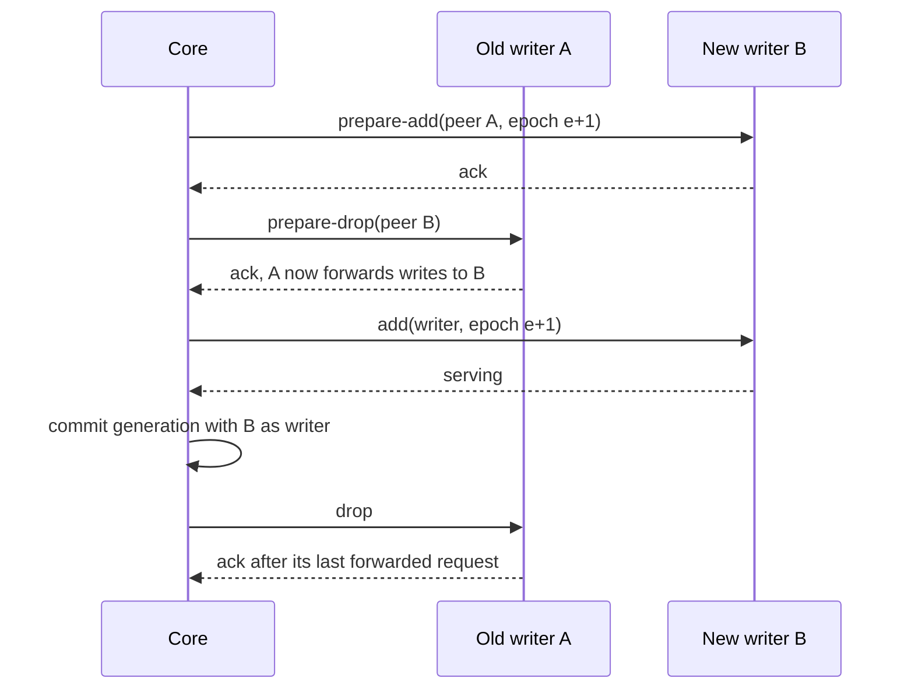

# RFC-0006: Ownership modes, handoff protocols and fencing

## Summary

A namespace selects one of four ownership modes: `affinity`, `exclusive`, `overlapping` and `delegated`. The support matrix contains `exclusive` with a transactional fence. Every write of a shard's data goes through a fence that the application implements over its own storage and checks in the same transaction as the write, under core's fence laws. Its guarantee, writer safety, is that a transaction of an older tenure fails once a newer tenure has acquired the shard's fence. A node's lease sets how soon a stale writer stops trying and how soon a failed writer is replaced, and has no effect on whether a stale write commits.

The handoff protocols `break-before-make`, `make-before-break`, `graceful` and `staged` move a replica between nodes, and `elect` asks a delegated namespace's authority to move the writer role. The support matrix contains `break-before-make`, whose writer gap is explicit and has a duration target under stated conditions. Each protocol is a script of callbacks with a defined abort path for every step. An abort path that cannot make a fallback the writer ends with no assigned writer, and the core places the shard again at fresh epochs. The core commits a transition's full record, with every epoch it may use, before the first callback, and every callback has an idempotency key and a digest of its payload. Every transition follows one lifecycle, declared as a state machine in core's `fsm` package.

The fence key is the namespace incarnation and the shard ID. A namespace that is created again over existing data therefore needs a fresh application-data namespace, or an administrative barrier that stops every writer of the old incarnation. The `delegated` mode, in which the application's own authority elects each writer and grants its epoch, is outside the support matrix.

## Motivation

Exclusive ownership fails in ways that a controller cannot see:

- A writer pauses for a garbage collection longer than its lease, resumes, and writes without knowing that another node took over. Kleppmann describes this case and concludes that the storage must "take an active role in checking tokens, and rejecting any writes on which the token has gone backwards". A check of the lease just before the write does not help, because the pause can fall between the check and the write.
- Helix's controller never plans two masters, but its issue 691 reports a participant cut off from ZooKeeper that "continues to think it is MASTER" while "The controller makes another node MASTER".
- etcd's documentation states that "the lock APIs cannot be used as mutual exclusion mechanism by themselves", and client-go's leader election "does not guarantee that only one client is acting as a leader". Both leave fencing to the resource.
- Temporal does fence. Acquiring a history shard increments a range ID, every write of the shard is conditioned on that range ID, and a mismatch shuts the shard down.

Handoff has its own failure: SM measured that moving primaries without its graceful protocol drops the request success rate of an application under a rolling upgrade from about 100% to about 98%, and to below 90% without coordination of container restarts as well. SM's paper lists the five steps of its graceful protocol but not what happens when one of them fails.

A controller that treats a callback's timeout as a failure can undo a move on a node that has already applied it, because a callback can take effect and lose its reply. The protocols have to be correct when the controller does not know whether a step happened.

Not every application wants exclusivity. A cache needs affinity without the cost of fencing, and SM's post notes that applications choose between availability and consistency when the network partitions. The library makes the mode a choice. It makes the exclusive modes correct under pauses, partitions and controller failure.

Consensus applications elect their own writers, as the thesmos ledger's voters elect each shard's leader and grant its epoch. The ledger replaces a crashed leader in about 3 seconds, where a store lease with the default TTL takes about 10. A core that also elected a writer for the same shard would create two authorities over one role. When their choices differ, the core's writer forwards every write to the application's writer, and the core fences with an epoch that the application never granted.

Core already states the rules a fence must apply, and every thesmos library that fences writes applies the same ones. A sharder fence with rules of its own would admit a write that another library's fence rejects over the same storage.

## Detailed design

### Ownership modes

| Mode | Writers per shard | Replicas during a move | Fencing tokens | Allowed handoffs | In the support matrix |
|---|---|---|---|---|---|
| `affinity` | Not tracked | Old and new overlap | None | All four | No |
| `exclusive` | At most one tenure per epoch | Never two writers that both commit | Issued to the writer | `break-before-make`, `graceful`, `staged` | With `fenced: true` and `break-before-make` |
| `overlapping` | At most one tenure per epoch | The old owner may serve reads while the new owner loads | Issued to the writer | `staged` | No |
| `delegated` | At most one tenure per epoch | The application's authority moves the writer role | Issued to the writer at the authority's epoch | `elect` | No |

```go
// Package ownership declares what a replica may assume about exclusive ownership.
package ownership

import "time"

// Mode is the ownership guarantee of a namespace.
type Mode string

const (
 // Affinity routes each key to its assigned replicas and lets replicas overlap during
 // moves. It does not provide exclusivity or issue fencing tokens.
 Affinity Mode = "affinity"
 // Exclusive gives each shard at most one writer tenure per epoch. With a fence, the
 // writes of a superseded tenure fail at the fence. Without one, exclusivity rests on
 // lease timing alone and is best effort.
 Exclusive Mode = "exclusive"
 // Overlapping gives each shard at most one writer tenure per epoch, and lets the old
 // owner keep serving reads while the new owner loads state during a move.
 Overlapping Mode = "overlapping"
 // Delegated gives each shard at most one writer tenure per epoch. The application's
 // authority elects every writer and grants its epoch, and the core follows the
 // writers that agents report.
 Delegated Mode = "delegated"
)

// OnLeaseLoss is what a node's writers do when the node cannot renew its lease.
type OnLeaseLoss string

const (
 // Stop stops every writer replica on the node when its lease deadline passes.
 Stop OnLeaseLoss = "stop"
 // ContinueFenced keeps writers running after the deadline. It is safe only when every
 // write of the application goes through a fence, because the fence is then the only
 // protection against a new writer.
 ContinueFenced OnLeaseLoss = "continue-fenced"
)

// Lease bounds how long a node's writers may act without renewing.
type Lease struct {
 // TTL is the lease duration at the store. The default is 10s.
 TTL time.Duration
 // Renew is the renewal interval. The default is TTL/3.
 Renew time.Duration
 // MaxDriftRate bounds the rate difference between the node's clock and the store's
 // clock, as a fraction. The default is 0.01.
 MaxDriftRate float64
 // LockDelay is how long the core waits after the store expires a lease before it
 // gives the writer role to another node. It lowers the chance that a resource
 // without a fence sees two writers, and it delays failover by the same time. It is
 // not a safety bound. The default is zero when the spec declares every write
 // fenced, and TTL otherwise.
 LockDelay time.Duration
 // OnLoss selects what writers do at the deadline. The default is ContinueFenced
 // when the spec declares every write fenced, and Stop otherwise.
 OnLoss OnLeaseLoss
}

// Validity returns how long a node may act as a writer after the send time of a
// renewal that the store accepts: TTL*(1-MaxDriftRate). When the store accepts a
// renewal, the node moves its deadline to that renewal's send time plus Validity, if
// that is later than the current deadline. A renewal that fails, or whose reply does
// not arrive, leaves the deadline unchanged.
func (l Lease) Validity() time.Duration

// Config configures the exclusive, overlapping and delegated modes.
type Config struct {
 Lease Lease
 // Fenced declares that every write of the application's shard data goes through a
 // fence. The configuration then provides the capability "fenced", which the support
 // matrix requires, and selects ContinueFenced as the default of Lease.OnLoss and
 // zero as the default of Lease.LockDelay.
 Fenced bool
}
```

The node measures its deadline from the moment it sent an accepted renewal, not the moment it received the response, and shortens it by the drift bound. A renewal that fails or has no reply does not move the deadline, and a reply that arrives after the deadline has passed does not revive the lease. Its deadline passes before the store expires the lease, for any clock error within `MaxDriftRate`. The core gives the writer role away only after the store's expiry plus `LockDelay`.

The deadline is a timer from core's `clock.Clock`, not a comparison of two time readings. Core's production clock returns wall time from its hybrid logical clock, and that wall time stops advancing while the system clock is stepped back. A deadline measured between two such readings would outlast the lease by the size of the step. A timer from `hlc.Clock.NewTimer` is a standard library timer, which runs on the monotonic clock, and under the simulator's `clock/fake` it fires when virtual time passes it.

`OnLoss` is the choice between availability and consistency. With `Stop`, a node that loses the store stops writing within one TTL, even when nobody else has taken over, so a store outage longer than the TTL stops every writer. With `ContinueFenced`, writers keep writing through an outage, and the fence rejects them once a new writer acquires the shard. A spec declares every write fenced with `fenced` in its ownership configuration. `ContinueFenced` is then the default, because the fence rejects every write of a replaced writer, and a store outage does not stop the writers that nobody replaced.

### Writer safety

Writer safety is the property of fenced exclusive ownership: once a tenure has acquired a shard's fence, no transaction of an older tenure commits a fenced write. It rests on three requirements of the application:

- Every write of the shard's data runs in a transaction that checks the fence, through a `fence.Writer` bound to the tenure's token.
- A new writer acquires the fence before its first read of the shard's data. The agent makes the acquisition through its fence guard before it calls `AddShard`.
- The fence's check and the write commit together, in one transaction of the application's storage.

A fourth requirement makes the new writer's state current. Writer safety does not depend on it. The new writer reads the shard's data only from a state that contains its acquisition and every fenced write before it:

- a new transaction on the authoritative data source, at a consistency level at which a transaction sees every committed write
- or a replica that is proven to have applied the acquisition and every fenced write before it, such as a standby whose replayed log position has passed the acquisition's commit

A transaction that starts after `Acquire` returns is not enough on a replica that lags. A read from a lagging replica, from a snapshot taken before the acquisition, or from a shared cache can miss writes of the old tenure, and a write that the new writer derives from that read overwrites them through a valid fence.

The property is about commits, not about processes. Two processes can both act as the writer for a while. An old writer that is paused, or cut off from the store, keeps running until its lease deadline, or longer under `ContinueFenced`. From the moment the new tenure acquires, the old writer's writes fail at the fence.

The lease and `LockDelay` decide how soon a stale writer stops trying, and how soon the core replaces a failed writer. They affect availability and the cleanup of state, not safety. A write that a paused writer sent before its deadline can arrive at a resource after any finite delay, so no lease and no `LockDelay` make a resource without a fence safe. Chubby's authors call their lock-delay "imperfect" for the same reason: it protects servers that do not check sequencers from everyday message delays and restarts. `exclusive` without a fence is therefore best effort. It is outside the support matrix, and `sharderctl status` reports such a namespace as best effort.

The agent enforces what it can. `replica.Start` refuses an `exclusive` namespace without a fence guard. The application remains responsible for routing every write through the fence, and a write outside the fence has no guarantee.

### Epochs

Outside the `delegated` mode, the core assigns every epoch by these rules:

- A shard's first writer gets epoch 1.
- Before a transition's first callback, the core reserves the epochs that the transition may use: the new writer's epoch, one above the highest epoch the shard has reserved before, and the abort path's epoch, one above that. It records both in the transition, and raises the placement's `Reserved` to the higher one, in one commit.
- A change of writer gives the new writer the transition's new epoch. An abort that returns the writer role to a fallback node gives it the abort epoch, because the new node may already have written under its epoch. An abort without a fallback does not grant an epoch.
- An epoch that an abort path reserved and never used is never granted, because every later reservation starts above `Reserved`.
- In the leaderless topology, outside the support matrix, the epoch is the term that the store's election for the shard granted, which increases but not necessarily by one.
- A shard created by a split or merge, outside the support matrix, starts at one more than the highest epoch among its parents.

The core grants each epoch to one writer, because it reserves every epoch in the shard's placement with a compare-and-set on the cell's generation before any callback names the epoch. Core's admit-equal law is sound only under that condition: two holders of one epoch would both pass a fence.

A cell's controller receives its epoch from the root by the same rules, because the root treats the cell as a shard and the controller as its writer.

A node receives four values with every callback that it checks before anything else: the namespace incarnation, its own node incarnation, the shard's epoch and the epoch of the cell's controller. It refuses a callback for another namespace incarnation or for another incarnation of itself. It keeps the highest shard epoch it has seen per shard and the highest controller epoch per cell, and it refuses a callback with a lower one. Each refusal classifies as `errs.Conflict`, because the state that the caller acted on has moved. The controller also returns its epoch in each reply to a node's reports, so a node refuses a replaced controller's callbacks as soon as it has heard from the replacement.

### Handoff protocols

A protocol turns a move into a script. The script is an ordered list of callbacks, each with a wait condition for the next step, and an abort path for each step.

```go
// Package handoff turns a replica move into an ordered script of callbacks, with an
// abort path for every step, and declares the lifecycle of a transition.
package handoff

import (
 "strconv"
 "time"

 "go.thesmos.sh/core/epoch"
 "go.thesmos.sh/core/fsm"
 "go.thesmos.sh/sharder/ownership"
 "go.thesmos.sh/sharder/protocol"
 "go.thesmos.sh/sharder/shard"
)

// Wait is the condition that the core waits for before it starts the next step.
type Wait string

const (
 // Ack waits for the node to acknowledge the callback.
 Ack Wait = "ack"
 // Serving waits for the node to report the replica serving in the step's role.
 Serving Wait = "serving"
 // LeaseLapse waits for the node's lease to expire plus the lock delay. The core uses
 // it in place of Ack when the node does not respond.
 LeaseLapse Wait = "lease-lapse"
 // Published waits for the core to commit the step's generation to the store.
 Published Wait = "published"
)

// Step is one callback on one node, or a commit of the assignment when Node is empty.
type Step struct {
 Node    shard.NodeID
 Call    protocol.Call
 Role    shard.Role
 Epoch   epoch.Epoch
 Peer    shard.NodeID // the other node of a prepare call
 Wait    Wait
 Timeout time.Duration
}

// Script is the steps of one move and, per step, the steps that undo the move when
// that step fails after every earlier step completed.
type Script struct {
 Steps []Step
 Abort [][]Step
}

// Transfer is one replica move, as the core passes it to a protocol.
type Transfer struct {
 Shard shard.ID
 From  shard.NodeID // empty when the move only adds a replica
 // To is empty when the move only removes a replica, or when a delegated
 // namespace's authority chooses the next writer.
 To       shard.NodeID
 FromRole shard.Role
 ToRole   shard.Role
 Writer   bool        // true when ToRole or FromRole is the model's writer role
 OldEpoch epoch.Epoch // the shard's epoch before the move
 // NewEpoch and AbortEpoch are the epochs that the core reserved for the move: the new
 // writer's, and the one that the abort path gives Fallback. A script names no other
 // epoch above OldEpoch.
 NewEpoch   epoch.Epoch
 AbortEpoch epoch.Epoch
 // Fallback is the node that the abort path makes the writer: From, unless From is
 // draining or has a fault, in which case the planner chooses another node. It is
 // empty when no node qualifies, such as for a move that only adds a replica, and the
 // abort path then leaves the shard without an assigned writer.
 Fallback shard.NodeID
}

// Protocol scripts transfers. Implementations are deterministic and must not perform I/O.
type Protocol interface {
 // Version identifies the scripts that the protocol returns. It increases whenever
 // Script returns another script for any transfer. A transition records it, and a
 // controller resumes the transition only with a protocol of the same name and
 // version.
 Version() uint32
 Script(t Transfer, mode ownership.Mode, lease ownership.Lease) (Script, error)
}

// Phase is the lifecycle state of one transition, as the store records it.
type Phase uint8

const (
 // Running runs the script's steps.
 Running Phase = iota
 // Aborting runs the abort path of the step that failed.
 Aborting
 // Done is reached when every step completed.
 Done
 // Aborted is the final phase of a transition whose abort path completed or was
 // abandoned.
 Aborted
)

// String returns the phase's name.
func (p Phase) String() string {
 switch p {
 case Running:
  return "running"
 case Aborting:
  return "aborting"
 case Done:
  return "done"
 case Aborted:
  return "aborted"
 }
 return "phase " + strconv.Itoa(int(p))
}

// Event is the outcome of a transition's current step.
type Event uint8

const (
 // Advance reports that a step other than the last one completed.
 Advance Event = iota
 // Finish reports that the last step of the current path completed.
 Finish
 // Fail reports that the current step failed after its retries.
 Fail
 // Abandon reports that a step of the abort path failed definitively: the node
 // incarnation that it addresses has ended, or the node's handler returned an error
 // that is not transient.
 Abandon
)

// String returns the event's name.
func (e Event) String() string {
 switch e {
 case Advance:
  return "advance"
 case Finish:
  return "finish"
 case Fail:
  return "fail"
 case Abandon:
  return "abandon"
 }
 return "event " + strconv.Itoa(int(e))
}

// Lifecycle is the transition table that every transition follows. The abort path
// retries a step that fails transiently. In a namespace with fenced ownership, a step
// that fails definitively abandons the path, and the transition ends without an
// assigned writer. The engine checks Lifecycle.Allows before it commits a phase change
// to the store.
var Lifecycle, errLifecycle = fsm.NewBuilder[Phase, Event, struct{}](Running).
 Edge(Running, Advance, Running).
 Edge(Running, Finish, Done).
 Edge(Running, Fail, Aborting).
 Edge(Aborting, Advance, Aborting).
 Edge(Aborting, Finish, Aborted).
 Edge(Aborting, Fail, Aborting).
 Edge(Aborting, Abandon, Aborted).
 Terminal(Done, Aborted).
 Build()
```

Before the core commits a transition, it checks that every step of the script names the transfer's `From`, `To` or `Fallback`, or no node for a commit, and that every epoch is `OldEpoch`, `NewEpoch`, `AbortEpoch` or zero. A protocol therefore cannot hand out an epoch that the core did not reserve.

The following tables give each built-in protocol for a writer move from node A to node B at epoch e. Steps without a node commit the assignment. e+1 and e+2 denote the transfer's `NewEpoch` and `AbortEpoch`, and F denotes its `Fallback`.

#### break-before-make

| Step | Node | Call | Waits for | Abort |
|---|---|---|---|---|
| 1 | A | `drop`, or `change-role` to a non-writer role, at e | Ack, or lease lapse if A does not respond | none needed |
| 2 | | Commit B as writer at e+1 | Published | none needed |
| 3 | B | `add` as writer at e+1 | Serving | 1. Commit F as writer at e+2. 2. `add` on F as writer at e+2. 3. `drop` on B |

A move that only adds a replica, such as a shard's first placement, has no step 1. When `Fallback` is empty, which it is for every such move, the abort path of step 3 is one commit: the shard without an assigned writer, together with the end of the transition. The transition engine describes that commit, and the abandonment of an abort path whose `add` on F fails definitively. The `drop` on B of the abort path waits, as step 1 does, for B's acknowledgement or for the lapse of the lease of the session that it addresses.

The shard has no writer from step 1 until step 3 completes: the writer gap. SM's basic move protocol has this order, and its post states that it provides "an at-most-one-primary guarantee". The gap is explicit in the spec: every namespace in the support matrix selects planned interruption, and the budget counts the shard's replica as unavailable for the gap.

The gap has a duration target of 2 seconds at p99, under three conditions:

- Both nodes are live.
- Their handlers return `drop` and `add` within 500 ms at p99.
- The store commits within 100 ms at p99.

Under those conditions the gap consists of the drop, one commit, the add with its fence acquisition, and two network round trips. The add starts only once B's watch has delivered the commit, so a watch that lags extends the gap. The metric `sharder.writer.gap` measures every gap.

The target assumes working components, and nothing bounds the gap without them:

- A store outage after step 1 keeps the shard without a writer until the store returns, because step 2 cannot commit.
- A node that does not respond to `drop` extends step 1 by its lease: TTL plus `LockDelay`.
- A handler that never returns keeps the shard without a writer until the abort path's `add` succeeds on the fallback, and that `add` can hang as well.

A step's timeout bounds how long the core waits before it retries the step or starts the abort path. It does not bound how long the shard is without a writer.

The abort path of step 3 does not wait for B. B's `add` may have taken effect with its reply lost, so B may serve and write at e+1. The abort path is safe because the fence decides which writes commit, and it rests on four requirements:

1. The core reserves e+2 and commits it in the transition's record before step 1, so the abort epoch is durable before any callback of the transition.
2. F's `add` at e+2 acquires the fence before F reads the shard's data. From that acquisition on, every write of B's tenure at e+1 fails at the fence.
3. F discards every state it derived from an earlier tenure of the shard, such as a cache that A built at e, and reads the shard's data again from a state that contains its acquisition, because B may have committed writes at e+1.
4. A late callback cannot restore a superseded state. The agent refuses a forward callback of an operation once it has seen that operation's abort path, a callback of an operation once it has seen the operation end, and a callback of an older operation once it has seen a newer one. It learns of each from callbacks and from its watch. A `drop` that B receives before its delayed `add` therefore remains in effect, and the `add` is refused. The agent also starts a tenure only while the placements that it watches list the tenure, so an `add` of a tenure that a later commit removed never starts, even when its watch skipped that commit.

#### make-before-break

`make-before-break` is outside the support matrix.

| Step | Node | Call | Waits for | Abort |
|---|---|---|---|---|
| 1 | B | `add` in the target role | Serving | `drop` on B |
| 2 | | Commit B in and A out of the replica set | Published | Commit A back |
| 3 | A | `drop` | Ack, or lease lapse | none needed |

Both replicas serve between steps 1 and 3. Validation rejects this protocol for writer moves in the exclusive modes.

#### graceful

`graceful` is outside the support matrix.

| Step | Node | Call | Waits for | Abort |
|---|---|---|---|---|
| 1 | B | `prepare-add`, peer A, at e+1 | Ack | `cancel-prepare` on B |
| 2 | A | `prepare-drop`, peer B | Ack | `cancel-prepare` on A at e+2, then on B |
| 3 | B | `add` as writer at e+1 | Serving | `cancel-prepare` on A at e+2, then `drop` on B |
| 4 | | Commit B as writer at e+1 | Published | retry |
| 5 | A | `drop` | Ack, or lease lapse | none needed |

After step 2, A forwards every write to B, and B accepts writes that A forwards. After step 3, B also accepts writes from clients directly. After step 4, clients route to B, and A keeps forwarding until no more requests arrive or its drain timeout passes. Steps 1 to 5 are SM's graceful migration. The `cancel-prepare` call and the abort column are additions, because SM's paper gives only the sequence that succeeds.

A forwards writes over the application's own protocol, to the node that `prepare-drop` names as its peer. The library has no forwarding helper, because it does not know the application's requests.

`graceful` needs an explicit acquisition barrier before the support matrix can include it: when B acquires the fence, when A stops writing directly, and when B first reads. Its abort paths also need the four requirements of `break-before-make`'s abort path, because A's `cancel-prepare` at e+2 can run while B writes at e+1.



#### staged

`staged` is outside the support matrix.

| Step | Node | Call | Waits for | Abort |
|---|---|---|---|---|
| 1 | A | `unload-state`: stop writing, save state, keep serving reads | Ack | `add` on A as writer at e+2 |
| 2 | B | `load-state` at e+1 | Ack | `drop` on B, then `add` on A as writer at e+2 |
| 3 | B | `add` as writer at e+1 | Serving | as step 2 |
| 4 | | Commit B as writer at e+1 | Published | retry |
| 5 | A | `drop` | Ack, or lease lapse | none needed |

Writes pause from step 1 until step 3 completes, and A serves reads. This is the transfer that Splitter supports with its loaded and unloaded grant states.

#### elect

`elect` is outside the support matrix, together with the `delegated` mode, which is the only mode that allows it. It asks the application's authority for a change of writer, then commits the writer that agents report. It moves only the writer role, because the core does not add or remove replicas in that mode, and it returns an error for any other transfer.

A move of the writer role to a node B that the core chose:

| Step | Node | Call | Waits for | Abort |
|---|---|---|---|---|
| 1 | B | `elect` at e | B reports the writer role at an epoch above e | none. The authority keeps or moves the writer |
| 2 | | Commit the reported writer at its epoch | Published | retry |

For a node A that is draining, closing or faulted, the core leaves `Transfer.To` empty, and the authority chooses the next writer:

| Step | Node | Call | Waits for | Abort |
|---|---|---|---|---|
| 1 | A | `abdicate` at e | Another node reports the writer role at an epoch above e | none. The authority keeps or moves the writer |
| 2 | | Commit the reported writer at its epoch | Published | retry |

When step 1 exhausts its retries, the core abandons the move and keeps the writer that agents report. A disruption that waits for the move remains deferred, and the budget reports the shard as the reason.

### The transition engine

The core runs each script through one engine, whatever the protocol:

1. Before step 1, the core commits the transition's record to the cell's scope, in phase `Running`, together with the placement's new `Reserved` and `Sequence`. The record has everything a new controller needs to resume the move without planning it again: the operation ID, the protocol's name and version, the spec version the move was planned under, both endpoints with their node incarnations and roles, the old epoch and both reserved epochs, and the fallback. `store.Transition` is its schema.
2. The core runs a step, waits for its condition, and commits the next step number, or the next phase that `Lifecycle` allows.
3. A step that times out, or whose callback fails with an error that classifies as `errs.Transient`, is retried through a `resilience.Retrier` from core, with the same idempotency key, because a callback without a reply may have taken effect. By default the Retrier makes at most five attempts, backs off with full jitter from 100 ms up to 10 s, and allows retries for at most 10% of the cell's callbacks over one minute, with a floor of 10. The Retrier stops at once on every other class, as core requires for an error that a retry cannot fix. A node's refusal of a callback for a lower epoch or another incarnation classifies as `errs.Conflict`, so it fails the step at once, for every call. When a step of the forward path fails, the core commits phase `Aborting` and the failed step's number, and runs the abort path through the same loop.
4. A new controller of the cell acquires the cell's scope first, then reads every transition in flight and continues each at its committed phase and step, with the recorded endpoints, epochs and protocol version. It never plans an endpoint of a transition in flight again. Every new protocol version raises the store's schema, so a controller whose release lacks a recorded protocol version refuses to acquire the scope before it commits anything, with an error of class `errs.Unsupported`.
5. The commit that ends a transition removes its record and keeps the placement's `Reserved` and `Sequence`, so the next transition of the shard starts above them.

A callback targets the node incarnation that the record names, also after the node has restarted. The restarted node refuses it, and the core places the restarted node's replicas again with new operations. A step completes, fails transiently or fails definitively:

- A step completes when its wait condition is met. In a namespace with fenced ownership, a `drop` also completes when a later incarnation of its node refuses it: the incarnation that it addresses has ended, and a new incarnation restores no writer.
- A step that fails transiently is retried with the same key.
- A step that fails definitively ends its path. A failure is definite when the node incarnation that the step addresses has ended, because a later incarnation refused the callback or the lease of the addressed session lapsed. It is also definite when the node's handler returned an error that is not transient, which the agent keeps for the key. A definite failure of the forward path starts the abort path, and a definite failure of the abort path abandons it.

Only a namespace with fenced ownership abandons an abort path. Without a fence, the next placement could start a writer while an earlier one still writes, so the engine retries the step instead.

An abandoned abort path, and an abort path without a fallback, end the transition with no assigned writer. The engine commits, in one commit, the shard's placement without an assigned writer, the end of the transition, and the placement's `Reserved` and `Sequence`, unchanged. The next planning pass places the shard with a new operation, whose epochs lie above every epoch that the ended transition reserved. The core never grants an epoch of the ended transition to another incarnation, because the incarnation whose callback failed may have acquired it.

No assigned writer does not mean that no process writes. Removing a replica from the assignment does not revoke a token that a process has acquired. Under `ContinueFenced`, a tenure that B or F acquired writes until a newer tenure acquires the shard's fence, and the next placement's acquisition is that newer tenure.

A late callback or report cannot bring an ended assignment back:

- The assignment changes only by commits of the core, and the engine ignores every reply of an operation that has ended.
- Outside the `delegated` mode, a report never adds a replica to the assignment. A replica that a report lists and the assignment does not name counts in no role.
- An agent refuses a callback of an operation that it has seen end, in a callback or on its watch, and starts a tenure only while the placements that it watches list the tenure. It cleans up a tenure that its watched state stops listing, after an event or a replacement snapshot, only while that exact tenure, which its epoch identifies, is still active. Neither a delayed removal nor an older snapshot can therefore stop a newer tenure.

The retry budget protects a node that fails every callback: without it, each of hundreds of transitions to that node would retry five times at once. The engine also bounds the work in flight with three settings of the spec's budget:

- It starts a transition only while the cell has fewer than `maxTransitions` transitions in flight, and fewer than `maxNodeTransitions` count against each node that the transition involves. A transition counts against its destination and its fallback, and against its source while the source's session is live. The settings bound the transitions in flight and their callbacks. They do not bound the shards without a serving writer, because a shard whose transition ended without an assigned writer, the shards of a failed node and an unplaced shard have no transition.
- Callbacks to one node pass through a `resilience.Bulkhead` from core. Its `Limit` is the budget's `nodeCallbacks`, and its `Queue` is `maxNodeTransitions` minus `nodeCallbacks` when the difference is positive. A transition has at most one callback outstanding, so at most `maxNodeTransitions` callbacks to one node are outstanding. The queue has room for each callback beyond `Limit`, and `Acquire` does not return `ErrFull`. The bulkhead bounds the controller's outstanding calls. A handler that ignores its context's cancellation can still run on the node after the controller's call has timed out.
- By default `nodeCallbacks` equals `maxNodeTransitions`. Each callback then gets a permit at once, including the `add` of a transition that has dropped its writer.

Repair and improvement moves share these bounds. The planner's churn limits apply only to improvement, so a drain runs as fast as the bounds allow.

The engine commits the step changes of every transition of the cell that is ready in the same tick in one store commit, up to the store's commit bound. A rebalance of hundreds of moves therefore costs a few commits per step, not one per transition.

### The callback contract

A retry, a new controller or a delayed message can deliver a callback again, so callbacks are delivered at least once, and a callback whose reply is lost may have taken effect.

`protocol.Request.Key` returns a callback's idempotency key. The key contains the operation ID, the path, the step within that path, the target node with its incarnation, and the epoch of the tenure that the callback acts on. The operation ID identifies the namespace incarnation, the shard and the transition's sequence, and the path is forward, abort, or the agent's own cleanup of a removed tenure. Two callbacks cannot share a key. A transition fails at most once, so it has one abort path at most, and the core does not reuse a sequence. A callback also contains a digest of its payload, and an agent refuses a key that it has seen with another digest. The payload excludes the sender's controller epoch, so a new controller that resends a callback under its own epoch sends the same digest, and receives the result that the agent kept.

The agent and the handler divide the work:

- The agent refuses a callback for another namespace incarnation or another node incarnation, a callback with a lower shard or controller epoch, a forward callback of an operation whose abort path it has seen, a callback of an operation that it has seen end, and a callback of an operation older than the newest it has seen for the shard. It refuses each before it looks up the key or calls the handler.
- The agent starts a tenure only while the placements that it watches list the tenure at the callback's epoch, and the core commits that placement before it sends the callback. The agent waits for its watch until then, and returns an error of class `errs.Transient` when the call's context ends first.
- The agent runs one callback at a time per shard. A callback that arrives while another callback with the same key runs waits for that callback's result and returns it.
- The agent keeps the result of every callback that ended in success, or in an error that is not transient, until the shard's next operation starts. A repeated key returns the kept result without calling the handler. The agent keeps no transient error, so a retry runs the handler again.
- The agent keeps its results in memory. A restarted node has a new incarnation, which refuses the callbacks of the old one, so no result has to survive a restart.
- A handler whose callback has an effect that must not happen twice, such as a write to an external system, records the callback's key in the same transaction as the effect, and returns the recorded result for a key that it finds. Only the application's storage can commit a key and an effect together, so the library does not make an arbitrary effect happen once.

The examples include a handler that records its keys in the transactions of its storage, and its test replays every callback of a move.

### Tokens

`Agent.Token` returns the fencing token of a shard that the node writes. Its result follows the node's state:

| Situation | `Token` returns |
|---|---|
| The node is not the shard's writer | `replica.ErrNotWriter` |
| The node is the writer, and its lease is valid | The tenure's token |
| The lease deadline has passed, under `Stop` | `epoch.ErrFenced`. The node starts no new writer work |
| The lease deadline has passed, under `ContinueFenced` | The tenure's token. The fence rejects its writes once a newer tenure acquires |
| The agent has learned of a newer tenure, or of the removal of its active tenure: from a callback, from its watch of its placements, or from an acquisition that returned `epoch.ErrFenced` | `epoch.ErrFenced`. The agent stops the writer and discards the tenure's state |
| A `delegated` namespace, outside the support matrix | The token of the node's latest election, until the application reports the node deposed |

A token that a process copied before its tenure ended remains in that process, and stopping the agent cannot recall it. The fence, not `Token`, decides whether a write commits.

### Fencing

Fenced storage applies core's fence laws to every write of a shard:

- A write whose epoch is at or above the shard's watermark is admitted, and a greater epoch advances the watermark.
- A write at `epoch.Zero` is unfenced: it is admitted and leaves the watermark unchanged.
- The check runs in the same transaction as the write, against the watermark in the application's storage, which survives a restart.

A rejected write returns `epoch.ErrFenced`, which classifies as `errs.Conflict`. Its remedy is to abdicate, not to retry: the writer stops, releases state derived from the revoked tenure, and waits for a new assignment. `errors.Is` separates it from `version.ErrMismatch`, whose remedy is to read again.

A writer binds its token when it is created, and every check it performs validates that token's epoch. No write takes an epoch as a parameter, so no write path escapes validation.

A fence keeps one watermark per fence key: the namespace incarnation and the shard ID. The cell is not part of the key, so a shard keeps its fence record when it changes cells.

```go
// Package fence defines fencing tokens and the interfaces of fenced storage. Every
// implementation applies core's fence laws.
package fence

import (
 "context"
 "math"

 "go.thesmos.sh/core/epoch"
 "go.thesmos.sh/sharder/shard"
)

// Retired is the watermark of a shard that a split or merge replaced. It is above
// every epoch that the core issues, so fenced storage rejects every writer of a
// retired shard with epoch.ErrFenced.
const Retired = epoch.Epoch(math.MaxInt64)

// Token authorises writes to one shard at one epoch. Its fence key is the pair of
// Incarnation and Shard. Namespace and Cell identify the shard to an operator, and
// neither is part of the key.
type Token struct {
 Namespace   shard.Namespace
 Incarnation shard.NamespaceIncarnation
 Cell        shard.CellID
 Shard       shard.ID
 Epoch       epoch.Epoch
 // Supersedes lists the parent shards that this shard's first acquisition retires,
 // after a split or merge. It is empty in the support matrix, which has no
 // resharding.
 Supersedes []shard.ID
}

// Acquirer starts a writer's tenure.
type Acquirer interface {
 // Acquire advances the watermark of t's fence key to t.Epoch and raises the
 // watermark of every shard in t.Supersedes to Retired, in one transaction. A writer
 // calls it once per tenure, before it reads shard data. It returns epoch.ErrFenced
 // when the watermark of t's fence key is above t.Epoch.
 Acquire(ctx context.Context, t Token) error
}

// Guard is the fence of one storage system. Tx is its transaction type, such as
// *sql.Tx.
type Guard[Tx any] interface {
 Acquirer
 // Writer returns a writer bound to t. It performs no I/O.
 Writer(t Token) Writer[Tx]
}

// Writer checks the writes of one tenure against the fence.
type Writer[Tx any] interface {
 // Token returns the token that the writer is bound to.
 Token() Token
 // Check applies the fence laws to the writer's epoch inside tx. It locks the fence
 // record against a new acquisition until tx ends, and advances the watermark in tx
 // when the writer's epoch is above it. It returns epoch.ErrFenced when the
 // watermark is above the writer's epoch. A writer calls it in every transaction
 // that writes shard data.
 Check(ctx context.Context, tx Tx) error
}
```

`Acquire` is the tenure's first fenced write, and the writer makes it before it reads. Suppose the writer read first. The old writer, still running, could write between the new writer's read and its acquisition, and the new writer would then act on a state it never saw. Hochstein's 2025 model check found this case in fencing tokens used alone. Core pairs its fence with conditional writes: a write conditioned on the version that the new writer read fails with `version.ErrMismatch` when another writer changed the value since. Temporal conditions each write on a record version as well as its range ID. Acquiring first gives the same protection to applications whose writes are not conditional: every later write of the old writer fails, so a read from a state that contains the acquisition includes every write that the old writer could complete. A read from a lagging replica or from an older snapshot does not, so the new writer reads only from a state that contains its acquisition.

A split or merge, outside the support matrix, retires its parents in the acquisition of each new shard. `Retired` is `math.MaxInt64`, and the core issues epochs one at a time from 1, so no writer ever has an epoch at or above it. The admit-equal law then rejects every writer of a retired shard, and the fence needs no separate retired flag.

The application implements `Guard` over its own storage, because the fence has to run in the same transaction as the application's writes. Every implementation meets these requirements:

- It keeps one watermark per fence key.
- `Acquire` advances the watermark of the token's fence key and raises every parent's watermark to `Retired` in one transaction.
- `Check` reads the watermark under a lock that makes a concurrent `Acquire` wait until the write's transaction ends, and advances the watermark in that transaction when the writer's epoch is above it.
- An absent record is a watermark of zero.

In a SQL database, the fence is one row per fence key. `Acquire` is an upsert conditioned on the stored epoch, and `Check` reads the row with a shared row lock, such as PostgreSQL's `SELECT ... FOR SHARE`. A new writer's `Acquire` then waits for every write transaction of the old writer that has already checked the fence, and every later `Check` of the old writer sees the new epoch and fails.

Every implementation passes core's `coretest/epochtest.AssertFencedWriter`, with two named writes: the acquisition, and a transaction that checks the fence and writes one row. The suite asserts that a write through a superseded writer returns `epoch.ErrFenced`, classifies as `errs.Conflict` and leaves the fence record unchanged. It also asserts that a write at the current epoch is admitted, that a writer at `epoch.Zero` neither validates nor advances, and that a fresh writer at a new epoch succeeds where the superseded one fails.

### Recreating a namespace over existing data

A new namespace incarnation starts every fence key at a watermark of zero, because its fence keys differ from the old incarnation's. The old incarnation's fence records remain valid for its own tokens. A writer of the old incarnation that is still running, paused or cut off, still passes its own fence, and its writes commit. A new incarnation is therefore not by itself a safe recovery for data that the old incarnation wrote.

Recovery over existing application data needs one of these:

- **A fresh application-data namespace.** The new incarnation writes to new tables, prefixes or databases, which no writer of the old incarnation uses.
- **An administrative barrier.** Before the new incarnation starts, an operator makes every writer of the old incarnation unable to write. For example, the operator raises every fence record of the old incarnation to `fence.Retired` in one transaction of the application's storage, or revokes the old incarnation's credentials for that storage.

The library provides neither mechanism, because both act on the application's storage. Recovery over the old data without one of them is not supported.

The same applies when a namespace's store is restored from a backup, which the support matrix does not support. A restored store can issue epochs again that the application's fences have already passed. Raising the epochs above the watermarks that the fences report does not repair it either, because the store's other restored state, such as its transitions and reservations, remains older than the application's.

### Delegated ownership

Delegated ownership is outside the support matrix. The thesmos ledger's integration depends on it. This section records the design.

In the `delegated` mode, the application's authority elects every writer and grants its epoch, and the core follows the writers that agents report. The authority is the application's own election, such as the leader election of a consensus protocol. It must grant each epoch to one writer, the condition under which core's admit-equal law is sound. In the ledger, each voter records one holder per epoch, and the compare-and-set that appends an epoch to the metadata ledger makes the epoch's leader unique.

The core applies these rules to a `delegated` namespace:

1. The core assigns no writer epoch. A shard's committed epoch is the highest epoch at which an agent has reported the shard's writer.
2. A report of a writer at an epoch above the committed one describes a change that has already happened. The core commits it as the cell's next generation, so that routers and `sharderctl` see it, and counts every other replica of the shard as a non-writer.
3. The replicas of a shard are the replicas that agents report through `Hosted`, `Elected`, `Deposed` and `Released`. The core adds and removes none. A plan may change only which reported replica is the writer, and only to a replica whose role the model allows to become the writer.
4. A change of writer that the core requests runs through `elect`, which asks the authority. The authority decides.
5. Epoch uniqueness and writer safety become contracts of the authority. A node's store lease still decides whether the node is live, but it no longer bounds a writer's tenure, so `LockDelay`, `OnLoss` and the `lease-lapse` wait do not apply to the namespace's writers.
6. `Agent.Token` returns a token at the epoch of the node's latest election, and `epoch.ErrFenced` once the application reports the node deposed. A fence over the application's storage checks those epochs with core's fence laws.
7. The authority splits and merges shards instead of the partitioner, so the core does not call `Reshape`. An agent reports each shard that a split or merge created with its range and its parents. The core applies the change in one generation once the reported children cover their parents' ranges exactly, each child at the epoch that the authority granted.
8. The disruption budget admits only the moves that the core requests. The authority's own changes of writer, such as its failovers, are outside the budget.

An authority that balances writers by itself must keep a writer that the core requested on the node that the core chose. In the ledger, a host's request for a shard becomes the shard's preferred leader, and the ledger's balancer keeps the shard there.

Validation requires `single-writer` on the replication axis and `delegated-safe` on the handoff axis, which only `elect` provides. Every node must implement the agent's `Elector` interface, and the core refuses to start a transition on a node that does not. Availability in a delegated consensus namespace also needs the voter-aware rule and the authority's effective quorum, which the replication models record as requirements.

### Failure handling

| Failure | Detected by | Core action | Time until a new writer serves |
|---|---|---|---|
| The writer's node crashes | Lease expiry at the store | Break-before-make with lease lapse as step 1 | TTL + lock delay + the new writer's `add` |
| The writer pauses past its deadline | The node's own deadline timer when it resumes | The node stops its writers under `Stop`. The fence rejects every write of its tenure once a new writer acquires | As a crash, if the pause outlasts the TTL |
| The writer is cut off from the store | Failed renewals at the node, expiry at the store | As a crash. The node stops at its deadline under `Stop`, and its writes fail at the fence under `ContinueFenced` once the new writer acquires | As a crash |
| A callback fails or times out | The step's wait condition | Retry with the same key within the attempt count and the budget, then the abort path | The protocol's step timeout times the attempts |
| A callback's reply is lost after it took effect | The step's wait condition, as a timeout | Retry with the same key. The node returns the kept result, or refuses the key when its digest differs. After the attempts, the abort path, which does not assume the callback failed | As a failed callback |
| A commit's outcome is unknown | `Commit` returns an error that wraps `version.ErrOutcomeUnknown` | The controller commits again with the same commit ID until it learns the outcome, or until a newer controller's acquisition fences it. It sends no callback that depends on the commit before then | Delayed by the reconciliation |
| The new node fails during a move | Callback failure, a refusal from its new incarnation, or lease expiry | The abort path gives the writer role to the fallback at the reserved abort epoch | One abort path |
| The fallback fails during an abort | A refusal from its new incarnation, the lapse of its session's lease, or an error from its handler that is not transient | The core abandons the abort path, commits the shard without an assigned writer, and places the shard again at epochs above every reserved one | One commit, one planning pass and the new writer's `add` |
| The application reports a fault in a writer | The agent's next report | Break-before-make to a node other than the faulted one, whatever the namespace's protocol. In the `delegated` mode, `abdicate` on the faulted node | The demotion's acknowledgement plus the new writer's `add` |
| The authority replaces a writer, in the `delegated` mode | The new writer's report | Commits the reported writer as the cell's next generation | The authority's own failover time, about 3 seconds for the ledger |
| A cell's controller fails during a move | The root, through the controller's lease | The root places the cell on another controller at a higher epoch. The new controller acquires the scope, reads each transition's record and continues it with the same keys and epochs. A node whose watch has not delivered the new controller's record yet returns `errs.Transient`, and the engine retries | The controller's lease plus one step |
| A replaced cell controller keeps running | Its next commit fails with `epoch.ErrFenced` | It abdicates and stops calling nodes | None: its callbacks contain a lower controller epoch than the new controller's, and a node refuses them once it has seen the new controller's epoch |
| The store is unavailable | Failed commits and renewals | No new transitions. Writers stop at their deadline under `Stop` and continue under `ContinueFenced` | Until the store returns |

With the default TTL of 10 seconds and every write fenced, a crashed writer is replaced after about 10 seconds plus the time the new writer's `add` takes. Published numbers for comparison: Service Fabric reports an average failover time of 1.9 seconds, Slicer measured a median lease recall of 2.6 seconds, and Dicer detects a crashed pod in roughly 30 seconds.

The core moves a faulted writer by break-before-make, the path it runs for a crashed node, whatever the namespace's protocol. `graceful` needs the old writer to forward writes, and `staged` needs it to save its state. A replica on a failed disk, or one whose store rejects every write, cannot do either. The abort paths of both protocols also return the writer role to the old node at a new epoch. A failed step would give the role back to the faulted replica, and the core would then move it again. Break-before-make's abort path gives the role to the transfer's fallback, which is never the faulted replica.

## Alternatives considered

### Leases without storage fencing

Grant each owner a lease and trust owners to stop when it expires, as Splitter does with its grants and as Slicer's consistent mode does with Chubby leases. The application can keep any storage without changes.

**Why not:** a lease is checked before a write, and a pause can fall between the check and the write. The authors of WriteGuards, a system for strongly consistent caches over an auto-sharder, state that "Ownership at the caching layer is not enough". The lease remains, to detect failure and to stop a stale writer's attempts. The fence is what makes a stale write fail.

### Waiting for the new node on the abort path

Obtain B's acknowledgement that it stopped, or wait for its lease to lapse, before the fallback becomes the writer again.

**Why not:** B may not respond, and the abort path would then wait for B's lease: TTL plus `LockDelay`, with the shard without a writer the whole time. Under a fence, the fallback's acquisition makes every later write of B fail at once, so waiting adds a lease period to the writer gap and makes no write safer. Outside fenced ownership, the wait is required, and that ownership is outside the support matrix.

### The controller's view as the only guarantee

Order transitions correctly in the controller and treat the controller's view as the truth, as Helix does. Nodes then run without lease logic, and storage is unchanged.

**Why not:** Helix's double-master reports show that the controller's view and a partitioned node's view diverge. A controller cannot stop a partitioned node.

### Fencing inside a replicated log in the library

Replicate shard data through the library, as Service Fabric does, and fence stale primaries in the replication protocol with epochs and quorums. The application then does not need a fence of its own.

**Why not:** most target applications store data in a database the library does not own. SM's authors found that Facebook's applications preferred external storage, and their Paxos library had one user. An application that needs replicated state can declare a consensus model and run its own consensus.

### Epochs checked only by the coordinator

Fence only the requests that pass through the coordinator, as Kafka's member epochs fence offset commits.

**Why not:** the writes that matter go to the application's storage, not to the coordinator. A fence at the coordinator does not stop them.

### An epoch parameter on every write

Pass the token to every check, so that one fence object serves every tenure.

**Why not:** a write that omits the parameter is unfenced, and review has to notice the absence. Core records the case of a ledger that threaded a fence through its request types by hand and left one write without it. A writer bound to its token at creation has no unfenced write path.

### A retired flag beside the epoch

Mark a retired shard with its own column, as a second condition that every check tests.

**Why not:** the admit-equal law already rejects every epoch below the watermark. A watermark above every issued epoch retires the shard with the same rule, and a check that forgets the second condition cannot exist.

### The core elects the writers of consensus applications

Let a consensus application follow the core's choice of writer, as the other modes do, or let its `ChangeRole` handler refuse every promotion that the application's election did not make.

**Why not:**

- Whoever picks a consensus group's new leader, that leader still fences a quorum of the previous epoch's voters and recovers from their replies. A leader that the core picks adds a controller decision, a store commit and a callback to every failover, and removes none of the application's steps.
- A refusal in `ChangeRole` leaves the shard without a writer in the core's view while the application's writer serves. A failover that the application runs by itself also has no path into the core.
- An interface to the authority that the controller calls would report the writers that the agents already report. Each agent reports the changes of its own node, and a ledger member yields those changes through `Member.Replicas`.

## Drawbacks

- Every application that wants exclusive ownership must route its writes through a fence that it implements for its storage. In the support matrix, that is every application. An implementation that gets locking wrong reopens the window this RFC closes. Core's conformance suite catches a write that escapes validation, but not every locking mistake.
- Fencing costs one extra statement and one shared row lock per write transaction, and one acquisition per tenure. The write transactions of one tenure share the lock, and an acquisition waits until every write transaction that checked the fence has ended. We have not measured the throughput cost.
- The application must acquire before its first read. The agent acquires automatically when the application registers its guard, but code that writes outside the agent's tokens bypasses the fence.
- Break-before-make leaves every moved shard without a writer for the writer gap, 2 seconds at p99 by target and unbounded when a store or a handler fails.
- The abort path of break-before-make does not wait for the new node to stop, so two nodes can act as the writer until the fallback acquires. Writer safety still applies, and an application that also acts outside the fence, such as by sending messages, can see both.
- An abort path whose fallback fails definitively leaves the shard without an assigned writer until the next planning pass places it. A tenure that the abandoned transition started can write under `ContinueFenced` until the next acquisition fences it.
- A handler whose callbacks have effects that must not repeat has to record each callback's key in the same transaction as the effect. The library cannot do it for the handler.
- A namespace whose writes are not all fenced uses `Stop`, and a 10-second TTL then stops every writer after 10 seconds of store unavailability. Shorter TTLs fail over faster and stop sooner in a store outage. Longer TTLs do the opposite.
- Recreating a namespace over existing data needs a fresh application-data namespace or an administrative barrier in the application's storage, which the library does not provide.
- The graceful protocol, outside the matrix, needs the application to forward writes from the old writer to the new one, which is application code that the library cannot supply.
- The built-in protocols have 20 steps, and 13 of them have an abort path or a retry to implement and to cover in the simulator.
- In the `delegated` mode, epoch uniqueness and writer safety rest on the application's authority. An authority that grants one epoch to two writers breaks them, and the core cannot detect it. The authority's own changes of writer also bypass the disruption budget.
- A faulted writer moves by break-before-make even in a namespace whose protocol is `graceful`, so its shard does not accept writes from the demotion until the new writer serves.
- `fence.Retired` stores as `math.MaxInt64` in a signed 64-bit column, so the fence refuses epochs from 2^63 up. The core would issue them only after about 2^62 changes of writer to one shard, at two reserved epochs per change.

## Open questions

None.

## Unresolved and future work

- Delegated ownership and `elect` are outside the support matrix. The thesmos ledger's integration depends on them.
- `affinity`, `overlapping` and `exclusive` without a fence are outside the support matrix.
- `make-before-break`, `graceful` and `staged` are outside the support matrix. `graceful` needs an explicit acquisition barrier, and its abort paths need the requirements of break-before-make's abort path.
- An administrative barrier that the library runs against the application's storage, for recovery over existing data, is not proposed here.
- Fencing for external systems that lack both transactions and conditional writes, such as plain object stores, is not proposed here.
- Moving state between nodes through the library, as Dicer's unreleased state transfer does, is not proposed here. `load-state` and `unload-state` leave the transfer to the application.

## References

| What | Where |
|---|---|
| Kleppmann, "How to do distributed locking", 2016 | https://martin.kleppmann.com/2016/02/08/how-to-do-distributed-locking.html |
| Burrows, "The Chubby lock service", OSDI '06, §2.4 | https://static.googleusercontent.com/media/research.google.com/en//archive/chubby-osdi06.pdf |
| Hochstein, "Locks, leases, fencing tokens, FizzBee!", 2025 | https://surfingcomplexity.blog/2025/03/03/locks-leases-fencing-tokens-fizzbee/ |
| temporalio/temporal v1.32.0, shard range ID | https://github.com/temporalio/temporal/blob/d94e34a1ebba5410a2e7d07119a76896909591aa/service/history/shard/context_impl.go |
| etcd v3.7, notes on lock and lease | https://etcd.io/docs/v3.7/learning/why/ |
| client-go v0.37.1, leader election | https://github.com/kubernetes/client-go/blob/v0.37.1/tools/leaderelection/leaderelection.go |
| Apache Helix issue 691 | https://github.com/apache/helix/issues/691 |
| Lee et al., "Shard Manager", SOSP '21, §4.3 and §8.2 | https://dl.acm.org/doi/10.1145/3477132.3483546 |
| Mao et al., "WriteGuards", OSDI '26 | https://www.usenix.org/system/files/osdi26-mao-ziming-writeguards.pdf |
| Kakivaya et al., "Service Fabric", EuroSys '18, §8.5 | https://dprg.cs.uiuc.edu/data/files/2018/ServiceFabricEuroSys2018.pdf |
| go.thesmos.sh/core at 8edf26a: ordering and fencing (RFC-0026), `epoch/fence.go`, `coretest/epochtest`, `clock/hlc/hlc.go`, resilience (RFC-0023), `resilience/retrier.go` | https://github.com/thesmos-ai/core |
| go.thesmos.sh/ledger RFC-0011, "Cluster and Replication": shards, leases and leader election, planned transfers and leadership | `docs/rfc/0011-replicated-storage.md` in the ledger repository |
