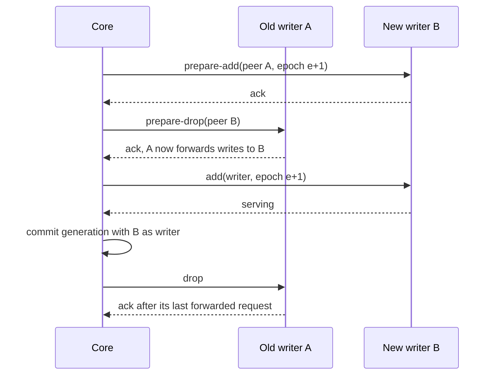

# RFC-0006: Ownership modes, handoff protocols and fencing

## Summary

A namespace selects one of four ownership modes: `affinity`, `exclusive`, `overlapping` and `delegated`. The last three give each shard at most one writer per epoch. In `delegated`, the application's own authority, such as a consensus protocol, elects each writer and grants its epoch, and the core follows it. The handoff protocols `break-before-make`, `make-before-break`, `graceful` and `staged` move a replica between nodes, and `elect` asks a delegated namespace's authority to move the writer role. Each protocol is a script of callbacks with a defined abort path for every step, and the core persists each step before it runs it. Every transition follows one lifecycle, declared as a state machine in core's `fsm` package.

Writers are protected at two levels. A node stops writing when its lease deadline passes. The deadline is a timer on the node's monotonic clock, shortened by a bound on clock drift. The application's storage applies core's fence laws: it admits a write whose epoch is at or above the shard's watermark, rejects a lower one with `epoch.ErrFenced`, and checks in the same transaction as the write. The library provides the fence as an interface, with a PostgreSQL adapter that passes core's conformance suite for fenced writers.

## Motivation

Exclusive ownership fails in ways that a controller cannot see:

- A writer pauses for a garbage collection longer than its lease, resumes, and writes without knowing that another node took over. Kleppmann describes this case and concludes that the storage must "take an active role in checking tokens, and rejecting any writes on which the token has gone backwards". A check of the lease just before the write does not help, because the pause can fall between the check and the write.
- Helix's controller never plans two masters, but its issue 691 reports a participant cut off from ZooKeeper that "continues to think it is MASTER" while "The controller makes another node MASTER".
- etcd's documentation states that "the lock APIs cannot be used as mutual exclusion mechanism by themselves", and client-go's leader election "does not guarantee that only one client is acting as a leader". Both leave fencing to the resource.
- Temporal does fence. Acquiring a history shard increments a range ID, every write of the shard is conditioned on that range ID, and a mismatch shuts the shard down.

Handoff has its own failure: SM measured that moving primaries without its graceful protocol drops the request success rate of an application under a rolling upgrade from about 100% to about 98%, and to below 90% without coordination of container restarts as well. SM's paper lists the five steps of its graceful protocol but not what happens when one of them fails.

Not every application wants exclusivity. A cache needs affinity without the cost of fencing, and SM's post notes that applications choose between availability and consistency when the network partitions. The library makes the mode a choice. It makes the exclusive modes correct under pauses, partitions and controller failure.

Consensus applications elect their own writers, as the thesmos ledger's voters elect each shard's leader and grant its epoch. The ledger replaces a crashed leader in about 3 seconds, where a store lease with the default TTL takes about 10. A core that also elected a writer for the same shard would create two authorities over one role. When their choices differ, the core's writer forwards every write to the application's writer, and the core fences with an epoch that the application never granted.

Core already states the rules a fence must apply, and every thesmos library that fences writes applies the same ones. A sharder fence with rules of its own would admit a write that another library's fence rejects over the same storage.

## Detailed design

### Ownership modes

| Mode | Writers per shard | Replicas during a move | Fencing tokens | Allowed handoffs |
|---|---|---|---|---|
| `affinity` | Not tracked | Old and new overlap | None | All four |
| `exclusive` | At most one per epoch | Never two writers | Issued to the writer | `break-before-make`, `graceful`, `staged` |
| `overlapping` | At most one per epoch | The old owner may serve reads while the new owner loads | Issued to the writer | `staged` |
| `delegated` | At most one per epoch | The application's authority moves the writer role | Issued to the writer at the authority's epoch | `elect` |

```go
// Package ownership declares what a replica may assume about exclusive ownership.
package ownership

import "time"

// Mode is the ownership guarantee of a namespace.
type Mode string

const (
 // Affinity routes each key to its assigned replicas and lets replicas overlap during
 // moves. It does not provide exclusivity or issue fencing tokens.
 Affinity Mode = "affinity"
 // Exclusive gives each shard at most one writer per epoch. A move never runs two
 // writers, and fenced storage rejects writes from superseded epochs.
 Exclusive Mode = "exclusive"
 // Overlapping gives each shard at most one writer per epoch, and lets the old owner
 // keep serving reads while the new owner loads state during a move.
 Overlapping Mode = "overlapping"
 // Delegated gives each shard at most one writer per epoch. The application's
 // authority elects every writer and grants its epoch, and the core follows the
 // writers that agents report.
 Delegated Mode = "delegated"
)

// OnLeaseLoss is what a node's writers do when the node cannot renew its lease.
type OnLeaseLoss string

const (
 // Stop stops every writer replica on the node when its lease deadline passes.
 Stop OnLeaseLoss = "stop"
 // ContinueFenced keeps writers running after the deadline. It is safe only when every
 // write of the application goes through a fence, because the fence is then the only
 // protection against a new writer.
 ContinueFenced OnLeaseLoss = "continue-fenced"
)

// Lease bounds how long a node's writers may act without renewing.
type Lease struct {
 // TTL is the lease duration at the store. The default is 10s.
 TTL time.Duration
 // Renew is the renewal interval. The default is TTL/3.
 Renew time.Duration
 // MaxDriftRate bounds the rate difference between the node's clock and the store's
 // clock, as a fraction. The default is 0.01.
 MaxDriftRate float64
 // LockDelay is how long the core waits after the store expires a lease before it
 // gives the writer role to another node. The default is zero when the spec declares
 // every write fenced, and TTL otherwise.
 LockDelay time.Duration
 // OnLoss selects what writers do at the deadline. The default is Stop.
 OnLoss OnLeaseLoss
}

// Validity returns how long a node may act as a writer after it sends a renewal that
// the store accepts: TTL*(1-MaxDriftRate). The node arms a clock timer for Validity
// when it sends each renewal.
func (l Lease) Validity() time.Duration
```

The node measures its deadline from the moment it sent the renewal, not the moment it received the response, and shortens it by the drift bound. Its deadline passes before the store expires the lease, for any clock error within `MaxDriftRate`. The core gives the writer role away only after the store's expiry plus `LockDelay`. `LockDelay` protects resources that cannot check a fence, as Chubby's lock-delay does. It is zero by default when every write is fenced.

The deadline is a timer from core's `clock.Clock`, not a comparison of two time readings. Core's production clock returns wall time from its hybrid logical clock, and that wall time stops advancing while the system clock is stepped back. A deadline measured between two such readings would outlast the lease by the size of the step. A timer from `hlc.Clock.NewTimer` is a standard library timer, which runs on the monotonic clock, and under the simulator's `clock/fake` it fires when virtual time passes it.

`OnLoss` is the choice between availability and consistency. With `Stop`, a node that loses the store stops writing within one TTL, even when nobody else has taken over, so a store outage longer than the TTL stops every writer. With `ContinueFenced`, writers keep writing through an outage, and the fence rejects them once a new writer acquires the shard.

### Epochs

Outside the `delegated` mode, the core assigns every epoch by these rules:

- A shard's first writer gets epoch 1.
- Each change of writer increments the epoch by one. In the leaderless topology, which has no core, the epoch is the store revision at which the node acquired the shard, so it increases by more than one.
- A shard created by a split or merge starts at one more than the highest epoch among its parents.
- An abort that returns the writer role to the old node assigns a new epoch, because the new node may already have written under the epoch it was given.

The core grants each epoch to one writer, because it commits every epoch to the store with a compare-and-set on the cell's generation. Core's admit-equal law is sound only under that condition: two holders of one epoch would both pass a fence. A store revision meets the same condition in the leaderless topology.

A cell's controller receives its epoch from the root by the same rules, because the root treats the cell as a shard and the controller as its writer.

A node receives two epochs with every callback: the shard's epoch and the epoch of the cell's controller. It keeps the highest shard epoch it has seen per shard and the highest controller epoch per cell, and it refuses a callback with a lower one. The refusal classifies as `errs.Conflict`, because the state that the caller acted on has moved. The controller also returns its epoch in each reply to a node's reports, so a node refuses a replaced controller's callbacks as soon as it has heard from the replacement.

### Handoff protocols

A protocol turns a move into a script. The script is an ordered list of callbacks, each with a wait condition for the next step, and an abort path for each step.

```go
// Package handoff turns a replica move into an ordered script of callbacks, with an
// abort path for every step, and declares the lifecycle of a transition.
package handoff

import (
 "strconv"
 "time"

 "go.thesmos.sh/core/epoch"
 "go.thesmos.sh/core/fsm"
 "go.thesmos.sh/sharder/ownership"
 "go.thesmos.sh/sharder/protocol"
 "go.thesmos.sh/sharder/shard"
)

// Wait is the condition that the core waits for before it starts the next step.
type Wait string

const (
 // Ack waits for the node to acknowledge the callback.
 Ack Wait = "ack"
 // Serving waits for the node to report the replica serving in the step's role.
 Serving Wait = "serving"
 // LeaseLapse waits for the node's lease to expire plus the lock delay. The core uses
 // it in place of Ack when the node does not respond.
 LeaseLapse Wait = "lease-lapse"
 // Published waits for the core to commit the step's generation to the store.
 Published Wait = "published"
)

// Step is one callback on one node, or a commit of the assignment when Node is empty.
type Step struct {
 Node    shard.NodeID
 Call    protocol.Call
 Role    shard.Role
 Epoch   epoch.Epoch
 Peer    shard.NodeID // the other node of a prepare call
 Wait    Wait
 Timeout time.Duration
}

// Script is the steps of one move and, per step, the steps that undo the move when
// that step fails after every earlier step completed.
type Script struct {
 Steps []Step
 Abort [][]Step
}

// Transfer is one replica move, as the core passes it to a protocol.
type Transfer struct {
 Shard shard.ID
 From  shard.NodeID // empty when the move only adds a replica
 // To is empty when the move only removes a replica, or when a delegated
 // namespace's authority chooses the next writer.
 To       shard.NodeID
 FromRole shard.Role
 ToRole   shard.Role
 Writer   bool        // true when ToRole or FromRole is the model's writer role
 OldEpoch epoch.Epoch // the shard's epoch before the move
}

// Protocol scripts transfers. Implementations are deterministic and must not perform I/O.
type Protocol interface {
 Script(t Transfer, mode ownership.Mode, lease ownership.Lease) (Script, error)
}

// Phase is the lifecycle state of one transition, as the store records it.
type Phase uint8

const (
 // Running runs the script's steps.
 Running Phase = iota
 // Aborting runs the abort path of the step that failed.
 Aborting
 // Done is reached when every step completed.
 Done
 // Aborted is reached when the abort path completed.
 Aborted
)

// String returns the phase's name.
func (p Phase) String() string {
 switch p {
 case Running:
  return "running"
 case Aborting:
  return "aborting"
 case Done:
  return "done"
 case Aborted:
  return "aborted"
 }
 return "phase " + strconv.Itoa(int(p))
}

// Event is the outcome of a transition's current step.
type Event uint8

const (
 // Advance reports that a step other than the last one completed.
 Advance Event = iota
 // Finish reports that the last step of the current path completed.
 Finish
 // Fail reports that the current step failed after its retries.
 Fail
)

// String returns the event's name.
func (e Event) String() string {
 switch e {
 case Advance:
  return "advance"
 case Finish:
  return "finish"
 case Fail:
  return "fail"
 }
 return "event " + strconv.Itoa(int(e))
}

// Lifecycle is the transition table that every transition follows. A failed abort
// step is retried, because abandoning an abort path can leave two writers. The engine
// checks Lifecycle.Allows before it commits a phase change to the store.
var Lifecycle, errLifecycle = fsm.NewBuilder[Phase, Event, struct{}](Running).
 Edge(Running, Advance, Running).
 Edge(Running, Finish, Done).
 Edge(Running, Fail, Aborting).
 Edge(Aborting, Advance, Aborting).
 Edge(Aborting, Finish, Aborted).
 Edge(Aborting, Fail, Aborting).
 Terminal(Done, Aborted).
 Build()
```

The following tables give each built-in protocol for a writer move from node A to node B at epoch e. Steps without a node commit the assignment.

#### break-before-make

| Step | Node | Call | Waits for | Abort |
|---|---|---|---|---|
| 1 | A | `drop`, or `change-role` to a non-writer role, at e | Ack, or lease lapse if A does not respond | none needed |
| 2 | | Commit B as writer at e+1 | Published | none needed |
| 3 | B | `add` as writer at e+1 | Serving | `add` on A as writer at e+2, or a new placement |

The shard has no writer from step 1 until step 3 completes. SM's basic move protocol has this order, and its post states that it provides "an at-most-one-primary guarantee".

#### make-before-break

| Step | Node | Call | Waits for | Abort |
|---|---|---|---|---|
| 1 | B | `add` in the target role | Serving | `drop` on B |
| 2 | | Commit B in and A out of the replica set | Published | Commit A back |
| 3 | A | `drop` | Ack, or lease lapse | none needed |

Both replicas serve between steps 1 and 3. Validation rejects this protocol for writer moves in the exclusive modes.

#### graceful

| Step | Node | Call | Waits for | Abort |
|---|---|---|---|---|
| 1 | B | `prepare-add`, peer A, at e+1 | Ack | `cancel-prepare` on B |
| 2 | A | `prepare-drop`, peer B | Ack | `cancel-prepare` on A at e+2, then on B |
| 3 | B | `add` as writer at e+1 | Serving | `cancel-prepare` on A at e+2, then `drop` on B |
| 4 | | Commit B as writer at e+1 | Published | retry |
| 5 | A | `drop` | Ack, or lease lapse | none needed |

After step 2, A forwards every write to B, and B accepts writes that A forwards. After step 3, B also accepts writes from clients directly. After step 4, clients route to B, and A keeps forwarding until no more requests arrive or its drain timeout passes. At every step, some node accepts the shard's writes. Steps 1 to 5 are SM's graceful migration. The `cancel-prepare` call and the abort column are additions, because SM's paper gives only the sequence that succeeds.



#### staged

| Step | Node | Call | Waits for | Abort |
|---|---|---|---|---|
| 1 | A | `unload-state`: stop writing, save state, keep serving reads | Ack | `add` on A as writer at e+2 |
| 2 | B | `load-state` at e+1 | Ack | `drop` on B, then `add` on A as writer at e+2 |
| 3 | B | `add` as writer at e+1 | Serving | as step 2 |
| 4 | | Commit B as writer at e+1 | Published | retry |
| 5 | A | `drop` | Ack, or lease lapse | none needed |

Writes pause from step 1 until step 3 completes, and A serves reads. This is the transfer that Splitter supports with its loaded and unloaded grant states.

#### elect

`elect` is the only protocol that the `delegated` mode allows. It asks the application's authority for a change of writer, then commits the writer that agents report. It moves only the writer role, because the core does not add or remove replicas in that mode, and it returns an error for any other transfer.

A move of the writer role to a node B that the core chose:

| Step | Node | Call | Waits for | Abort |
|---|---|---|---|---|
| 1 | B | `elect` at e | B reports the writer role at an epoch above e | none. The authority keeps or moves the writer |
| 2 | | Commit the reported writer at its epoch | Published | retry |

For a node A that is draining, closing or faulted, the core leaves `Transfer.To` empty, and the authority chooses the next writer:

| Step | Node | Call | Waits for | Abort |
|---|---|---|---|---|
| 1 | A | `abdicate` at e | Another node reports the writer role at an epoch above e | none. The authority keeps or moves the writer |
| 2 | | Commit the reported writer at its epoch | Published | retry |

When step 1 exhausts its retries, the core abandons the move and keeps the writer that agents report. A disruption that waits for the move remains deferred, and the budget reports the shard as the reason.

### The transition engine

The core runs each script through one engine, whatever the protocol:

1. Before step 1, the core commits the transition to the cell's scope in the store, in phase `Running`, with its protocol, epochs and step number.
2. The core runs a step, waits for its condition, and commits the next step number, or the next phase that `Lifecycle` allows.
3. A step that times out, or whose callback fails with an error that classifies as `errs.Transient`, is retried through a `resilience.Retrier` from core. By default it makes at most five attempts, backs off with full jitter from 100 ms up to 10 s, and allows retries for at most 10% of the cell's callbacks over one minute, with a floor of 10. The Retrier stops at once on every other class, as core requires for an error that a retry cannot fix. A node's refusal of a callback for a lower epoch classifies as `errs.Conflict`, so it fails the step at once, for every call. When the step fails, the core commits phase `Aborting` and runs the abort path through the same loop.
4. A new controller of the cell reads every transition in flight from the cell's scope and continues each at its committed phase and step.

The retry budget protects a node that fails every callback: without it, each of hundreds of transitions to that node would retry five times at once. Callbacks to one node also pass through a `resilience.Bulkhead` from core, with as many permits as the `move-limits` constraint allows moves per node, so that one slow node cannot occupy every callback slot of the controller.

The engine commits the step changes of every transition of the cell that is ready in the same tick in one store commit, up to the store's commit bound. A rebalance of hundreds of moves therefore costs a few commits per step, not one per transition.

Every callback has an idempotency key of the form `namespace/shard/sequence/step`, where the sequence number counts the shard's transitions. A retried callback reuses the key. A node that receives a key it has completed returns the first result and does nothing else. When a controller fails between sending a callback and committing the next step, its successor resends the same callback, and the node does not repeat the callback's effect.

### Fencing

Fenced storage applies core's fence laws to every write of a shard:

- A write whose epoch is at or above the shard's watermark is admitted, and a greater epoch advances the watermark.
- A write at `epoch.Zero` is unfenced: it is admitted and leaves the watermark unchanged.
- The check runs in the same transaction as the write, against the watermark in the application's storage, which survives a restart.

A rejected write returns `epoch.ErrFenced`, which classifies as `errs.Conflict`. Its remedy is to abdicate, not to retry: the writer stops, releases state derived from the revoked tenure, and waits for a new assignment. `errors.Is` separates it from `version.ErrMismatch`, whose remedy is to read again.

A writer binds its token when it is created, and every check it performs validates that token's epoch. No write takes an epoch as a parameter, so no write path escapes validation.

```go
// Package fence defines fencing tokens and the interfaces of fenced storage. Every
// implementation applies core's fence laws.
package fence

import (
 "context"
 "math"

 "go.thesmos.sh/core/epoch"
 "go.thesmos.sh/sharder/shard"
)

// Retired is the watermark of a shard that a split or merge replaced. It is above
// every epoch that the core issues, so fenced storage rejects every writer of a
// retired shard with epoch.ErrFenced.
const Retired = epoch.Epoch(math.MaxInt64)

// Token authorises writes to one shard at one epoch.
type Token struct {
 Namespace shard.Namespace
 Cell      shard.CellID
 Shard     shard.ID
 Epoch     epoch.Epoch
 // Supersedes lists the parent shards that this shard's first acquisition retires,
 // after a split or merge. It is empty otherwise.
 Supersedes []shard.ID
}

// Acquirer starts a writer's tenure.
type Acquirer interface {
 // Acquire advances the watermark of t.Shard to t.Epoch and raises the watermark of
 // every shard in t.Supersedes to Retired, in one transaction. A writer calls it once
 // per tenure, before it reads shard data. It returns epoch.ErrFenced when the
 // watermark of t.Shard is above t.Epoch.
 Acquire(ctx context.Context, t Token) error
}

// Guard is the fence of one storage system. Tx is its transaction type, such as
// *sql.Tx.
type Guard[Tx any] interface {
 Acquirer
 // Writer returns a writer bound to t. It performs no I/O.
 Writer(t Token) Writer[Tx]
}

// Writer checks the writes of one tenure against the fence.
type Writer[Tx any] interface {
 // Token returns the token that the writer is bound to.
 Token() Token
 // Check applies the fence laws to the writer's epoch inside tx. It locks the fence
 // record against a new acquisition until tx ends, and advances the watermark in tx
 // when the writer's epoch is above it. It returns epoch.ErrFenced when the
 // watermark is above the writer's epoch. A writer calls it in every transaction
 // that writes shard data.
 Check(ctx context.Context, tx Tx) error
}
```

`Acquire` is the tenure's first fenced write, and the writer makes it before it reads. Suppose the writer read first. The old writer, still running, could write between the new writer's read and its acquisition, and the new writer would then act on a state it never saw. Hochstein's 2025 model check found this case in fencing tokens used alone. Core pairs its fence with conditional writes: a write conditioned on the version that the new writer read fails with `version.ErrMismatch` when another writer changed the value since. Temporal conditions each write on a record version as well as its range ID. Acquiring first gives the same protection to applications whose writes are not conditional: every later write of the old writer fails, so the new writer's first read already includes every write the old writer could complete.

A split or merge retires its parents in the acquisition of each new shard. `Retired` is `math.MaxInt64`, and the core issues epochs one at a time from 1, so no writer ever holds an epoch at or above it. The admit-equal law then rejects every writer of a retired shard, and the fence needs no separate retired flag.

The PostgreSQL adapter, in package `fence/sqlfence`, uses this table:

```sql
CREATE TABLE sharder_fence (
    namespace text   NOT NULL,
    shard     text   NOT NULL,
    epoch     bigint NOT NULL,
    PRIMARY KEY (namespace, shard)
);

-- Acquire, in one transaction with the retirements. Zero affected rows means the
-- watermark is above the epoch, and Acquire returns epoch.ErrFenced.
INSERT INTO sharder_fence (namespace, shard, epoch) VALUES ($1, $2, $3)
ON CONFLICT (namespace, shard) DO UPDATE SET epoch = EXCLUDED.epoch
WHERE sharder_fence.epoch <= EXCLUDED.epoch;

-- Retire one parent. 9223372036854775807 is fence.Retired.
INSERT INTO sharder_fence (namespace, shard, epoch) VALUES ($1, $4, 9223372036854775807)
ON CONFLICT (namespace, shard) DO UPDATE SET epoch = EXCLUDED.epoch;

-- Check, inside every write transaction. The shared lock makes a concurrent Acquire
-- wait until this transaction ends. An absent row is a watermark of zero.
SELECT epoch FROM sharder_fence WHERE namespace = $1 AND shard = $2 FOR SHARE;
```

PostgreSQL locks the conflicting row even when the `WHERE` clause prevents the update, and a shared row lock blocks other transactions from updating the row. A new writer's `Acquire` waits for every write transaction of the old writer that has already checked the fence, and every later `Check` of the old writer sees the new epoch and fails. A `Check` that finds the watermark below its epoch updates the row in the same transaction before it admits the write.

```go
// Package sqlfence implements fence.Guard over a table in a database/sql database.
package sqlfence

import (
 "context"
 "database/sql"

 "go.thesmos.sh/sharder/fence"
)

// Guard implements fence.Guard[*sql.Tx] over the sharder_fence table.
type Guard struct {
 // unexported fields
}

// New returns a guard that uses table, which must have the sharder_fence schema.
func New(db *sql.DB, table string) (*Guard, error)

// Acquire implements fence.Acquirer.
func (g *Guard) Acquire(ctx context.Context, t fence.Token) error

// Writer implements fence.Guard.
func (g *Guard) Writer(t fence.Token) fence.Writer[*sql.Tx]

var _ fence.Guard[*sql.Tx] = (*Guard)(nil)
```

`sqlfence` passes core's `coretest/epochtest.AssertFencedWriter`, with two named writes: the acquisition, and a transaction that checks the fence and writes one row. The suite asserts that a write through a superseded writer returns `epoch.ErrFenced`, classifies as `errs.Conflict` and changes nothing. It also asserts that a write at the current epoch is admitted, that a writer at `epoch.Zero` neither validates nor advances, and that a fresh writer at a new epoch succeeds where the superseded one fails. Every fence adapter must pass the same suite.

### Delegated ownership

In the `delegated` mode, the application's authority elects every writer and grants its epoch, and the core follows the writers that agents report. The authority is the application's own election, such as the leader election of a consensus protocol. It must grant each epoch to one writer, the condition under which core's admit-equal law is sound. In the ledger, each voter records one holder per epoch, so at most one candidate collects a fence quorum for an epoch.

The core applies these rules to a `delegated` namespace:

1. The core assigns no writer epoch. A shard's committed epoch is the highest epoch at which an agent has reported the shard's writer.
2. A report of a writer at an epoch above the committed one describes a change that has already happened. The core commits it as the cell's next generation, so that routers and `sharderctl` see it, and counts every other replica of the shard as a non-writer.
3. The replicas of a shard are the replicas that agents report. The core adds and removes none, and a plan may change only which reported replica is the writer.
4. A change of writer that the core requests runs through `elect`, which asks the authority. The authority decides.
5. Invariant 2 becomes a contract of the authority. A node's store lease still decides whether the node is live, but it no longer bounds a writer's tenure, so `LockDelay`, `OnLoss` and the `lease-lapse` wait do not apply to the namespace's writers.
6. `Agent.Token` returns a token at the epoch of the node's latest election, and `epoch.ErrFenced` once the application reports the node deposed. A fence over the application's storage checks those epochs with core's fence laws.
7. The authority splits and merges shards instead of the partitioner, so the core does not call `Reshape`. An agent reports each shard that a split or merge created with its range and its parents. The core applies the change in one generation once the reported children cover their parents' ranges exactly, each child at the epoch that the authority granted.
8. The disruption budget admits only the moves that the core requests. The authority's own changes of writer, such as its failovers, are outside the budget.

An authority that balances writers by itself must keep a writer that the core requested on the node that the core chose. In the ledger, a host's request for a shard becomes the shard's preferred leader, and the ledger's balancer keeps the shard there.

Validation requires `single-writer` on the replication axis and `delegated-safe` on the handoff axis, which only `elect` provides. Every node must implement the agent's `Elector` interface, and the core refuses to start a transition on a node that does not.

### Failure handling

| Failure | Detected by | Core action | Time until a new writer serves |
|---|---|---|---|
| The writer's node crashes | Lease expiry at the store | Break-before-make with lease lapse as step 1 | TTL + lock delay + the new writer's `add` |
| The writer pauses past its deadline | The node's own deadline timer when it resumes | The node stops its writers. The fence rejects any write in flight | As a crash, if the pause outlasts the TTL |
| The writer is cut off from the store | Failed renewals at the node, expiry at the store | As a crash. The node stops at its deadline under `Stop` | As a crash |
| A callback fails or times out | The step's wait condition | Retry within the attempt count and the budget, then the abort path | The protocol's step timeout times the attempts |
| The new node fails during a move | Callback failure or lease expiry | The abort path returns the writer role to the old node at a new epoch | One abort path |
| The application reports a fault in a writer | The agent's next report | Break-before-make, whatever the namespace's protocol. In the `delegated` mode, `abdicate` on the faulted node | The demotion's acknowledgement plus the new writer's `add` |
| The authority replaces a writer, in the `delegated` mode | The new writer's report | Commits the reported writer as the cell's next generation | The authority's own failover time, about 3 seconds for the ledger |
| A cell's controller fails during a move | The root, through the controller's lease | The root places the cell on another controller at a higher epoch. The new controller continues from the committed step with the same idempotency keys | The controller's lease plus one step |
| A replaced cell controller keeps running | Its next commit fails with `epoch.ErrFenced` | It abdicates and stops calling nodes | None: its callbacks contain a lower controller epoch than the new controller's, and a node refuses them once it has seen the new controller's epoch |
| The store is unavailable | Failed commits and renewals | No new transitions. Writers stop at their deadline under `Stop` and continue under `ContinueFenced` | Until the store returns |

With the default TTL of 10 seconds and every write fenced, a crashed writer is replaced after about 10 seconds plus the time the new writer's `add` takes. Published numbers for comparison: Service Fabric reports an average failover time of 1.9 seconds, Slicer measured a median lease recall of 2.6 seconds, and Dicer detects a crashed pod in roughly 30 seconds.

The core moves a faulted writer by break-before-make, the path it runs for a crashed node, whatever the namespace's protocol. `graceful` needs the old writer to forward writes, and `staged` needs it to save its state. A replica on a failed disk, or one whose store rejects every write, cannot do either. The abort paths of both protocols also return the writer role to the old node at a new epoch. A failed step would give the role back to the faulted replica, and the core would then move it again. Break-before-make aborts its last step to a new placement instead, not to the faulted replica.

## Alternatives considered

### Leases without storage fencing

Grant each owner a lease and trust owners to stop when it expires, as Splitter does with its grants and as Slicer's consistent mode does with Chubby leases. The application can keep any storage without changes.

**Why not:** a lease is checked before a write, and a pause can fall between the check and the write. The authors of WriteGuards, a system for strongly consistent caches over an auto-sharder, state that "Ownership at the caching layer is not enough". The lease remains the first level of protection here, and `LockDelay` covers resources that cannot check a fence.

### The controller's view as the only guarantee

Order transitions correctly in the controller and treat the controller's view as the truth, as Helix does. Nodes then run without lease logic, and storage is unchanged.

**Why not:** Helix's double-master reports show that the controller's view and a partitioned node's view diverge. A controller cannot stop a partitioned node.

### Fencing inside a replicated log in the library

Replicate shard data through the library, as Service Fabric does, and fence stale primaries in the replication protocol with epochs and quorums. The application then does not need a fence of its own.

**Why not:** most target applications store data in a database the library does not own. SM's authors found that Facebook's applications preferred external storage, and their Paxos library had one user. An application that needs replicated state can declare a consensus model and run its own consensus.

### Epochs checked only by the coordinator

Fence only the requests that pass through the coordinator, as Kafka's member epochs fence offset commits.

**Why not:** the writes that matter go to the application's storage, not to the coordinator. A fence at the coordinator does not stop them.

### An epoch parameter on every write

Pass the token to every check, so that one fence object serves every tenure.

**Why not:** a write that omits the parameter is unfenced, and review has to notice the absence. Core records the case of a ledger that threaded a fence through its request types by hand and left one write without it. A writer bound to its token at creation has no unfenced write path.

### A retired flag beside the epoch

Mark a retired shard with its own column, as a second condition that every check tests.

**Why not:** the admit-equal law already rejects every epoch below the watermark. A watermark above every issued epoch retires the shard with the same rule, and a check that forgets the second condition cannot exist.

### The core elects the writers of consensus applications

Let a consensus application follow the core's choice of writer, as the other modes do, or let its `ChangeRole` handler refuse every promotion that the application's election did not make.

**Why not:**

- Whoever picks a consensus group's new leader, that leader still fences a quorum of the previous epoch's voters and recovers from their replies. A leader that the core picks adds a controller decision, a store commit and a callback to every failover, and removes none of the application's steps.
- A refusal in `ChangeRole` leaves the shard without a writer in the core's view while the application's writer serves. A failover that the application runs by itself also has no path into the core.
- An interface to the authority that the controller calls does not fit the ledger, whose members report leadership one member at a time. No member reports the leaders of a whole cell, and each agent already reports the changes of its own node.

## Drawbacks

- Every application that wants exclusive ownership must route its writes through a fence adapter for its storage. The library provides one adapter, for PostgreSQL. Each other store needs its own, and an adapter that gets locking wrong reopens the window this RFC closes. Core's conformance suite catches a write that escapes validation, but not every locking mistake.
- Fencing costs one extra statement and one row lock per write transaction, and one acquisition per tenure. Writers of one shard serialise on the fence row. We have not measured the throughput cost.
- The application must acquire before its first read. The agent acquires automatically when the application registers its guard, but code that writes outside the agent's tokens bypasses the fence.
- A 10-second TTL with `Stop` stops every writer after 10 seconds of store unavailability. Shorter TTLs fail over faster and stop sooner in a store outage. Longer TTLs do the opposite.
- The graceful protocol needs the application to forward writes from the old writer to the new one, which is application code that the library cannot supply.
- The built-in protocols have 20 steps, and 13 of them have an abort path or a retry to implement and to cover in the simulator.
- In the `delegated` mode, invariants 1 and 2 rest on the application's authority. An authority that grants one epoch to two writers breaks them, and the core cannot detect it. The authority's own changes of writer also bypass the disruption budget.
- A faulted writer moves by break-before-make even in a namespace whose protocol is `graceful`, so its shard does not accept writes from the demotion until the new writer serves.
- `fence.Retired` stores as `math.MaxInt64` in a signed 64-bit column, so the fence refuses epochs from 2^63 up. The core would reach them only after 2^63 changes of writer to one shard.

## Open questions

1. Is 10 seconds the right default TTL, when Service Fabric fails over in 1.9 seconds on average and Slicer recalls a lease in 2.6 seconds at the median?
2. Should the library provide fence adapters for more stores, and which: MySQL, etcd, Cassandra lightweight transactions?
3. Should `ContinueFenced` be the default when a spec declares every write fenced?
4. Should the graceful protocol's forwarding be offered as a helper for gRPC servers, since every graceful application needs it?

## Unresolved and future work

- Fencing for external systems that lack both transactions and conditional writes, such as plain object stores, is not proposed here.
- Moving state between nodes through the library, as Dicer's unreleased state transfer does, is not proposed here. `load-state` and `unload-state` leave the transfer to the application.

## References

| What | Where |
|---|---|
| Kleppmann, "How to do distributed locking", 2016 | https://martin.kleppmann.com/2016/02/08/how-to-do-distributed-locking.html |
| Burrows, "The Chubby lock service", OSDI '06, §2.4 | https://static.googleusercontent.com/media/research.google.com/en//archive/chubby-osdi06.pdf |
| Hochstein, "Locks, leases, fencing tokens, FizzBee!", 2025 | https://surfingcomplexity.blog/2025/03/03/locks-leases-fencing-tokens-fizzbee/ |
| temporalio/temporal v1.32.0, shard range ID | https://github.com/temporalio/temporal/blob/d94e34a1ebba5410a2e7d07119a76896909591aa/service/history/shard/context_impl.go |
| etcd v3.7, notes on lock and lease | https://etcd.io/docs/v3.7/learning/why/ |
| client-go v0.37.1, leader election | https://github.com/kubernetes/client-go/blob/v0.37.1/tools/leaderelection/leaderelection.go |
| Apache Helix issue 691 | https://github.com/apache/helix/issues/691 |
| Lee et al., "Shard Manager", SOSP '21, §4.3 and §8.2 | https://dl.acm.org/doi/10.1145/3477132.3483546 |
| Mao et al., "WriteGuards", OSDI '26 | https://www.usenix.org/system/files/osdi26-mao-ziming-writeguards.pdf |
| Kakivaya et al., "Service Fabric", EuroSys '18, §8.5 | https://dprg.cs.uiuc.edu/data/files/2018/ServiceFabricEuroSys2018.pdf |
| PostgreSQL 18, INSERT and explicit locking | https://www.postgresql.org/docs/current/sql-insert.html |
| go.thesmos.sh/core at 8edf26a: ordering and fencing (RFC-0026), `epoch/fence.go`, `coretest/epochtest`, `clock/hlc/hlc.go`, resilience (RFC-0023), `resilience/retrier.go` | https://github.com/thesmos-ai/core |
| go.thesmos.sh/ledger RFC-0011, "Replicated storage": shards, leases and leader election, planned transfers and leadership | `docs/rfc/0011-replicated-storage.md` in the ledger repository |
