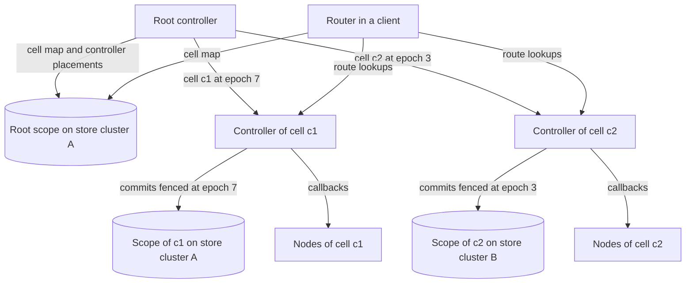

# RFC-0009: Horizontal scaling with cells and a root controller

## Summary

A namespace scales horizontally in cells. A cell is a disjoint set of nodes, the shards placed on them, one controller and one scope in the store. Each cell covers one range of positions. Adding a cell adds controller capacity, store capacity and membership capacity at the same time, because each of them is per cell.

The root of a namespace keeps the cell map and places each cell's controller on a controller process. It uses the library's own placement, handoff and fencing to do so: a cell is a shard of the root, the cell's controller is that shard's writer, and the controller's epoch fences its commits to the cell's scope. A node joins the cell that its `cell` label names. A deployment places each scope on an etcd cluster of its choice. A router resolves a key in two levels, the cell map and then the cell's routes.

By default a cell holds at most 5,000 nodes and 1,000,000 shards. An operator splits a cell above either bound with `sharderctl cell split`.

## Motivation

The target scale is larger than one controller, one store cluster or one membership pool can serve:

- One control-plane instance has a ceiling. The largest instances of SM's control plane manage about 50,000 servers and 1.3 million shards, each on an 18-core machine with 64 GB of memory. SM as a whole manages nearly 100 million shards on over one million servers, because it divides large applications into "non-overlapping partitions, where each partition typically comprises thousands of servers and hundreds of thousands of shard replicas".
- One store cluster has ceilings. An etcd cluster, for example, accepts 1.5 MiB per request and 128 operations per transaction by default, suggests at most 8 GiB of data, and completes more than 30,000 requests per second under heavy load by its documentation. Each client connection costs it 17 KB of memory.
- One membership pool has a ceiling. HashiCorp recommends at most 5,000 Consul agents per gossip pool, and Kubernetes found that node heartbeats reached etcd's storage limit in clusters of more than 2,000 nodes whose Node objects listed many images.
- One routing table has a ceiling. A client cannot hold every route of a namespace with a hundred million shards. Bigtable resolves tablet locations through a three-level hierarchy that addresses 2^34 tablets, with clients that cache locations lazily.

SM's design settles the unit of scale. SM places every replica of a shard on servers of the shard's own partition, manages partitions independently, and assigns them to control-plane instances through a partition registry. When the load of two partitions diverges, SM's operators "use tools to initiate server or shard migration across partitions". This proposal follows that design, with cells as SM's partitions and the root as its partition registry.

## Detailed design

### Cells

A cell is a disjoint set of nodes, the shards placed on them and one controller. These rules hold for every cell:

- Each node belongs to one cell: the cell that its `cell` label names. In a namespace with one cell, a node without the label joins that cell. In a namespace with more than one cell, a node without the label is refused.
- Each cell covers one contiguous range of positions, and the ranges of a namespace's cells cover every position without gaps or overlaps.
- Every replica of a shard is on a node of the shard's cell. Placement, the disruption budget and the planner therefore work within one cell.
- Each cell has its own scope in the store, its own membership and its own lease sessions.

The spec bounds a cell. `cells.maxNodes` defaults to 5,000, the size of pool that HashiCorp recommends for Consul's gossip, at which a cell sends about 1,500 lease renewals per second with the default TTL. `cells.maxShards` defaults to 1,000,000, near the 1.3 million shards of SM's largest control-plane instance, and about 1 GB of store data at about 1 KB per shard, by our estimate. The root reports a cell above either bound. It does not split cells by itself.

### The root

The root is the controller of a namespace's cell map. It is small: its assignment has one placement per cell, whatever the size of the cells.

The root's assignment follows the rules of every assignment, with these meanings:

| In the root | Means |
|---|---|
| A shard | A cell. Its ID is the cell's ID and its range is the cell's range |
| The writer replica of a shard | The controller process that runs the cell's controller |
| The shard's epoch | The controller's fence epoch for the cell's scope |
| A node | A controller process: a `sharderd` process in the `service` topology, or an application process in the `embedded` topology |

The root uses the `primary-only` model, `exclusive` ownership, `break-before-make` handoff and the `planner`, whose count goal balances cells across controller processes. In the `embedded` topology, a label constraint places each cell's controller on a node of that cell. The root publishes the cell map, `shard.CellMap`, from its placements: each cell's range, its controller's address, its controller's identity and its controller's epoch.

A controller process joins the root as a node, with a membership session in the root scope that registers its identity. The root assigns a cell to it with the `add` callback, and the process starts the cell's controller with the cell's epoch. The `drop` callback stops it. The root elects its own leader through `store.Store.Campaign`, the only election in a namespace.

A cell's controller starts in four steps:

1. It opens a writer for the cell's scope, bound to the epoch that the root granted: `store.Store.Writer(scope, epoch)`.
2. It commits the cell's record: its address, its identity and its epoch. The commit advances the scope's watermark to its epoch, and every later commit of the controller it replaces fails with `epoch.ErrFenced`.
3. It reads the scope: the placements, the layout version and the transitions in flight.
4. It continues every transition at its committed phase and step, and starts its planning loop.

### Store scopes on more than one cluster

A store adapter can place each scope on a backend cluster of its own, so a deployment adds clusters as its cells grow. The etcd adapter maps scopes to clusters through a table in its configuration, and by our estimate one etcd cluster within its suggested 8 GiB fits about seven cells of 1,000,000 shards with three replicas. The root scope is small and can share a cluster with any cell. A cell's scope never spans clusters, so every commit remains one transaction on one cluster.

### Routing across cells

A router resolves a key in two levels:

1. It computes the key's position with the partitioner and finds the position's cell in the cell map, which it watches in the root scope. The cell map has one entry per cell.
2. It finds the position's route in the cell's cache. In `lookup` mode, a miss becomes a lookup at the cell's controller, whose address the cell map gives, and falls back to the cell's scope when the controller does not respond.

A router's memory and its load on the store therefore grow with the cells and routes it uses, not with the size of the namespace.

### Capacity

Every component that grows with the namespace is per cell, and only the root and the cell map grow with the number of cells:

| Component | Load per cell, at the default bounds | How it scales |
|---|---|---|
| Controller | One planner, one transition engine, and lookups for up to 5,000 nodes and 1,000,000 shards | The root spreads cells over controller processes |
| Store | About 1 GB of placements and about 1,500 lease renewals per second, by our estimate | The store adapter spreads scopes over backend clusters |
| Membership | One session per node in the cell's scope | Per cell |
| Routers | One watch of the root scope, and lookups at the controllers of the cells used | Per cell used |
| Root | One placement and one controller session per cell | Grows with the number of cells only |

A namespace of 100 cells at the default bounds holds 500,000 nodes and 100,000,000 shards, the order of SM's total deployment. We have not built or measured it.

### Splitting a cell

`sharderctl cell split <ns> <cell>` divides a cell in five steps:

1. It chooses a split position at a shard boundary near the cell's median, and the nodes that go with the upper half. It prints those nodes, so that the operator can relabel them.
2. The cell's controller adds a constraint that places shards above the split on the chosen nodes and the other shards on the rest, and moves replicas under the disruption budget until the cell is segregated. It then stops planning shards above the split.
3. The root creates the new cell's scope, copies the placements above the split into it, and commits the new cell map in one generation of the root. Each shard keeps its ID and its epoch, so the application's fences are unaffected.
4. The root places the new cell's controller. The chosen nodes restart with the new `cell` label and join the new cell.
5. The old controller deletes the placements above the split from its scope.

The split never moves data. Step 2 moves replicas within one cell, through the normal protocols, before any cell boundary changes.

### Failure handling

| Failure | Detected by | Action | Effect on the data plane |
|---|---|---|---|
| A cell's controller process crashes | Its session in the root scope expires | The root places the cell on another process at a higher epoch. The new controller continues the cell's transitions | None. Routers keep cached routes, and lookups of uncached routes read the cell's scope |
| A replaced controller keeps running | Its next commit fails with `epoch.ErrFenced`. A node refuses its callbacks once the node has seen the new controller's higher epoch in a callback or a report reply | It abdicates | None |
| The root's leader crashes | Its election key expires | Another controller process wins `Campaign` and continues | None. Cells keep their controllers, and no cell can change controller meanwhile |
| A store cluster is unavailable | Failed commits and renewals in its scopes | Its cells stop transitions. Other cells continue | Its cells' writers stop at their lease deadline or continue fenced, as the ownership mode configures |

## Alternatives considered

### One controller per namespace

Run the whole namespace in one controller with one scope, as SM's control plane does for one partition.

**Why not as the only mode:** one controller, one store cluster and one membership pool each have a ceiling below the target scale, as the Motivation measures. A namespace with one cell is exactly this design, so small namespaces lose nothing.

### Cells that share nodes

Divide only the shards into cells, and let every node host shards of every cell.

**Why not:** each cell's planner would place shards on nodes whose load other planners change at the same time, so every planner would need every other planner's view, and so would every disruption budget. SM keeps every replica of a shard inside one partition for the same reason, and moves servers between partitions with tools when their loads diverge.

### An election per cell

Let every controller process campaign for the leadership of every cell through the store.

**Why not:** leadership lands on whichever process wins each election, with no balance across processes, and every process holds a campaign for every cell. SM assigns partitions to control-plane instances through a partition registry instead. The root is that registry, and it balances cells with the planner that balances shards.

### Consistent hashing of cells onto controller processes

Map each cell to a controller process with a hash of their IDs, without a root.

**Why not:** a hash moves cells when the set of processes changes, without a handoff protocol and without an epoch. Two processes can then control one cell until both notice. The root's placement moves a cell through `break-before-make` and fences the old controller with the epoch.

### Automatic splitting of cells

Split a cell as soon as it exceeds a bound, without an operator.

**Why not in this proposal:** a split moves nodes between cells, which operators map to node pools, deployments and quotas outside the library. SM also leaves cross-partition migration to tools. The root reports cells above their bounds, and the operator decides when to split them.

## Drawbacks

- The root adds a controller and a level of indirection to every namespace, including namespaces that never grow beyond one cell.
- Load cannot move between cells without an operator. A cell whose nodes are full cannot use the free capacity of another cell until nodes move.
- The split procedure runs rarely, touches the root, two cells and the nodes' labels, and must be correct the first time. The simulator has to cover each of its steps under faults.
- Operators manage cell labels, for example with one node pool or one deployment per cell.
- A cold route costs two lookups in the worst case: the cell map, then the cell's route.
- The capacity figures in this document are estimates from etcd's documentation and SM's paper. We have not measured the library at any of them.

## Open questions

1. Should the root split cells automatically when they exceed a bound?
2. Should one controller process host more than one cell, as proposed, and up to how many?
3. Are 5,000 nodes and 1,000,000 shards the right default bounds of a cell?
4. Should the root assign a cell to a node without a `cell` label, instead of refusing it?

## Unresolved and future work

- Moving a shard from one cell to another without splitting the cell is not proposed here.
- Balancing load across cells automatically is not proposed here.

## References

| What | Where |
|---|---|
| Lee et al., "Shard Manager", SOSP '21, §6.1 and §8.1 | https://dl.acm.org/doi/10.1145/3477132.3483546 |
| Guo and Kooburat, "Scaling services with Shard Manager", Engineering at Meta, 2020 | https://engineering.fb.com/2020/08/24/production-engineering/scaling-services-with-shard-manager/ |
| Chang et al., "Bigtable", OSDI '06, §5.1 | https://static.googleusercontent.com/media/research.google.com/en//archive/bigtable-osdi06.pdf |
| etcd, system limits | https://etcd.io/docs/v3.6/dev-guide/limit/ |
| etcd, performance and benchmarks | https://etcd.io/docs/v3.6/op-guide/performance/ |
| etcd, watch memory usage benchmark | https://etcd.io/docs/v3.7/benchmarks/etcd-3-watch-memory-benchmark/ |
| HashiCorp, operating Consul at scale | https://docs.hashicorp.com/consul/docs/manage/scale |
| Kubernetes KEP-589, efficient node heartbeats | https://github.com/kubernetes/enhancements/blob/master/keps/sig-node/589-efficient-node-heartbeats/README.md |
