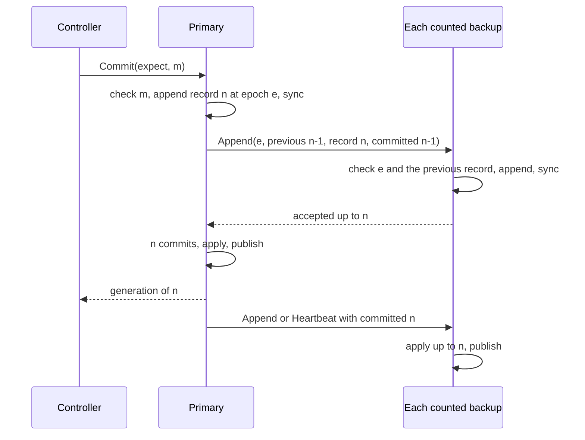

<!--
  ~ Copyright ThesmOS B.V. 2026
  ~ SPDX-License-Identifier: BUSL-1.1
-->

# RFC-0015: Consensus only for the root, and cell scopes that the root replicates

## Summary

An application embeds sharder in its binary and scales horizontally by running more processes of that binary. We want such an application to run on 100,000 servers, and a datastore built on sharder to work without an external consistent store and without a component that the deployment runs apart from the application. Today one store adapter keeps every scope of a namespace, and that adapter must be replicated by consensus to keep the control plane available.

We propose three levels. Three or five processes of the application form a root quorum that keeps the root scope of each namespace, and only this quorum runs a consensus protocol. The processes that the root places for a cell keep the scope of the cell: a primary, which runs the controller of the cell, and backups. The root is the configuration master of each cell, as in Vertical Paxos:

- A record of a cell scope commits once every counted replica has synced it. A record gets its receipt when it commits, and readers and watchers see committed records alone.
- A new configuration takes effect only after its primary has stopped the old configuration and brought every counted replica to its own log.
- Each backup grants its primary a lease. A primary that the root replaces stops renewing sessions before its successor starts.

A cell has no election of its own, and the deployment does not run a consensus service beside the application. Its primary orders its records, and the root commits each change of its replica set. Each replica keeps its copy of a scope with the log and the state machine of RFC-0014. The interfaces of controllers, agents and routers do not change. A new scope protocol replicates a cell scope, and serves the store and membership calls of a remote scope.

## Motivation

### The target

At the default bound of 5,000 nodes per cell (RFC-0009), 100,000 servers need at least 20 cells. RFC-0009 puts each cell at about 1 GB of placements and about 1,500 lease renewals per second. We have not measured a cell at either bound.

RFC-0007 places every scope in one store adapter. RFC-0009 lets the adapter spread scopes over backend clusters. The only adapter that RFC-0007 proposes is over etcd, and we decided not to build it. `store/memory` and `store/file` of RFC-0014 each run in one process. A scope then becomes unavailable when the machine of that process fails.

### What needs consensus

A controller gets its term from `store.Store.Campaign`. The watermark of its scope fences it. If sharder placed the replicas of its own store, the controller that places them would need that store to grant its term. One component must agree without being configured by sharder. Every other component can be configured by it.

Systems that place their own data run consensus only for a small state at the bottom:

- Bigtable keeps one file in Chubby, "a file stored in Chubby that contains the location of the root tablet". The root tablet locates the METADATA tablets, which are ordinary tablets that Bigtable places.
- FoundationDB uses coordinators, which "work by communicating and storing a small amount of shared state" and "aren't involved at all in committing transactions". Its documentation recommends 3 or 5 of them.
- Kafka replaced ZooKeeper with a quorum of its own controllers (KIP-500). KIP-631 selects them from "a potentially smaller pool of nodes specifically configured to act as controllers", typically three or five.

The root of RFC-0009 is already the configuration master of the cells. It places each cell as a shard of its own, at an epoch that fences the scope of the cell.

Vertical Paxos states that "a master allows a state-machine implementation to tolerate k failures using only k + 1 processors instead of the 2k + 1 processors required without it". With writes to every replica, the new primary is a read quorum of the old configuration by itself, so it transfers the state alone. PacificA builds log-based storage on this scheme. A request commits "when the primary receives acknowledgments from all replicas", and the primary takes a lease from each secondary. A cell under the root agrees on its history this way, without an election of its own.

### Liveness without a log entry per renewal

A session that renews through the log of a consensus group costs one entry per renewal. Kafka keeps heartbeats out of its metadata log. Its `BrokerHeartbeatManager` states: "This design minimizes the size of the metadata partition by excluding heartbeats from it. However, it does mean that after a controller failover, we may take some extra time to fence brokers, since the new active controller does not know when the last heartbeats were received from each."

Chubby records each session in its database and keeps the timer of each session lease in the memory of its master. A new master picks a new epoch number and rejects every call with an older one. It extends each session lease "to the maximum that the previous master may have been using".

Both systems keep the timing of a session out of the log, and both bind a renewal to the current authority. This proposal does the same. A cell records each start and end of a session, keeps renewals in the memory of the primary, and accepts a renewal only while the primary has its lease.

## Detailed design

### Levels

| Level | Contains | Authority | Replicated by |
|---|---|---|---|
| 0, the root quorum | The root scope of each namespace: the cell map, the record and the term of the root, the mapping and the spec. The sessions of the controller processes | The leader of the quorum, under a leader lease | Consensus among three or five processes of the application |
| 1, the cell scopes | The scope of each cell: its placements, transitions, reservations, drains and receipts. The sessions of the nodes of the cell | The primary of the cell, at the epoch that the root granted, under the lease that its backups grant | Primary-backup on the replicas that the root places for the cell |
| 2, the application | The data of each shard | The writer of the shard, at the epoch that the cell granted | The choice of the application: primary-backup fenced by the epochs of the cell, or a consensus protocol of the application under delegated ownership |

Each level configures the level above it. The quorum orders the commits of the root. The root places the replicas of each cell scope and decides each change of their configuration. Each cell places the replicas of its shards.

### Components

| Component | Where | Responsibility |
|---|---|---|
| Root quorum | A role of three or five processes of the application. A library outside this repository implements it | `store.Store` and `membership.Membership` for root scopes, durable session records, and a leader lease |
| Cell replica | `store/replicated`, new | One copy of one cell scope: the log and the state machine of RFC-0014, the committed point, and the lease that the replica grants to its primary |
| Cell primary | `store/replicated` | The appends, the commit and the publication of records, the renewals of sessions, and the lease that it takes from its backups |
| Configuration master | The root, with the handoff protocol `scope-replica` | It places the replicas of each cell, and runs each change of a configuration as a transition with durable steps |
| Dispatching store | `store/tier`, new | `store.Store` and `membership.Membership` that send each call for a root scope to the root quorum, and each call for a cell scope to the primary that the cell map names |
| Scope protocol | `protocol` | `Append`, `Heartbeat` and `Install` between the replicas of a cell, and the store and membership calls of a remote scope |

`store/tier` gives the controllers, the agents and the routers the interfaces that they take today. The replicas, the configurations and the scope protocol behind it are new behaviour, with new messages, errors and crash tests.

### The root quorum

The deployment configures three or five processes of the application as the members of the root quorum, and every process reads their addresses from its configuration. FoundationDB works the same way: "Any FoundationDB process can be used as a coordinator", and each client and server reads the coordinators from its cluster file. Kafka configures the addresses of its controller quorum on every broker.

A library outside this repository implements the quorum, and the application links it into its binary. The library meets these requirements:

- It implements `store.Store` and `membership.Membership` for root scopes, and passes `store/storetest` and `membership/membershiptest`.
- Its leader serves reads, renewals and views only under a leader lease that a majority granted, as the master of Chubby does. A new leader serves only after the lease of the old leader has expired.
- It records each session: the node, its incarnation, its lease, and the end of the session. A new leader extends each live session by one full lease before it ends any. Renewals remain in the memory of the leader.
- `Campaign` in a root scope elects the leader of the root, as RFC-0009 states.

A new law of `membership/membershiptest` checks a change of the leader. Every renewal that the replaced leader acknowledges must end within the grace of its successor.

The `embedded` topology runs a controller in every application process, and only controller processes join a root scope. At this scale the topology runs controllers on a subset of its processes, as RFC-0009 allows. The other processes run the same binary with that role turned off in their configuration.

### The log of a cell scope

A cell scope has one log in the format of RFC-0014, with two more record kinds: the start of a session and its end. Each record has a position: its index in the log and the epoch of the primary that appended it. Each replica keeps three parts:

- The accepted log contains the records that the replica has synced, in index order.
- The committed point is the highest index that the replica knows to be committed.
- The published state is the state machine after the records up to the committed point.

A record commits once every counted member of the active configuration has synced it. Only the published state serves `Head`, `Read`, `Watch`, `Outcome`, the receipts and the views of the membership. A replica never publishes a record above its committed point. PacificA keeps the same parts as a prepared list and a committed point. Kafka gives a consumer only committed messages, the records below its high watermark.

### Commits



The primary runs one record of a scope at a time: it appends record n+1 after n has committed. A commit costs one sync at the primary, one round trip, and one sync at the slowest backup.

A commit whose ID has a receipt in the published state returns the recorded generation. When the ID belongs to the record in flight, the commit waits for that record. A retry never appends a second record for the same mutation.

The primary resends an Append that a backup has not acknowledged. `Commit` returns once the record has committed. When the primary loses its authority first, `Commit` returns an error that wraps `version.ErrOutcomeUnknown`. The record can then commit under the next primary, and `Outcome` at that primary returns its receipt.

### Configurations

A configuration of a cell is its placement in the root scope, under the `primary-secondary` model of RFC-0005, and the transition that changes it:

| Part of a configuration | Record in the root scope |
|---|---|
| Identity | The shard of the cell, and the `Sequence` of its placement |
| Primary and its epoch | The replica in the role `primary`, and the `Epoch` of the placement |
| Counted members | The replicas in the roles `primary` and `secondary` |
| Learners | The replicas in the role `offline`. A learner installs the scope and follows its log without counting |
| Predecessor and the change in progress | The transition of the cell, with its endpoints, its epochs, its phase and its step |
| Activation | The commit of the root that ends the transition |

The active configuration is the committed placement. These rules apply to every change:

1. A change either adds a counted member, removes one, or makes a counted member the primary. A change of the primary can also remove the old primary.
2. The root makes only a counted member of the active configuration the primary. A learner never becomes the primary.
3. The root activates an addition or a change of the primary only after the primary of the new configuration reports a cut. The cut is a record that this primary appended for the change, and every counted member of the new configuration has synced the log up to it. A removal activates at once, because every remaining member has every committed record. Vertical Paxos notes that the master "can at any time remove acceptors" from the one write quorum of primary-backup.
4. A primary does not serve a client before the root has activated its configuration.
5. When no counted member of the active configuration is reachable, the cell waits. When every counted member is lost, the namespace recovers with a new incarnation, over a fresh application-data namespace or behind an administrative barrier.

The handoff protocol `scope-replica` runs each change as a transition of the root. Each step is an idempotent callback, and a root that fails over resumes the change at its committed step:

| Change | Steps |
|---|---|
| Add a member R | 1. R installs a snapshot of the primary, and follows its log as a learner. 2. The primary starts to count R and appends the record of the change. It reports the cut once every counted member and R have synced the record. 3. The root commits R in the role `secondary` |
| Remove a member R | 1. The root commits the placement without R. 2. The primary stops counting R once it reads the commit. 3. R removes its copy |
| Make a member S the primary | 1. S and every member of the new configuration stop acknowledging the old epoch, and accept the new epoch once their last promise to the old primary has expired. 2. S makes the log of every counted member of the new configuration equal to its own, and appends the record of the change at the new epoch. It reports the cut once every member has synced the record. 3. The root commits S in the role `primary` at the new epoch. 4. S serves |

The abort path of a change of the primary makes the fallback the primary at the abort epoch, with the same steps. An epoch only rises, so the abort path never returns a replica to an epoch that another replica has refused.

Each rule prevents one failure:

- Rule 2 prevents the loss of acknowledged records. A learner that installed an old snapshot lacks records that the counted members acknowledged, among them a reservation of a shard epoch. A promoted learner could grant that epoch of the shard a second time, and the fence of the application accepts an equal epoch.
- Rule 3 orders an addition. The record of the change commits only with the acknowledgement of R, and R acknowledges a record only after it has every record before it. From that record on, every commit includes the acknowledgement of R.
- Step 1 of a change of the primary stops the old configuration. S is a counted member of the active configuration, and a record of the old primary commits only with the acknowledgement of S. Once S stops acknowledging the old epoch, the old configuration cannot commit, even when the old primary and its other backups still exchange messages. PacificA makes the same argument. The lease of the old primary expires before any member accepts the new epoch, so the old primary stops serving renewals and reads first.
- Step 2 of a change of the primary keeps every committed record. A record that the old primary committed is on S. A record that it did not commit is on some members and not on others. S keeps its own log, and each member truncates every record from the first index at which its record differs from the record of S. Such a record never committed, so no reader has seen it. KIP-101 truncates the logs of Kafka by the epoch of the leader for the same reason.

### The lease of a primary

Each counted backup grants its primary a lease, as in PacificA:

- A backup that acknowledges an Append or a Heartbeat of the primary at time t on its clock promises to refuse a higher epoch until t plus the lease period on its clock.
- The lease of the primary from a backup ends at the send time of the acknowledged request, plus the lease period times one minus the maximum drift rate, on the clock of the primary.
- The primary serves `Join`, renewals, `Leave`, `Head`, `Read` and `Outcome` only while it has an unexpired lease from every counted backup. It sends a Heartbeat when it has not sent an Append for one heartbeat interval.
- A replica that learns of a higher epoch, from the root or from an Append, stops acknowledging the lower epoch at once. It accepts the higher epoch once its last promise to the lower one has expired. The new primary sends an Append to every member as soon as it learns of its epoch, so the waits of the members overlap.
- The new primary extends every live session by one full lease of the session from its activation, before it ends any.

The defaults are a lease period of 10 seconds, a heartbeat interval of 2 seconds and a maximum drift rate of 0.01, the drift bound of the ownership lease.

The lease bounds a deposed primary. Its last acknowledgement of a renewal precedes the end of its lease, and the end of its lease precedes the start of its successor. A node extends its deadline from that acknowledgement by at most the validity of its lease. The successor ends no session within one full lease after its start, so it never ends a session whose node still acts on the old acknowledgement.

A primary and its backups renew the lease among themselves, so a cell continues while the root quorum is unavailable. Only a change of configuration needs the root.

### Sessions of a cell

The membership of a cell is part of its log:

- `Join` appends the start of a session, with the node, its incarnation and its lease. `Leave` and the expiry of a session append its end. Renewals remain in the memory of the primary.
- The revision of a view is the index of the record that changed the view, so revisions rise across primaries.
- A session whose end has committed is never live again. When the end of a session from `Leave` does not commit, the session expires.
- Each renewal and its reply name the namespace incarnation, the scope, the epoch of the primary and the incarnation of the session. A node extends its deadline only from a reply whose epoch is at least the highest epoch that it has seen.
- A node finds the primary in the cell map. A replica that refuses a call because it is not the primary returns the primary of the configuration that it knows.

### The scope protocol

```go
package protocol

// ErrRedirect reports a call for the primary of a scope at a replica that is not its
// primary. The error contains the address of the primary of the configuration that the
// replica knows. It classifies as errs.Conflict.
var ErrRedirect = errs.WithClass(errors.New("protocol: not the primary"), errs.Conflict)

// ReplicaServer receives the records, the heartbeats and the snapshots of the primary of a
// cell scope.
//
// # Concurrency
//
// A ReplicaServer is safe for concurrent use.
type ReplicaServer interface {
	// Append appends records of the primary to the log of the replica.
	//
	// Error modes:
	//   - shard.ErrIncarnation for another namespace incarnation than the replica's.
	//   - epoch.ErrFenced for an epoch below the highest that the replica accepted.
	//   - version.ErrMismatch when Prev does not match the log of the replica. The
	//     result then contains the last position of the replica.
	Append(ctx context.Context, md Metadata, r *AppendRequest) (AppendResult, error)
	// Heartbeat renews the lease of the primary at a backup, and passes its committed
	// point.
	// It has the error modes of Append, apart from version.ErrMismatch.
	Heartbeat(ctx context.Context, md Metadata, r *HeartbeatRequest) (HeartbeatResult, error)
	// Install writes one part of a snapshot of the primary into a learner. It has the
	// error modes of Heartbeat, and returns an error of class errs.Integrity when the size or
	// the digest of the whole snapshot does not match.
	Install(ctx context.Context, md Metadata, r *InstallRequest) (InstallResult, error)
}

// ScopeServer serves the store and membership calls of each scope that the process
// keeps. The request of each call contains the namespace incarnation that its caller
// expects.
//
// # Concurrency
//
// A ScopeServer is safe for concurrent use.
type ScopeServer interface {
	Commit(ctx context.Context, md Metadata, r *CommitRequest) (CommitResult, error)
	Head(ctx context.Context, md Metadata, r *HeadRequest) (HeadResult, error)
	Read(ctx context.Context, md Metadata, r *ReadRequest) (ReadResult, error)
	Outcome(ctx context.Context, md Metadata, r *OutcomeRequest) (OutcomeResult, error)
	Watch(ctx context.Context, md Metadata, r *WatchRequest) iter.Seq2[store.Event, error]
	Join(ctx context.Context, md Metadata, r *JoinRequest) (JoinResult, error)
	Renew(ctx context.Context, md Metadata, r *RenewRequest) (RenewResult, error)
	Leave(ctx context.Context, md Metadata, r *LeaveRequest) (LeaveResult, error)
	WatchViews(ctx context.Context, md Metadata, r *WatchViewsRequest) iter.Seq2[membership.View, error]
}

// Position is the place of a record in the log of a cell scope.
type Position struct {
	// Index is the index of the record, from 1.
	Index uint64
	// Epoch is the epoch of the primary that appended the record.
	Epoch epoch.Epoch
}

// Record is one record of the log of a cell scope, in the format of store/file.
type Record struct {
	Payload  []byte
	Position Position
	Kind     uint8
}

// AppendRequest contains consecutive records of the primary for one replica, and the
// committed point of the primary.
type AppendRequest struct {
	_ incomparable
	// Scope is the cell scope, and Incarnation is its namespace incarnation.
	Scope       shard.Scope
	Incarnation shard.NamespaceIncarnation
	// Epoch is the epoch of the primary.
	Epoch epoch.Epoch
	// Prev is the position of the record before the first record of Records.
	Prev Position
	// Records lists consecutive records after Prev.
	Records []Record
	// Committed is the committed point of the primary.
	Committed uint64
}

// AppendResult contains the position of the last record of the replica after an Append.
type AppendResult struct {
	_    incomparable
	Last Position
}

// HeartbeatRequest contains the epoch and the committed point of the primary.
type HeartbeatRequest struct {
	_           incomparable
	Scope       shard.Scope
	Incarnation shard.NamespaceIncarnation
	Epoch       epoch.Epoch
	Committed   uint64
}

// HeartbeatResult contains the position of the last record of the replica.
type HeartbeatResult struct {
	_    incomparable
	Last Position
}

// InstallRequest contains one part of a snapshot of the primary.
type InstallRequest struct {
	_           incomparable
	Scope       shard.Scope
	Incarnation shard.NamespaceIncarnation
	Epoch       epoch.Epoch
	// Cut is the position of the last record that the snapshot covers.
	Cut Position
	// Schema is the highest schema of the scope at the cut.
	Schema uint32
	// Offset is the offset of Part in the snapshot, and Size is the size of the snapshot.
	Offset int64
	Size   int64
	Part   []byte
	// Digest is the SHA-256 digest of the whole snapshot.
	Digest crypto.Digest
}

// InstallResult contains the offset of the next part that the learner expects.
type InstallResult struct {
	_    incomparable
	Next int64
}
```

The request of each call of `ScopeServer` contains the parameters of the call of `store.Store` or `membership.Membership` that it serves, with the scope and the namespace incarnation. Its result contains the results of that call. These rules apply to the calls:

- `Append` accepts a record that the replica already has at the same position, as a duplicate. A record of a higher epoch replaces an uncommitted record at the same index, and every record after it.
- `Install` writes a snapshot in parts into `snapshot.tmp`. After the last part, the learner checks the size and the digest, and publishes the snapshot as RFC-0014 publishes a checkpoint. The primary keeps its log from the cut until the learner counts or the transition ends, within the log limit of RFC-0014. When the start of that log passes the position of a learner, the learner installs a newer snapshot. An interrupted install resumes at the offset that the learner returns.
- `Commit` runs at the primary, as the commits state.
- `Head`, `Read` and `Outcome` run at the primary under its lease. A page token contains the namespace incarnation and the generation of the read. A later page reads the same generation at any primary of the incarnation that keeps it, and returns `store.ErrCompacted` otherwise. A replica that is not the primary returns `ErrRedirect` to `Outcome`, never a missing receipt.
- `Watch` runs at any replica, and yields committed generations alone. It resumes from a generation at any replica that keeps it. A replica ends its watches with an error that makes the watcher reconnect when it leaves the configuration, and when it has not received an Append or a Heartbeat for one lease period.
- `Join`, `Renew` and `Leave` run at the primary under its lease, as the sessions of a cell state. `WatchViews` runs at any replica and yields the views of the committed records, as `Watch` does.

### Routers

A router watches the scope and the views of every cell of its namespace, and waits for the first snapshot and view of each cell before it starts. The load of the routers depends on these variables:

| Variable | Example at the target |
|---|---|
| R, the processes that run a router | 100,000, when every process routes requests |
| C, the cells | 20 |
| K, the replicas of a cell | 3 |
| S, the routes of the namespace | 1,000,000 |
| b, the bytes of one route in a router | about 200 |

| Load | Formula | At the example |
|---|---|---|
| Watch streams | 2 × R × C | 4,000,000 |
| Watch streams per replica | 2 × R ÷ K | about 66,700 |
| Memory of the routes in one router | S × b | about 200 MB |
| Bytes to start every router | R × S × b | about 20 TB |
| Sends of one commit, per replica | R ÷ K | about 33,000 |

These figures are estimates. By them, a router in every process exceeds what one replica can serve, so a deployment at this scale runs routers only in the processes that route requests. The benchmark of the verification measures how many routers one replica serves, and the documentation publishes that limit. The measurements include the route updates of a membership view, whose cost the router bounds by the slots that a view moves.

### Invariants

1. A committed index has the same record at every replica that has the index.
2. A replica publishes only committed records.
3. Every committed record is on every counted member of the active configuration.
4. At most one primary of a cell has an unexpired lease at any instant, within the bound of clock drift.
5. A cell reserves each epoch of a shard once in a namespace incarnation, because a reservation is a committed record.
6. The root activates an addition or a change of the primary only after its cut, and makes only a counted member of the active configuration the primary.
7. Renewals are never records of a log, and a session whose end has committed is never live again.
8. No level keeps its own configuration.

### Bounds

| Quantity | Bound at 100,000 servers in 20 cells |
|---|---|
| Root quorum, per namespace | 20 placements, and one session per controller process. 60 processes run the 20 cells at three replicas each |
| Root quorum, commits per change of a configuration | Three to four: the transition, each completed step, and the activation that ends the transition |
| Root quorum, other commits | The moves of cells, the sessions of controller processes, and each acquisition of the root |
| Primary of a cell | Up to 5,000 sessions of nodes, about 1,500 renewals per second in memory, and every commit of the cell |
| Copies of a cell scope | Three by default, so 60 copies for 20 cells |
| A commit to a cell scope | One sync at the primary, one round trip, and one sync at the slowest backup |
| A failover of a primary | The TTL of the root session of the primary, then the lease period, the catch-up of the members and the activation. The new primary then ends no session for one full lease |

These are targets. We have not measured a cell, the quorum or a failover.

### Failure handling

| Failure | Detected by | Action | Effect on the data plane |
|---|---|---|---|
| A backup of a cell scope fails | Its session in the root scope expires | The root removes it, and commits resume | The commits of the cell wait from the failure until the removal. Writers keep their tenures |
| The primary of a cell scope fails | Its session in the root scope expires | The root makes a counted backup the primary at a higher epoch, after the lease of the old primary has expired | Writers under `continue-fenced` continue. A writer under `stop` stops at its local deadline when its renewals fail until then. A move in its writer gap waits. The writers of the failed process end with it |
| Every counted member of a cell scope is unreachable, and one survives | The root | The cell waits | As for a failed primary, until a counted member returns |
| Every counted member of a cell scope is lost | The session of every member expires | The root cannot activate a configuration. The namespace recovers with a new incarnation, over a fresh application-data namespace or behind an administrative barrier | Writers of the cell continue fenced until the recovery. A new incarnation has a new fence key and does not stop a writer of the old one, so the recovery needs the barrier |
| A member of the root quorum fails | The quorum | The quorum continues with a majority | None |
| The root quorum loses its majority | Failed commits and renewals | No cell changes its configuration. A cell whose primary and backups run continues | A cell whose primary fails stops its control plane until the quorum returns |

### Verification

The protocol creates a new authority and moves it between processes, so we model it before we build it. The machines of `store/replicated` and of the protocol `scope-replica` are sans-IO, like the machines of the controller and the agent. A deterministic simulation drives them with `stateful.Steps` of assert, over a network that loses, delays and reorders messages, and disks that crash with the fault model of RFC-0014. It runs these schedules:

1. Every prefix of an append, its acknowledgements and its publication, followed by every takeover that the rules allow.
2. A learner that installs while changes commit, with the root or the primary failing at each step of its addition.
3. An old configuration whose members exchange messages with each other and not with the root, while a successor activates.
4. Renewals at the old primary after a takeover, without commits.
5. A lost reply of a commit, the lookup of its receipt, a takeover, and the retry.
6. Paged reads and watches across a takeover, a compaction and an install.
7. Repeated changes of the primary within the grace of the sessions, with `Leave` and new incarnations of nodes.
8. The loss of every counted member while a learner remains.

The oracles of the simulation check the invariants independently of the code under test:

- A committed index never changes its record, and a replica publishes committed records alone.
- Every commit that returned, and every receipt, is present after each takeover that the rules allow.
- Each epoch of each shard is granted once per namespace incarnation.
- A deposed primary does not acknowledge a renewal after its successor starts.
- A session whose end committed never returns.
- A paged read completes at one generation or fails with `store.ErrCompacted`.
- After the loss of every counted member, the root does not activate a configuration.

After the model, tests of real processes inject the same faults across OS processes, with the persistence tests of RFC-0014 on each replica.

### Prerequisites

| Prerequisite | State |
|---|---|
| Namespaces of more than one cell | Outside the support matrix |
| The `primary-secondary` model for the root scope | Outside the support matrix |
| A network transport | `httptransport` of RFC-0001, not built |
| The log and the state machine of a scope | RFC-0014, Draft |
| Controllers on a subset of the processes in the `embedded` topology | RFC-0009 allows it, and `embedded.Process` always runs a controller |

### Verdicts

- **In:** one binary. Every component runs in the processes of the application, and their configuration selects the members of the root quorum and the processes that run a controller.
- **In:** consensus only for root scopes, in a quorum of three or five processes of the application. A library outside this repository implements it, with a leader lease and durable sessions.
- **In:** cell scopes on replicas that the root places, with one primary and two backups by default.
- **In:** a record commits once every counted member has synced it, and replicas publish committed records alone.
- **In:** configurations as placements of the root, changed by the handoff protocol `scope-replica`. An addition and a change of the primary activate after their cut, and a removal activates at once. The new primary is a counted member of the active configuration.
- **In:** the lease that each backup grants to its primary, with its period, its heartbeat interval and the bound of clock drift.
- **In:** sessions as records of the cell log, with renewals in the memory of the primary and a full lease of grace after a takeover.
- **In:** one record in flight per cell scope.
- **In:** `store/tier` and `store/replicated` in this repository, and the scope protocol in `protocol`.
- **In:** an executable model of the protocol, with the eight schedules, before the build.
- **Out:** `store/file` as the root of other processes. Its sessions are in memory, so a restart of its process ends every root session of every other process.
- **Out:** relays and demand-driven subscriptions for routers. A measurement that shows the routers of a supported deployment above what one replica serves reverses this verdict.
- **Out:** `Head`, `Read` and `Outcome` at a backup. A backup serves watches, which accept a lag.

## Alternatives considered

### A control plane apart from the application

A quorum, or `sharderd` of the `service` topology, runs as a deployment of its own beside the application.

Rejected because sharder is a library that an application embeds to scale horizontally, so every process of a deployment runs the application's binary. The `service` topology of RFC-0001 remains outside the support matrix.

### One consensus store for every scope

A quorum keeps the root scope and every cell scope, as an etcd cluster would.

Rejected because the quorum would then order every commit and receive every renewal of every cell. At 20 cells that is about 30,000 renewals per second, and cells exist so that no single component serves the whole namespace.

### A consensus group per cell

A consensus group keeps each cell scope, with an election of its own.

Rejected because a group needs 2f+1 copies to survive f failures where primary-backup under the root needs f+1, and the cell would then have an election beside the placement of the root. This verdict reverses if cells must fail over while the root quorum is unavailable for longer than a deployment accepts.

### Cell scopes in shards of the cell

Each cell keeps its scope in shards that its own controller places, as data.

Rejected because a cell whose scope is in a shard that the cell itself places cannot repair that shard once its replicas fail: the repair needs a commit, and the commit needs the shard.

### An external store for the cell scopes

An external consistent store keeps each cell scope, one cluster per group of cells.

Rejected because a datastore built on sharder would then operate a second distributed system beside its own, and we decided against the etcd adapter.

### Publication at a backup on append

A backup applies and publishes a record once it has synced it.

Rejected because the root can promote another backup that lacks the record. A watcher of the first backup has then seen a generation whose record the new primary replaces.

### A lease of each primary from the root

The root grants each primary a lease, and a new primary waits for the expiry of the old lease.

Rejected because every cell then stops its control plane when the root quorum is unavailable for one lease period. A lease from the backups keeps a cell running while the root is unavailable.

### Promotion of any reachable replica

When no counted member is reachable, the root makes the most advanced reachable replica the primary.

Rejected because a learner can lack acknowledged records, among them the reservation of a shard epoch. Kafka makes the same choice by default, and waits for a replica of its in-sync set.

### Renewals as records of the log

Every renewal appends a record, and a new primary reads the deadlines from the log.

Rejected because a cell of 5,000 nodes then appends about 1,500 records per second for renewals alone, and every replica syncs each of them.

### Pipelined records

The primary appends record n+1 before record n commits.

Rejected because the checks of a commit would then run against a state that an uncommitted record may never produce. A control plane commits a move or a batch at a time. A measurement that shows the latency of one record limiting a pass reverses this verdict.

## Drawbacks

- A failed backup stops the commits of its cell until the root removes it: at least the TTL of a root session.
- A commit waits for the slowest counted replica.
- A failover takes the TTL of the root session, the lease period of 10 seconds by default, the catch-up of the members and the activation.
- A planned change of the primary also waits for the lease period, because the old primary serves until its lease expires.
- The lease rests on a bound of clock drift. A clock that drifts faster than the bound can let two primaries acknowledge renewals at once.
- The library operates the logs of the cell scopes: their directories, snapshots, catch-up and recovery.
- Every transport gains `Append`, `Heartbeat`, `Install` and nine store and membership calls.
- The root scope needs the `primary-secondary` model and the handoff protocol `scope-replica`, and the log of RFC-0014 gains two record kinds.
- A router in every process does not fit the target, so a deployment at that scale limits its routers.
- Three or five processes of the application also run the root quorum, and the configuration of every process contains their addresses.

## Open questions

None.

## Unresolved and future work

- The consensus library of the root quorum is outside this repository. The application links it into its binary.
- Splitting a cell, and moving a cell scope between replica sets beyond the transitions of the root, remain as RFC-0009 states.

## References

| What | Where |
|---|---|
| Cells, the root and their capacity | RFC-0009 |
| The store contract and the loss of a store | RFC-0007 |
| The `primary-secondary` model | RFC-0005 |
| Transitions, epochs and abort paths | RFC-0006 |
| The log and the state machine of a scope | RFC-0014 |
| The router watches every cell | ADR-0029 |
| Lamport, Malkhi and Zhou, "Vertical Paxos and Primary-Backup Replication", MSR-TR-2009-63, sections 2 and 3 | <https://www.microsoft.com/en-us/research/publication/vertical-paxos-and-primary-backup-replication/> |
| Lin, Yang, Zhang and Zhou, "PacificA: Replication in Log-Based Distributed Storage Systems", MSR-TR-2008-25, sections 2.1 to 2.4 | <https://www.microsoft.com/en-us/research/publication/pacifica-replication-in-log-based-distributed-storage-systems/> |
| Kafka, replication and unclean leader election | <https://kafka.apache.org/43/design/design/#replication> |
| Kafka KIP-101, truncation by the epoch of the leader | <https://cwiki.apache.org/confluence/display/KAFKA/KIP-101+-+Alter+Replication+Protocol+to+use+Leader+Epoch+rather+than+High+Watermark+for+Truncation> |
| Chang et al., "Bigtable", OSDI '06, §5.1 | <https://static.usenix.org/events/osdi06/tech/chang/chang_html/index.html> |
| Burrows, "The Chubby lock service", OSDI '06, §2.2, §2.8 and §2.9 | <https://research.google.com/archive/chubby-osdi06.pdf> |
| FoundationDB, configuration: coordination servers | <https://apple.github.io/foundationdb/configuration.html> |
| Kafka KIP-500, a self-managed metadata quorum | <https://cwiki.apache.org/confluence/display/KAFKA/KIP-500%3A+Replace+ZooKeeper+with+a+Self-Managed+Metadata+Quorum> |
| Kafka KIP-631, the quorum-based controller | <https://cwiki.apache.org/confluence/spaces/KAFKA/pages/158864865/KIP-631+The+Quorum-based+Kafka+Controller> |
| Kafka, `BrokerHeartbeatManager` | <https://github.com/apache/kafka/blob/trunk/metadata/src/main/java/org/apache/kafka/controller/BrokerHeartbeatManager.java> |
